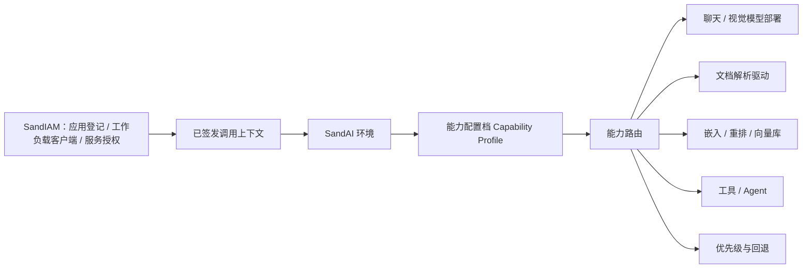

# SandAI 可配置能力底座

## 目标

SandAI 不是“固定模型的 API 服务”。它是多个业务项目共用的能力底座：每个应用和环境可以选择不同的模型、模型部署、文件解析驱动、向量库与回退策略，同时仍共享审计、私有文件、来源引用、权限和运行时观测。

因此下面两种配置必须同时成立：

- 项目 A：本地开发解析 + 模型 C。
- 项目 B：模型 D + 解析器 E；生产凭证、限额、失败策略与项目 A 隔离。

## 能力解析顺序

解析时以 `SandIAM application → environment → capability profile → capability route` 为准；不读取全局“唯一模型”或“唯一 OCR”。这里的 application 是 SandIAM 登记的外部调用方，而不是 SandAI 内部的多应用模式或源码目录。每一条路由都有能力类型、主部署/主解析器、可选回退、限额和启用状态。

## 平台控制面与运行面

SandAdmin 是运行宿主，SandAI 和 SandIAM 都是宿主插件。SandAI 的模型、能力路由、文件、
任务和用量能力必须随 `sand-ai` 插件交付；SandIAM 提供同一宿主内的应用和服务授权。早期
`server/app/*` 结构仅作迁移基线，不是新的目标部署形态。

| 边界 | SandIAM（唯一权威） | SandAI（唯一权威） |
| --- | --- | --- |
| 应用接入 | 组织、业务应用、环境、工作负载客户端、凭证轮换、服务注册与授权 | 消费已验证的调用上下文，不另建 application/client/credential/grant 表 |
| 服务授权 | 把 `sand_ai.chat.complete`、`sand_ai.document_parse`、`sand_ai.retrieval.search` 等语义服务动作授予某个应用环境 | 校验 audience、应用/环境、动作、限额与数据策略后执行业务能力 |
| AI 配置 | 可查看某调用方被授予哪些 SandAI 服务 | Provider、模型、能力路由、解析/OCR 驱动、文件、来源、任务、用量与 AI 审计 |
| 管理体验 | SandIAM 插件创建应用、签发客户端、授予/撤销服务 | SandAI 插件配置 AI 内部能力；接入授权页只读展示并跳转 SandIAM，不自行签发密钥 |

运行时通过 `IdentityContextProvider`（身份上下文端口）获得 SandIAM 颁发的短期、带 audience 的上下文；默认可由同一平台部署中的 SandIAM 适配器满足，未来也可改为远程 JWKS/OIDC 或 token-introspection 适配器。SandAI 不直接联表读取 SandIAM 数据库；撤销和策略变更通过签名令牌的短缓存、事件失效或受版本控制的服务接口传递。

一个业务项目（例如示例项目）只登记为一次 SandIAM application/client，获得被授予的 SandAI 服务动作后调用 SandAI；它不会安装或复制第二套 SandIAM。SandAI 后台也不负责部署该业务项目。

站在平台超级管理员视角，示例项目可以称为 SandIAM 管理的“平台用户/客户”；但权威模型是
`organization + application`，不能把示例项目存成普通后台 user/role。示例项目内部律师、客户和
律所管理员是 SandIAM 支持的应用用户，与 SandAdmin 后台账号体系无关。完整主体、授权与迁移要求见
[SandIAM 与 SandAI 服务接入边界](sand-iam-access-boundary.md)。

## 四层配置模型

| 层 | 保存内容 | 是否可被项目复用 |
| --- | --- | --- |
| 驱动注册表 | 代码声明的 `driver_code`、支持媒体、配置 schema、版本、能力限制 | 是 |
| 服务商账户 | 厂商连接、密钥引用、超时、区域；密钥只写不可读 | 可复用，但不自动授权给所有项目 |
| 逻辑能力 | `chat`、`vision`、`embedding`、`rerank`、`document_parse`、`image_ocr` 等稳定业务名称 | 是 |
| 环境能力配置档 | 某一应用环境选择哪些账户/部署/解析器、优先级、回退与限额 | 否，默认环境隔离 |

现有的 `provider`、`model`、`deployment`、`environment` 是前两层的基础。后续新增的能力配置档只做**绑定与路由**，不复制密钥，也不把厂商代码泄漏给业务 API。

### 真实模型 Provider 边界

首个真实协议为代码注册的 `openai_compatible`，不是在业务任务里硬编码某一家厂商。Provider 只写配置 `{ base_url, api_key, extra_headers? }`；运行时在受信任后端解密后固定调用 HTTPS `.../chat/completions`，并把限流、网络、厂商拒绝映射为 SandAI 稳定错误码。能力档以 `approved_cloud` 明确批准某个环境使用该部署；`local_only` 与 `private_only` 仍拒绝外发 Provider。这样项目 A 可选择模型 C，项目 B 可选择模型 D，而业务调用仍只传逻辑模型名。

## 同时做到灵活与易用

### 高级配置

管理员可以为一个环境分别选择：聊天模型、视觉模型、文档解析、图片 OCR、嵌入、重排和向量库；每项可配置主/备顺序、超时、大小/页数限制、是否允许外发文件。

### 简化配置

向导只问“使用场景、数据是否可外发、预算/速度偏好”，再应用一个可审计模板：

| 模板 | 示例绑定 | 用途 |
| --- | --- | --- |
| 本地开发 | Fake/本地模型 + 本地文本解析；OCR 未安装则明确不可用 | 跑通链路，不伪造生产能力 |
| 国内云文档 | 已授权云模型 + 云文档解析 | 需要较好中文文档效果 |
| 私有数据优先 | 本地模型/内网解析 + 私有向量库 | 文件不可外发 |
| 混合最优 | 聊天模型 C、视觉模型 D、解析器 E、嵌入模型 F | 每项按能力选择，不绑成单一厂商 |

模板生成的仍是普通能力配置档，管理员可再进入“高级配置”逐项修改；向导不会藏起真实配置或硬编码厂商。

## 从 Dux AI 学到的代码结构

已核对 `duxweb/dux-ai` 主仓库：

| 借鉴 | SandAI 改造 |
| --- | --- |
| `ParseDriverEvent` + 注册监听器：驱动代码和展示元数据一起注册 | 建立 `MediaCapabilityRegistry`；元数据还需声明支持媒体、输出粒度、外发要求与配置 schema。 |
| `ParseProvider`：数据库配置选择一个解析驱动，前端据元数据动态渲染表单 | 建立环境级能力配置档；凭证字段改为密钥引用/只写字段，不能随读取 DTO 返回。 |
| 调度器：条件领取、投递队列、陈旧 running 恢复、退避重试 | SAND-104 使用 PostgreSQL 状态机与条件更新；任务/步骤独立于业务审批。 |
| 本地、云端多驱动共存 | 本地驱动仅作为开发/私有部署选项；云驱动经过私有对象与数据外发策略检查。 |

## 明确不照搬的部分

- 驱动只返回 `string`：SandAI 保留 `source_block`、页码/段落/坐标、置信度和解析版本，才能审计和引用。
- 驱动配置的明文 JSON 回显：SandAI 的服务商密钥、OCR 密钥和令牌始终只写不读。
- 将原文、预览或临时文本写入普通日志：SandAI 日志只记录任务 ID、驱动代码、耗时、错误码与厂商请求 ID（如有）。
- 在 HTTP 请求中轮询 OCR 或把文件中转为公开 URL：SAND-104 的 Worker 负责异步轮询；私有文件只按已批准的数据外发策略向驱动传送最小必要内容。

## 实施顺序

1. **SAND-104**：通用任务、步骤、条件领取、重试、取消与观测；先服务已有文本解析。
2. **SAND-110**：驱动注册表、环境能力配置档、模板向导与能力解析器。
3. **SAND-103B**：接入首个 OCR/文档解析驱动；先以样本验证来源定位、失败语义和数据外发策略。
4. **SAND-105～107**：同一能力解析器供 AI 任务、RAG、Agent 调用；业务项目不需要理解厂商差异。

## 参考

- [Dux AI 文件解析能力](https://ai.docs.dux.plus/usage/media-capabilities.html)
- [Dux AI 主仓库](https://github.com/duxweb/dux-ai)
- [Dux AI 文档仓库](https://github.com/duxweb/dux-ai-docs)
