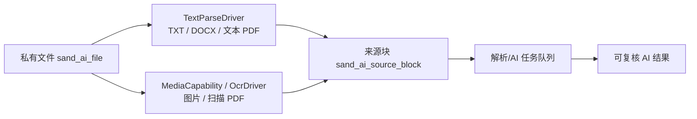

# SandAI 媒体能力设计

## 结论

文件存储、文本抽取、OCR/文档理解和 AI 任务必须分层。上传 API 只负责把私有文件变成可追溯的文件记录；解析能力由可配置、可替换的驱动完成；异步任务负责重试、状态和审计。

这个边界参考了 Dux AI 的媒体能力：直接可读的文本文件优先本地读取，图片与扫描 PDF 使用独立的“解析配置”，并可在本地 OCR 与外部驱动间选择。SandAI 采用这个**边界**，不引入 Dux 的 MySQL 一体化运行时。完整的多项目模型/解析器选择见 [可配置能力底座](sand-ai-capability-platform.md)。

## 能力分层

## 已实现与待实现

| 层 | 当前状态 | 责任 |
| --- | --- | --- |
| 私有文件与下载到受控临时目录 | 已实现 | `StorageDriver` |
| TXT、DOCX、文本型 PDF | 已实现 | `ParseDriver` |
| 来源定位 | 已实现：行号、段落号、页码 | `sand_ai_source_block` |
| 图片与扫描 PDF OCR | 已实现并在演示异步链路验收本机 `local_paddle_ocr` 驱动 | `OcrDriver` |
| 排队、重试、观察、取消 | SAND-104 | 任务运行面 |

## OCR 驱动契约

`OcrDriver` 以能力注册，不以厂商名称渗入文件控制器：

- 输入：受控的临时文件、媒体类型、解析选项。
- 输出：文本块、定位（页码；图片/页面可选坐标）、置信度、驱动版本和警告。
- 状态：`succeeded`、`failed`、`retryable_failed`、`unavailable`；不把“没有配置”降级为成功。
- 配置：`driver_code`、启用状态、超时、大小/页数限制、写入一次的密钥引用；读取接口只返回“是否已配置”。
- 隔离：文件仍留在私有 OSS；仅在驱动必须调用外部服务时传送最小必要数据，绝不下发公开 URL 或把访问密钥交给前端。

首个驱动采用 `local_paddle_ocr`（仅本机开发/链路验证）：服务只能监听 loopback，解析器仅把受控临时文件发送给它；输出转换为带页码、坐标和置信度的来源块，不暴露对象 key、Bucket、URL 或模型原始输出。图片与无文本层 PDF 已完成演示异步验收；服务停机时返回稳定 `SAND_AI_OCR_UNAVAILABLE` 并可重试。云端文档解析/OCR 仍是未来可配置驱动，不能由上传接口硬编码；表格 PDF 的准确性评测属于生产驱动选型，不阻塞首个本地驱动。

本机 OCR 响应中有正文的块必须携带正整数页码；缺失或非法页码、错误的坐标/置信度或非列表块结构使整次解析失败，不默认为第 1 页，也不静默跳过错误来源。空正文块可忽略。此校验仅保证已返回来源块的定位有效，不证明 OCR 覆盖了文件的每一页。

文本与扫描页混合的 PDF 在每个原页检查 XObject；含 `Image` 时即使还有页码、页眉或其他原生文字，也需要 OCR。`Form` 可包装未确认图像，因此同样保守要求 OCR，不根据文字长度或比例猜测正文完整性。OCR 返回结果会替代原生结果，既有覆盖策略逐页核对所有含原生文字或图像／Form 的原页；缺少非空来源块、或返回页码越过原文件页数时整次解析失败。OCR 未配置则返回 `SAND_AI_OCR_REQUIRED`，不能将局部原生文字标为文件解析成功；纯空白且没有上述 XObject 的页不要求 OCR。此覆盖保护不证明 OCR 识别准确或表格结构已还原，真实识别质量仍需在允许阶段验证。

## 对产品和 UI 的影响

- “上传成功”只表示文件进入私有存储；“解析成功”必须另有状态。
- 图像和扫描 PDF 在 OCR 未配置时，管理端展示可行动的“需要配置 OCR”，而非空文本或假成功。
- AI 回答/摘要只能引用已完成解析的来源块；用户可定位回文件页、段落或行。
- 文件解析错误、OCR 失败和 AI 业务审批不可混为同一状态。

## 参考

- Dux AI： [文件解析能力](https://ai.docs.dux.plus/usage/media-capabilities.html)
- Dux AI 的独立文档仓库：[duxweb/dux-ai-docs](https://github.com/duxweb/dux-ai-docs)
