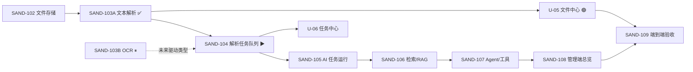

# SandAI 任务看板

> **历史记录入口（2026-09-28 核对）。** 当前统一产品任务唯一来源为 [OpenSpec tasks](../../openspec/changes/unify-sandai-product/tasks.md)，证据见同目录 `evidence.md`。下方旧队列与 Codex/Cursor 分工描述仅记录历史，不恢复旧 Autopilot 队列。本次 1.2 修正项目 AGENTS／README 的统一产品、sandbox 与最终源码归属；16 个入口链接均存在，`openspec validate unify-sandai-product --strict --no-interactive` 通过。保留既往验收记录，不增加功能完成数或产品闭环结论。

> **旧任务看板维护约定。** 旧任务的负责人、状态、完成证据、解锁项与最小阻塞条件保留于下方；当前统一产品状态由上方 OpenSpec 入口维护。

## 状态说明

- `✅ 已完成`：交付条件和证据已满足。
- `▶ 进行中`：负责人当前只执行这一项。
- `🟢 可领取`：无未解决依赖，负责人可直接开始。
- `⏸ 等待决策`：仅等待明确的外部权限或产品选择；不阻塞无关任务。
- `◻ 未开始`：仍有明确前置条件。

## 当前快照

| 已完成 | 进行中 | 可领取 | 等待决策 | 未开始 |
| --- | --- | --- | --- | --- |
| C-01–C-05、U-01–U-22、U-24、U-25A、A-01、SAND-101～112、SAND-113A～F（历史插件包）、SAND-114（SandAdmin 宿主适配） | SAND-115、SAND-116、SAND-117、U-23 | 无 | 部署负责人：signer + 管理员会话的受保护路径验收 | — |

**历史自动执行配置（不再作为当前入口）。** `.codex/autopilot/tasks.md` 曾是 Codex 的原子执行队列，Stop Hook 在一个任务验证并勾选后续跑下一个任务；`.codex/autopilot/executions/` 保存当时的任务级执行记录。SAND-112 已完成源端迁移、演示宿主可恢复增量同步及临时端口健康/Worker 回归，临时演示凭证由 Codex 经 SandAI 现有签发能力自动创建、执行回归并吊销。该记录不授权当前启动旧队列、修改 Hook 或继承旧 Codex/Cursor 分工。

## 已完成

- [x] **C-01～C-05 · Codex · PostgreSQL 基线、核心表、管理/运行 API**
  - 证据：PostgreSQL 实例、冻结的管理与运行 API 契约、`example-host:8788` 真实调用链。
- [x] **U-01～U-04 · Cursor · SandAI 管理端壳、真实接口接入与 PG 联调**
  - 证据：`saiadmin-artd` 构建与 `vue-tsc` 通过；开发前端入口固定为 `3007`。
- [x] **A-01 · Codex + Cursor · 首期管理/运行面验收**
  - 证据：应用配置、一次性环境凭证、Fake Provider 调用、用量与审计均可回查。
- [x] **SAND-101 · Codex · 私有 StorageDriver 与 OSS 适配**
  - 证据：本地和 OSS 私有读写删；不会向运行 API 返回对象 key 或永久 URL。
- [x] **SAND-102 · Codex · 文件上传、查询、受控删除**
  - 证据：`composer test:sand-ai-storage`、`composer test:sand-ai-file`；演示 API 上传、查询、删除通过。
- [x] **SAND-103A · Codex · 文本解析与来源块基线**
  - 交付：TXT 行号、DOCX 段落号、文本型 PDF 页码；解析记录和 `sand_ai_source_block` 均可追溯。
  - 证据：`composer check`、`composer test:sand-ai-parse`；演示站经私有 OSS 的 TXT/DOCX/PDF 上传→解析→读取→删除通过。
- [x] **SAND-104 · Codex · 异步解析任务队列**
  - 交付：`sand_ai_task_run`/`sand_ai_task_step`、按环境的 API 1.4 任务查询/取消/重试、Worker 租约恢复与幂等提交；AI 任务状态不承担业务审批。
  - 演示证据：`example-host:8788` 实际连接 `example_db_fallback` PostgreSQL；私有 OSS TXT `file=16` 入队→Worker→`text/plain` 2 个来源块，PDF `file=17` 入队→Worker→`pdf/smalot` 44 个来源块；相同 `X-Request-Id` 返回 `idempotent_replay=true`；PDF 受控删除成功。解析任务与步骤均为 `succeeded` 且 `attempt_count=1`。
  - 隔离证据：隔离环境凭证读取 demo 文件返回 `SAND_AI_RESOURCE_NOT_FOUND`。取消/重试状态转换由 `composer run test:sand-ai-task` 覆盖；对已完成任务的运行面取消正确返回 `SAND_AI_RESOURCE_CONFLICT`。
  - 回归修复：演示页曾显示 `#undefined · undefined`；根因是任务读取/取消/重试响应多包了一层 `{ task }`，与 API 1.4 Task DTO 不一致。已修复、部署并以 `file=20 → task=5 / succeeded / 2 来源块` 复验页面轮询与任务显示。
- [x] **SAND-105 · Codex · 可审计 AI 任务运行**
  - 交付：`ai_completion` 通过 PostgreSQL Worker 执行；任务结果只返回结构化输出、调用摘要和定位型来源引用，取消/自动重试/人工重试均在任务状态机内，AI 不执行或替代业务审批。
  - 演示证据：当前有效 GLM-4.7 资源包对应的 `zhipu_glm → glm_4_7 → glm-4.7` 已发布到演示环境能力档 `#6`。受控私有 TXT 完成上传→解析任务 `#14`→来源块 `#156`→AI 任务 `#15`；解析和 AI 任务及其步骤均为 `succeeded`，AI 结果含 1 个来源引用，调用摘要 `succeeded / 21,202 ms`。受控文件随后删除，未用真实业务材料验证。
  - 回归修复：此前默认发布 `glm-5.2` 导致 HTTP 429；不是用户资源包失效。部署脚本现可用 `--model` 显式切换，缺省改为 `glm-4.7`，逻辑模型 code 由远端模型名生成；能力档缺失 `document_parse`/`image_ocr` 时会补入本地驱动基线，避免已发布档错误拒绝解析。
- [x] **SAND-106 · Codex · PostgreSQL 检索/RAG**
  - 交付：环境内 `sand_ai_source_block` PostgreSQL FTS、定位/摘要 DTO、短词和中文 `ILIKE` 回退；不公开对象位置。
  - 演示证据：`POST /api/sand-ai/v1/retrieval/search` 在 demo 环境命中刚解析的私有 TXT 来源块（含 `source_block_id`、行号 locator）；隔离环境相同查询返回空 `matches`。
- [x] **SAND-107 · Codex · Agent 与受控工具调用**
  - 交付：Agent 只能选择注册工具 `retrieval.search`，工具仅搜索当前环境私有来源；结果记录调用摘要、定位型引用和可选 `review_required` 标记。该标记只是人工复核交接，不会创建审批或改变业务状态。
  - 演示证据：受控私有 TXT 完成上传→解析任务 `#16`→Agent 任务 `#17`；Agent 和步骤均 `succeeded`，仅有 `retrieval.search` 1 次、工具/最终结果各含 1 个来源引用、`review_required=true`、调用摘要 `succeeded / 10,635 ms`。测试文件已删除。
- [x] **SAND-109 · Codex + Cursor · 运行面端到端验收**
  - 交付：可重复执行的 `server/scripts/sand-ai-runtime-acceptance.php`，用实际 HTTP API 自动签发、自动吊销两枚短期凭证；验收失败同样回收文件与凭证，不写入任何长期密钥文件。
  - 演示证据：`127.0.0.1:8788` 完成上传→异步解析→检索→GLM‑4.7 AI→受控 Agent→双环境隔离。最终摘要显示解析、AI、Agent 任务均 `succeeded`，Agent 仅调用 `retrieval.search`，`review_required=true`；隔离环境读取本次文件返回 `SAND_AI_RESOURCE_NOT_FOUND`、检索本次随机标识为 0；受控文件已删除、两枚凭证已吊销。摘要不含 key、对象位置、原文或厂商原始响应。
- [x] **SAND-110 · Codex · 环境级能力配置档**
  - 交付：环境级模型部署/解析驱动路由、优先级和外发策略；`local_development` 等模板简配与高级路由共存。配置档只引用受控部署或驱动，不存、不返回任何密钥。
  - 管理面证据：已登录 `3007/#/sand-ai/capability`，为 `SandAI 演示 / 隔离验收环境` 保存并发布 `default-capability`：`local_development`、`local_only`、`document_parse → native_document_parse`，发布版本为 1。
  - 运行证据：文件中心以该隔离环境的短期凭证上传 `capability-profile-runtime.txt`（`file=19`）并提交解析；`example_db_fallback` PostgreSQL 记录为 `task=4 / succeeded / attempt_count=1`、`parse=18 / text/plain / succeeded / 2` 个来源块、文件状态 `parsed`。浏览器会话已清除，临时凭证已撤销。
- [x] **SAND-111 · Codex · SandAI 主应用基线**
  - 已有交付：`server/app/*` 运行面与同仓 SandAdmin 后台整合层。2026-08-16 用户重新确认：该基线恢复为本仓正式目标架构。
  - 当前目标：SandAI 是主应用，SandAdmin 是同仓管理宿主，运行能力归 `server/app/**` 和 `server/config/**`；SandIAM 仍提供应用用户身份与应用/服务授权，平台后台账号仍由 SandAdmin 管理。`server/plugin/sand-ai/**` 迁移至 `sand_plugins/sand-ai/` 的开源包前不得继续作为第二运行面；发布导出只进入 `sand_plugins/sandadmin-demo-host` 或其他明确的消费宿主。
  - 架构：SandIAM 单次部署，统一管理外部业务 application、environment、workload client、credential、service grant 与 access audit；SandAI 经身份上下文端口消费带 audience 的上下文，负责 AI 本地能力配置和执行，不复制授权体系或直接跨库联表。
  - 主体边界：平台超级管理员负责全局治理；示例项目是平台客户主体及其 application，而不是普通后台 user/role；示例项目的律师、客户与律所管理员使用 SandIAM 的应用用户与授权体系，不复用后台账号；案件和业务数据范围的实体事实仍归示例项目。
  - 证据：`sand-platform-conventions`、`sand-iam-access-boundary.md`、`sand-ai-capability-platform.md`、`sand-ai-design.md`、`sand-ai-api-contract.md`、`README.md`；`git diff --check` 通过。
- [x] **U-05 · Cursor · 文件中心管理页**
  - 交付：`file/index.vue` 上传/按 id 查询/解析/受控删除；会话最近列表；OCR/解析错误码如实展示；不暴露存储位置。
  - 证据：`vue-tsc --noEmit`、`pnpm run build` 通过；路由 `/sand-ai/file`；运行面 `/api/sand-ai/v1/files*`；开发代理保留 `/api/sand-ai` 前缀。
  - 说明：契约无服务端列表接口，列表=本页会话内最近文件。
- [x] **U-06 · Cursor · 任务中心**
  - 交付：`task/index.vue` 查询/步骤/取消；文件中心改为异步提交解析并轮询任务；setup 增加 `tasks:*` scopes。
  - 证据：`vue-tsc --noEmit`、`pnpm run build` 通过；路由 `/sand-ai/task`；契约 API 1.4。
- [x] **U-07 · Cursor · 总览解耦推进（不依赖 SAND-105～107）**
  - 交付：总览用已冻结 `*/index.total` 与近期调用/审计；去掉 mock 开关；知识库诚实占位页+路由。
  - 证据：`dashboard/index.vue`、`knowledge/index.vue`、`vue-tsc`+`build`。
  - 说明：SAND-108 仍留给未来独立 stats 契约；U-07 不占用、不阻塞 Codex。
- [x] **U-08 · Cursor · 生产页去掉 MockErrorToggle**
  - 交付：application/provider/model/invocation/usage/audit 不再渲染 mock 错误开关。
  - 证据：`vue-tsc --noEmit`；页面无 `MockErrorToggle` 引用。
- [x] **U-09 · Cursor · 快速配置复用已有环境**
  - 交付：setup 环境步加载 `setup/environment/index`；可选用已有环境签发凭证。
  - 证据：`setup/index.vue`；`vue-tsc --noEmit`。
- [x] **U-10 · Cursor · 运行面 API Key 会话配置**
  - 交付：`RuntimeApiKeyField` 用于 file/task；可清除、跳转 setup。
  - 证据：`vue-tsc --noEmit`。
- [x] **U-11 · Cursor · 调用记录 request_id 深链**
  - 交付：`/sand-ai/invocation?request_id=` 自动筛选；总览近期调用可点进。
  - 证据：`vue-tsc --noEmit`。
- [x] **U-12 · Cursor · 环境能力配置档（API 1.5）**
  - 交付：`/sand-ai/capability` metadata/read/save/publish；模板与 routes。
  - 证据：`capability/index.vue`；`vue-tsc --noEmit`。
- [x] **U-13 · Cursor · 任务中心增强（API 1.6）**
  - 交付：retry、`ai_completion` 提交、result/来源引用展示。
  - 证据：`task/index.vue`；`vue-tsc --noEmit`。
- [x] **U-14 · Cursor · 检索页（API 1.7）**
  - 交付：知识库占位改为 `POST /retrieval/search` 真实页。
  - 证据：`knowledge/index.vue`；`vue-tsc --noEmit`。
- [x] **U-15 · Cursor · Agent 运行页（API 1.8）**
  - 交付：`/sand-ai/agent` 提交受控 Agent；展示工具/引用/`review_required`。
  - 证据：`agent/index.vue`；`vue-tsc --noEmit`。
- [x] **SAND-108 · Cursor · 总览冻结面聚合（不猜 stats）**
  - 交付：总览说明与入口覆盖 1.5–1.8；管理计数仍用 `index.total`。
  - 证据：`dashboard/index.vue`；`vue-tsc --noEmit`。
  - 说明：独立 stats 契约未出前不伪造任务/检索统计数。
- [x] **U-16 · Cursor · 检索→AI 来源预填**
  - 证据：`knowledge/index.vue` + `task/index.vue` query；`vue-tsc`。
- [x] **U-17 · Cursor · Agent 终态轮询**
  - 证据：`agent/index.vue`；`vue-tsc`。
- [x] **U-20 · Cursor · SandAdmin 管理端前端目录迁移**
  - 交付：`saiadmin-artd/` → `sandadmin-artd/`；Cursor 独占面现为 `sandadmin-artd/src/views/plugin/sand-ai/`。
  - 证据：`cd sandadmin-artd && pnpm run build`、`pnpm exec vue-tsc --noEmit`。
  - 跨界：为保持 ZIP 审计仍能找到前端载荷，同步改了 Codex `server/scripts/audit-sand-ai-plugin-package.php` 的路径字符串；回滚=还原这些路径。`plugin\\saiadmin` PHP、Composer、`SAIADMIN_*`、`sai:*` 仍归 Codex。
  - 执行记录：`.cursor/autopilot/executions/U-20.md`
- [x] **U-21 · Cursor · SandAI 总览接入 SandIAM 管理入口**
  - 交付：本仓 `sandadmin-artd` 可进入 `/sand-iam/application` 等 U-03 冻结列表；源仍以 `sand_plugins/sand-iam` 为准。
  - 证据：`vue-tsc --noEmit`、`vite build` 通过。
  - 执行记录：`.cursor/autopilot/executions/U-21.md`
- [x] **U-22 · Cursor · 运行面展示 API 1.13 身份错误码**
  - 交付：file/task/agent/knowledge 展示冻结身份/能力错误码；运行面 Bearer 入口指向 SandIAM，不再跳已删除的 `/sand-ai/setup`。
  - 证据：`vue-tsc --noEmit`、`vite build` 通过。
  - 执行记录：`.cursor/autopilot/executions/U-22.md`

## 正在执行与可并行任务

SAND-115 正在执行：先消除本仓 SandAI 主应用与插件树并存的运行歧义，再冻结 SandIAM 上下文和主应用的管理/API 验收路径。SAND-113F 的开源插件安装证据仍可复用，但不代表本仓主应用已经完成真实宿主验收。

统一产品 6.1 当前交接（2026-09-28）：SandWorkflow 已恢复通用 1.0.7，专用 SERVICE=7、机器启动和通知链已撤回；以下旧切片证据保留为历史，不作为当前安装计划。用户已确认当前已明确需求由 SandWorkflow 现有能力满足，无需改造插件；消费接入由 SandAI／消费应用侧完成。SandAI 保留通用 `state_version` 与显式启动／查询适配，尚无生产业务 caller；真实业务定义、发起时点、参与人与调用入口待业务确认，不虚构审批或调用方，不以此阻塞独立材料功能。Codex 本轮领取并完成该已确认边界的既有文档同步；运行集成验收仍未完成，**6.1 不勾选，整体 6/32、真实业务 0/4**。

2026-09-27 旧 `example_db` 库接管路径已修正为受控归档旧表后由标准 SandPackage 一次安装新基线及应用/后台载荷；此前“归档加预建新表”的生成入口已撤销。权威候选包已包含归档 SQL 与宿主载荷，数据库和服务仍未改动，安装生命周期及真实功能未验收；证据见统一产品 OpenSpec。整体仍为 **6/32、真实业务 0/4**。

2026-09-27 接管只读预检固定目标为 `127.0.0.1:5432/example_db`、角色 `example_user`：SandAdmin 核心表结构/ORM/权限兼容 **22/22**，另有 **18 张旧 `sand_ai_*` 表**。隔离 mock 宿主 staged CLI preflight 退出 0；CLI SHA-256 为 `023e4078a170008f74e2237d1d11f8e9ebefb6a8f14d4f27ddc7b038bdec5bdf`，fingerprint `e1b397d74d49f540d0f1011a677261e2f6447b56a43b4234256c7f8d87337448` **只绑定 mock 路径，不能用于真实 confirm**。SandCore 权威仓 3 文件写入被 auto-review 拒绝，已请求用户明确授权、尚待答复；真实 confirm、`.env`/数据库写入、迁移和安装均未执行。下一步取得权威源码写入授权后重新预检真实目标，并单独核定接管副作用。**1.3、6.4 不勾选，整体 6/32、真实业务 0/4**；详情见统一产品 OpenSpec 证据。

本轮补充的真实 `example_db` 只读预检在临时同构宿主运行，与候选 CLI SHA-256 一致；22 张核心表、ORM、权限及管理员条件均 **PASS，exit 0**。此前网络沙盒内的连接失败是假阴性；新指纹仅绑定临时路径，不能用于真实宿主 `confirm`。没有生成 `.env` 或安装锁，也没有迁移、单元测试或 TypePHP 编译；**1.3、6.4 不勾选，整体 6/32、真实业务 0/4**。详见统一产品 OpenSpec 证据。

用户已明确授权原待批准的 SandCore 三文件源码写入；权威 `sand-core` 的 `attach-existing.php`、`InstallController.php`、`README.md` 经写前 SHA 守卫交付，写后 **3/3** 与已审候选同字节。真实宿主尚未消费该源码，也未运行 `confirm`、写 `.env`、迁移或安装；须在实际宿主路径重新预检取得专属指纹。**1.3、6.4 不勾选，整体 6/32、真实业务 0/4**。

当前新宿主锁定本地 path SandPackage **0.1.6**：vendor/运行目录 host-payload PHP **55/55 同字节**，与最新权威源码仍有 **7 份 PHP 差异**；旧版 0.1.5 无载荷能力是历史快照，不代表当前宿主。#20 尚待真实宿主 CLI 预检及 `.env` 接管；#21 本地载荷消费能力已在，但实际生命周期和公开发布包未验。后续最低顺序：接管 `example_db` → 现有 schema 专用入口重接 SandIAM → 备份/归档 **18 张旧 SandAI 表** → SandAI 标准 fresh-install。未执行这些操作；**1.3、6.4 不勾选，整体 6/32、真实业务 0/4**。

SandIAM 只读接管核对（1.3、2.5、6.4）：`127.0.0.1:5432/example_db` 中，权威 manifest/capture 在 `BEGIN READ ONLY`、`ROLLBACK` 下 **exit 0**，**86 表、42 条账本及 catalog 指纹匹配**；manifest SHA-256 `89149fbde9d3e900b779a9c02690f61b04eadb6c788005bf2ab07e1bc15fafeb`。标准脚本另从权威源码生成未安装候选 `/path/to/tmp/sandiam-attach-candidate.9nPMZs/sand-iam-0.7.3.zip`，SHA-256 `611b3f5b8acb985319d888008ce239c4741b54ebef9c39a09c9b25b702d60215`；包内 `existing-schema.json`、`install.sql`、`info.ini` **3/3** 同权威，且与 SandAI 固定依赖 ZIP 同字节，满足 SandPackage 的版本/摘要/身份校验。标准 inspect 会写宿主 storage 锁，故未调用；上传候选和 attach 未验，包未安装。**1.3、2.5、6.4 不勾选，整体 6/32、真实业务 0/4**。

SandPackage 官方 `0.1.8` release 的 tag 对象 `3437fa80059c1ecf9ffecd42b7261c80970e5639` 指向提交 `8f813daf881ee2b185d9328de3f30a7b35d1f127`；该版有普通构包脚本和 Composer 前端发布钩子，但缺既有 schema 重接与受控 host-payload 实现，普通安装仍执行 `install.sql`。当前测试宿主 `.acceptance/sandadmin-fresh-20260927/server` 锁定具备这两项能力的 `0.1.6` local path；**SandIAM 重接前不升级到官方 0.1.8**，也未改 Composer 或宿主。

用户授权的真实宿主接管已完成：权威 SandCore CLI 复制到 `.acceptance/sandadmin-fresh-20260927/server/` 后，真实路径 `preflight` 与同指纹 `confirm` 均 **exit 0**；`.env` 已创建，权限 `0600`、`DB_NAME=example_db`，安装锁存在。没有改宿主 `InstallController.php`、执行数据库初始化/迁移、安装插件或启停服务。宿主仍锁本地 path SandPackage 0.1.6，交接所述官方发布版 0.1.8 尚未更新到此宿主。下一步是 SandIAM ZIP 上传与已有 schema 专用重接；**1.3、2.5、6.4 不勾选，整体 6/32、真实业务 0/4**。

2026-09-27 音频能力配置已能按名称选择已发布的录音转写或语音合成模型部署，目录和页面源码均交付权威插件；部署草稿、真实音频验证及发布仍是下一功能缺口。静态语法/类型与安装包载荷摘要通过，真实音频/页面未验收；**4.4、4.5 不勾选**。

2026-09-27 语音合成部署的草稿、真实 Provider 验证调用和发布路径已接入权威应用与开通页源码，语音验证失败按冻结事实保持结果不明，防止同修订重复派发；审查发现的问题已修正。语法、Vue 类型与 **643/643** 载荷摘要通过，真实音频/数据库/页面及安装未验收；录音转写部署仍待实现，**4.4、4.5 不勾选，整体 6/32、真实业务 0/4**。

2026-09-27 录音转写部署的草稿、内置 WAV 验证与发布路径已交付权威插件源码；标准 SandPackage 工具生成未安装候选包，包内验证样本及验证器存在，宿主载荷 **644/644** 摘要一致，7 份相关 PHP 语法检查通过。该证据未覆盖真实 Provider 响应、数据库、HTTP、页面或安装；下一步在获授权的已安装宿主上验证录音转写部署和真实音频业务链。**4.4、4.5 不勾选，整体 6/32、真实业务 0/4**；详情见统一产品 OpenSpec。

2026-09-27 录音转写部署开通页已补齐草稿、固定样本验证、同修订状态读取及发布操作；三份管理端源码交付权威插件并与测试场逐字节一致。Vue 类型检查通过，未做真实 Provider、HTTP、浏览器或安装验收；共享载荷清单未在本切片刷新。**4.4、4.5 不勾选，整体 6/32、真实业务 0/4**。

补充打包核对：标准 SandPackage 生成的未安装 ZIP SHA-256 为 `0be8ba79f873d3e5400e3d7258df8a17a1ee495d522da95e9c0ca439ce45312f`，898 项，`host-payload.json` **661/661** 路径及摘要匹配；包内 `api/onboarding.ts`、`onboarding/index.vue`、`components/TranscriptionDeploymentSetup.vue` 与权威三文件同摘要。包未安装；**4.4、4.5 不勾选，整体 6/32、真实业务 0/4**。

2026-09-27 Embedding 部署的草稿保存、固定非敏感文本验证及精确修订发布已交付权威插件；部署配置只接受空对象，验证与运行共用向量响应校验。受控 cURL 路径固定 DNS，接收时有界写入，可能已发出的验证失败冻结为结果不明。独立 Astra 已关闭传输阻断项。权威载荷 **648/648** 摘要一致，标准 SandPackage 工具生成 879 项的未安装候选包；9 份 Embedding 及 1 份音频传输 PHP 语法检查通过。真实 Provider、PostgreSQL、HTTP、页面和安装未验收；后续仍须完成实际部署验证与业务调用。**4.4 不勾选，整体 6/32、真实业务 0/4**；详情见统一产品 OpenSpec。

统一产品 OpenSpec 5.4 持续推进：权威后端已有 Provider 已验证段落→JSONL 持久化→逐次授权 SSE/`Last-Event-ID` 续传。测试场 `knowledgeConversation.ts` 与 `conversation-panel.vue` 候选已修复撤权清理和重复帧边界，SHA-256 分别为 `468c00a91294f02d57c1cf42f8b9415c5a517a216f6ceb841183d028ffe9266c`、`9ff1ba505b2569bb417439c49b96b23a2f4a4f0b03d1c9bd39b443c55d570ba0`；`vue-tsc` 及 Astra 定点复审通过。两份前端权威源码尚未写入，已发弹窗请求两路径授权；真实 Provider/HTTP/页面未验。**5.4 不勾选，整体 6/32、真实业务 0/4**；按用户要求不运行单元测试或 TypePHP 编译。

统一产品 OpenSpec 4.4 的 TTS 已在权威插件源码接通受控 OpenAI 兼容连接器、已发布能力目标、私有运行账本、调用时字符价格快照、不可变用量事件、共用环境预算窗口的预占/结算/结果不明保持占额，以及应用提交/查询/私有音频读取入口。待记账结果有独立进程按冻结身份恢复；同键提交可在能力路由变更后找回已派发运行而不重发服务商。开通页已有语音合成试用组件，经应用接口提交、查看费用和私有音频；页面刷新后可用原请求键只读找回运行。安装包 `host-payload.json` 已纳入全部 596 个应用/配置文件并刷新摘要。SandIAM 资源事实与调用处授权已接入代码。源码迁移 058–062 未执行，SandIAM 动作未在真实宿主登记，真实 HTTP/服务商/数据库、页面和安装验收仍缺；不能作为已可用的 TTS 对外宣称。按用户要求，在全部功能完成前不做单元测试和 TypePHP 编译。

**并行规则：** Codex/Cursor 互不阻塞。Cursor 在已冻结契约上可自领并行项（如 U-07）；不得因 Codex 演示站部署或 OCR 决策停工。

统一产品 OpenSpec 6.3 继续推进：权威插件的私有文件删除现拒绝未终结解析任务；私有对象删除成功后，在文件封存事务中清空该文件所有来源块正文，封存来源块及解析记录，并记录清理数量。已发布知识源仍不能直接删除。源码和载荷已交付 `sand_plugins/sand-ai`；未执行单元测试、TypePHP 编译、迁移或真实删除。知识库引用解除、历史成果清理、数据库及对象存储故障路径仍待完成，6.3 不勾选。

统一产品 OpenSpec 3.4/6.3 并发边界继续推进：结构化工作流在冻结文件到创建待授权任务的事务中锁定文件行；文件删除拒绝引用它的非终态工作流；授权失败后的同键激活先重新核对原文件及解析版本。权威源码和载荷已更新，真实并发、撤权及成果清理仍待验收。

统一产品 OpenSpec 6.3 的停用知识库来源清理已交付权威插件源码：停用、撤销全部应用发布且清除向量后，管理端可按独立幂等键清理全部版本来源引用及知识问答会话/轮次；停用前拒绝待处理问答轮次，问答创建与停用按知识库锁串行。后台显示已解除引用状态；迁移 070 已写入安装 SQL 但未执行。权威载荷 **604/604** 摘要匹配，交付文件 **10/10** 同字节，五份 PHP 语法检查与前端 `vue-tsc --noEmit` 通过。未运行单元测试、TypePHP 编译、迁移或真实 API/页面；原文件、其他历史成果、加密回执及故障并发路径仍待处理，**6.3 不勾选，整体 6/32、真实业务 0/4**。

统一产品 OpenSpec 6.3 的私有文件删除又接通材料工作流历史成果清理：删除引用文件时，关联运行的快照、最终/逐文件/跨文件成果正文及全部历史调用回执密文在同一事务内清理；费用和审计事实保留，详情显式返回 `content_purged`，来源读取和失败重试拒绝已清理运行。取消后迟到的模型成功响应不会重新保存正文，仍进入真实用量结算。迁移 071 与安装 SQL 已交付权威源码但未执行；独立审查发现的锁序、迟到回执及计量问题已修复并复核。交付 **10/10** 同字节、宿主载荷 **605/605** 摘要匹配、七份权威 PHP 语法检查通过。未运行单元测试、TypePHP 编译、迁移或真实删除/并发/API；其他结果类型及故障路径仍待检查，**6.3 不勾选，整体 6/32、真实业务 0/4**。

## 等待决策，但不阻塞后续

| ID | 负责人 | 状态 | 最小阻塞条件 | 完成条件 |
| --- | --- | --- | --- | --- |
| SAND-103B | Codex | ✅ 已完成 | 本机 `local_paddle_ocr` 仅监听 `127.0.0.1:18080`，PaddleOCR/PaddlePaddle 与 PP-OCRv6 模型均已安装。演示宿主完成图片与无文本层 PDF 的异步 OCR，各生成 1 个带页码/坐标/置信度的来源块；停机时稳定返回 `SAND_AI_OCR_UNAVAILABLE` 且任务进入 `retrying`，服务恢复后人工重试成功。验证临时数据和凭证已清理/吊销。 | 生产 OCR 厂商选择仍可由能力配置档在未来替换，不需要云 API Key 才能完成本地实现。 |

**已定架构：** OCR 是 `MediaCapability/OcrDriver`，不是上传接口中的厂商 SDK 调用。先实现一个驱动，再由配置选择 `local` 或云端；新增驱动不改变文件 API。详见 [媒体能力设计](../architecture/sand-ai-media-capabilities.md)。

## 后续依赖图

说明：图中的 `SAND-103B → SAND-104` 仅代表队列必须预留 OCR 任务类型；SAND-104 的文本解析队列可以先完成，不能因 OCR 厂商未选而停工。

## 后续任务

| ID | 负责人 | 状态 | 前置 | 交付/验收条件 |
| --- | --- | --- | --- | --- |
| U-06 | Cursor | ✅ 已完成 | API 1.4 DTO（无需等待演示站部署） | 任务列表、状态、失败原因、来源跳转；不展示后端未提供字段。 |
| SAND-105 | Codex | ✅ 已完成 | SAND-104、SAND-110 | GLM-4.7 已与当前有效资源包匹配并完成受控真实 Worker 验收；任务、步骤、调用摘要和来源引用均可回查，测试文件已删除。 |
| SAND-106 | Codex | ✅ 已完成 | SAND-103A、SAND-104 | 私有来源检索、定位命中、PostgreSQL 索引与环境隔离已在演示站验证。 |
| SAND-107 | Codex | ✅ 已完成 | SAND-105、SAND-106 | 真实 Agent Worker 已用 `glm_4_7` 验收 `retrieval.search → GLM → 引用`，复核标记和零业务审批边界可回查。 |
| SAND-108 | Cursor | ✅ 已完成 | API 1.5–1.8 已冻结 | 总览聚合管理 `index.total` + 1.5–1.8 运行入口；独立 stats 未冻结前不伪造。 |
| SAND-109 | Codex + Cursor | ✅ 已完成 | U-05、U-06、SAND-105～108 | 实际 HTTP 端到端双环境验收通过；任务、隔离、文件删除和短期凭证吊销均可复核。 |
| SAND-112 | Codex | ✅ 已完成 | SAND-111 | 已迁移早期 `server/app/sandAi`、Composer 映射、路由、Worker、测试和同仓后台整合至普通 `app\\*`；源端 Composer 全量检查与全部 SandAI smoke tests 已通过。演示宿主以 SandAI 自动签发的两枚 15 分钟凭证完成私有文件上传→异步任务 `#8`→2 个来源块→受控删除；隔离环境读取返回 `SAND_AI_RESOURCE_NOT_FOUND`。两枚凭证已吊销、临时密钥文件已删除；不要求用户提供凭证。 |
| SAND-113 | Codex | ⏸ 仅外部 signer/管理员会话验收 | SAND-111 | **SAND-113B/C/D/E/F 已完成。** 包已建立完整插件本地运行/管理切片；所有管理 Controller 只调用本地 Logic；包 SQL 生命周期排除 IAM 兼容表、环境外键和 MySQL 方言，`0.1.0` `update.sql` 是显式 PostgreSQL 空基线。SandPackage 实际导入根 SQL 并覆盖约定的 backend/frontend 目录，静态 ZIP 审计验证临时 ZIP 不保留、后端布局通过。SandAI 前端已移除 SandIAM-owned application/environment/credential setup 面，只通过冻结 SandIAM 管理 API 消费 application/environment 引用。**2026-08-14 SAND-113F**：可丢弃 SandAdmin + PostgreSQL 宿主实际安装 SandIAM（18 张 `sand_iam_*` 表）和 SandAI（14 张 `sand_ai_*` 表），完成 Composer 依赖阶段，`HealthController`/`OrganizationController` 能重新加载；双插件卸载后均为 0 张表，未触及正式库。包源已修复根生命周期 SQL 载荷与待安装 `state = 2` 元数据，`composer test:sand-ai-plugin-package`、静态审计、主宿主后端检查、前端类型检查与生产构建均通过。仅部署负责人提供 signer 与管理员已登录会话后，才可验证受保护管理路由和受控身份上下文；这不再是 Cursor 队列。 |
| SAND-114 | Codex | ✅ 已完成 | Cursor U-20 | SandAI 随仓宿主核心、插件引用、主路由和 Composer 自动加载已切至 SandAdmin；原核心运行依赖已显式移入根 `require`，受控 Composer 刷新移除 `example-vendor/saiadmin` 而不移除实际运行依赖。`composer check`、`php webman list`（发现 `sand:*`）、插件烟测、ZIP 审计、旧引用扫描和 `git diff --check` 通过。详见 [执行记录](../../.codex/autopilot/executions/SAND-114.md)。 |
| SAND-115 | Codex | 进行中 | 2026-08-17 用户确认 SandAI 主应用归本仓、SandAI 可安装插件归 `sand_plugins/sand-ai/` | 以 `server/app/**` 和 `server/config/**` 作为唯一运行面；以 `sand_plugins/sand-ai/` 维护完整可安装包，发布副本只进入 `sand_plugins/sandadmin-demo-host` 或其他明确消费宿主；移除本仓插件树的运行所有权与条件路由/Worker；把应用/环境/凭证上下文迁为 SandIAM 适配；冻结健康路径后完成 PostgreSQL 宿主真实 API/后台验收。当前只完成插件源码初始镜像，尚未完成本仓迁移期树移除或真实宿主验收。**2026-08-20 基线：** 随仓 SandAdmin 宿主映射与 SandAI 默认 `8787/2206` 已核对；独立 SandAdmin 验证实例占用 `8788/2207`，默认端口均可用。详见 [执行记录](../../.codex/autopilot/executions/SAND-115-host-port-baseline.md)。 |
| U-20 | Cursor | ✅ 已完成 | [SandAdmin 更名通知](sandadmin-rename-notice.md) | `saiadmin-artd/` 已迁为 `sandadmin-artd/`；契约前端载荷、`.env.example` `FRONTEND_DIR`、独占目录与构建入口已切到新路径。PHP `plugin\\saiadmin`、Composer 核心映射、`SAIADMIN_*`、`sai:*` 仍待 Codex。 |
| SAND-116 | Codex | ▶ 进行中 | [管理端可理解性规格](../product/sand-ai-admin-understandability.md) | API 1.14 已冻结：`GET /app/sand-ai/admin/setup/deployment/index` 受 `CheckLogin → CheckAuth` 与 `sand_ai:setup:deployment:read` 保护。主应用 Directory 只列 active Provider→Model→Deployment→published ConfigRevision 链；环境查询先经 SandIAM `EnvironmentReferenceVerifier`，只从该环境 published/active capability profile route 得到注册且类型相容的能力和外发策略。拒绝未知/非法查询；不读密钥/配置 JSON、`sand_iam_*`，不写 audit/usage；无环境固定 `egress_policy=null/source.environment=not_configured/capabilities=[]`。API 契约、源码实现、专用无数据库 smoke、`composer validate --strict`、`composer check` 与 `git diff --check` 已通过；U-23 可消费 API 1.14 静态契约与无数据库证据，真实受保护 HTTP/SandIAM 路径仍未验收。详见 [执行记录](../../.codex/autopilot/executions/SAND-116.md)。 |
| SAND-117 | Codex | ▶ 进行中 | 用户确认 SandAI 插件必须将 SandIAM 作为可安装前置依赖 | 在 SandAdmin 安装器支持可信、版本锁定的插件依赖计划：已有兼容 SandIAM 时只安装 SandAI；缺失时先装并校验 SandIAM；随后通过 SandIAM 公共目录端口幂等登记 `sand_ai` 服务和本包声明动作。不得自动创建 organization/application/environment/client/credential/grant，且 SandAI 不直接写 `sand_iam_*`。验收=无 IAM、已有 IAM、冲突、SandAI 后续失败和重复安装的包级证明；空白 PostgreSQL 宿主真实链路另行记录。 |
| U-23 | Cursor | 🔁 返工中 | SAND-116/API 1.14 | 用户任务 6/6 与登录态走查仍未完成。第二轮 4 个 P1 的代码修复由 U-24 交付。详见 `.cursor/autopilot/executions/U-23.md`。 |
| U-24 | Cursor | ✅ 已完成 | U-23 第二轮 4 个 P1 | 手选部署、草稿跨关闭且改字段失效、环境 `egress_policy` 约束、切环境清空。`vue-tsc --noEmit` 与 `vite build`（15.72s）通过。连接测试为任务中心必经步（契约无探测接口）。验证码挡登录态 HTTP，不伪称 6/6。详见 `.cursor/autopilot/executions/U-24.md`。 |
| U-25A | Cursor | ✅ 已完成 | API 1.14；U-25B 另验 HTTP | generation + captured IDs；provider 只写 `base_url`；删除任务中心/checkbox 假测试，无真实 tested 不得发布；egress 仅标已发布策略。`vue-tsc --noEmit` 与 `vite build`（15.01s）通过。未发明 API 1.42。详见 `.cursor/autopilot/executions/U-25A.md`。 |

## 无等待协作协议

1. **目录独占。** 不跨改对方目录；必须跨界时先在本看板写明文件、原因和回滚方式。
2. **契约是交接物。** Codex 先在 `sand-ai-api-contract.md` 发布增量版本，再标注“可消费”；Cursor 只消费已冻结版本。向后兼容的新增字段不要求 Cursor 同步等待。
3. **每个任务只依赖可验证物。** 例如 U-05 依赖 API 1.3，而不是“Codex 做完 OCR”；SAND-104 依赖来源块，不依赖 OCR 服务商已选。
4. **交接不靠口头提醒。** 完成者在对应任务下补四项：变更路径、契约版本、验证命令/真实路径、已解锁任务。接手者从这里开始，不需要反复向对方确认进度。
5. **合并只在验收点发生。** 两条线各自完成并自测；只有需要真实联调时才在 `example-host` 合并验证，不让日常开发互相等待。

## 当前交接包

### 给 Codex：2026-08-31 Cursor 已恢复协作（Codex 恢复后握手）

- Cursor Autopilot Goal `enabled=true`；HARD_STOP 已清；DETECT-01 监视看板/契约/`.codex/autopilot/tasks.md`；watcher 已拉起。
- 契约仍停在 **1.14**；无新冻结行，无可领取 Cursor 项。U-23 保持 `[~]` / 🔁（6/6 登录态）；U-24、U-25A 代码已结清。U-25B 等真实 HTTP，不进 Cursor 队列。
- 你的原子队列首项仍是 **SAND-116 `[ ]`**，但契约 1.14 与 `.codex/autopilot/executions/SAND-116.md` 已存在：不要重写已冻结 1.14；从受保护 HTTP/SandIAM 缺口继续，或勾选静态部分后推进 SAND-115。请在 Codex 会话执行：`Autopilot — execute .codex/autopilot/tasks.md`。
- 独占面未变：Codex 不改 `sandadmin-artd/src/views/plugin/sand-ai/**`；Cursor 不改 `server/app/**` PHP。

### 给 Codex：2026-08-30 Cursor U-25A 已结清假门禁与纯前端竞态

- 应用/环境加载用 generation + captured IDs；provider 只写 `encrypted_config.base_url`；连接发布去掉任务中心跳转与 checkbox，无真实 tested evidence 不得发布。
- API 1.14 egress 只展示当前环境已发布策略，不按 adapter 猜、不声称前置通过。未消费不存在的 1.42/SAND-136。
- `vue-tsc --noEmit` 与 `vite build` 通过。U-23 仍为 🔁（6/6 登录态）。U-25B 等真实 HTTP，不进 Cursor 队列。
- 独占面仍是 `sandadmin-artd/src/views/plugin/sand-ai/**`。

### 给 Codex：2026-08-30 Cursor U-24 已结清四项 P1 代码

- 手选部署；草稿跨关闭保留且改字段不能发旧草稿；外发用环境目录 `egress_policy`；切环境清空状态。
- `vue-tsc --noEmit` 与 `vite build` 通过。U-23 仍为 🔁（6/6 登录态未走完）。验证码挡真实 HTTP。
- 独占面仍是 `sandadmin-artd/src/views/plugin/sand-ai/**`。

### 给 Codex：2026-08-30 Cursor U-23 第二轮 4 个 P1 已结清

- 手选部署；草稿跨关闭保留且改字段不能发旧草稿；外发用环境目录 `egress_policy`；切环境清空状态。
- `vue-tsc --noEmit` 与 `vite build` 通过。登录态 6/6 仍需管理员会话。
- 独占面仍是 `sandadmin-artd/src/views/plugin/sand-ai/**`。

### 给 Codex：2026-08-30 Cursor U-23 第二轮复核（返工中）

- 原 P1 关闭 2/5；当前 4 个 P1：管理员不能选择 deployment 而自动第一条；连接测试仅 checkbox 且 `draftId` 跨关闭丢失/字段可变却发布旧草稿；外发仍按 adapter 猜而 environment egress 仅展示；切换环境未清 `profile`/`connectionTested`/`previewRoutes`，旧状态跨环境。
- 静态检查 4/4 通过；正式用户任务 0/6；真实 HTTP/登录态未验收。U-23 保持返工中。
- 返工仍限 `sandadmin-artd/src/views/plugin/sand-ai/**`；SAND-116/API 1.14 后端静态通过，不受前端返工影响。不得直接改 Cursor 队列，由 Stop hook/watcher 根据任务板新指纹处理。

### 给 Cursor：U-24 queued 交接指针（2026-08-30）

- U-23 保持 `🔁 返工中`；U-24 仅作为下一轮返工任务排队，不得提前勾选或将 U-23 改为已完成。
- 仅改 `sandadmin-artd/src/views/plugin/sand-ai/**`：人工选择 deployment 且不自动第一条；真实可复核连接测试；草稿跨关闭恢复且字段变更后不得发布旧草稿；环境 `egress_policy` 参与校验，不按 adapter 猜；切环境清/重载 `profile`、`connectionTested`、`previewRoutes`。
- `vue-tsc --noEmit`、`vite build`、执行记录、真实登录/HTTP 证据分别验收；静态检查不得替代真实证据。任务队列入口为 `.cursor/autopilot/tasks.md` 首个未完成项 U-24；U-23 以 `[~]` 保持返工中，不伪称完成。

### 给 Codex：2026-08-30 Cursor U-23 五项 P1 已结清

- 环境目录已传 `environment_id`；场景生成路由；连接不再直发草稿+发布；外发策略按本地/`fake` vs 云协议；非法 `priority` 拒绝保存。
- `vue-tsc --noEmit` 与 `vite build` 通过。登录态 6/6 用户任务仍需管理员会话，不伪称已走完。
- 独占面仍是 `sandadmin-artd/src/views/plugin/sand-ai/**`。SAND-116 真实受保护 HTTP 仍不是前端前置。

### 给 Codex：2026-08-30 Cursor U-23 返工中（消费 API 1.14）

- 独立复核：静态检查 2/2 通过；用户任务 0/6；真实 HTTP/登录态未验收。
- 五项 P1：环境上下文未传 deployment directory；场景不生成路由且 `null` 可保存；连接流程直发草稿/发布且无测试重试；外发策略判断错误；`priority > 3` 静默改为 1。
- 返工仍限 `sandadmin-artd/src/views/plugin/sand-ai/**`；API 1.14 后端静态通过，不影响 SAND-116 后端交接。详见 `.codex/autopilot/executions/U-23-REVIEW.md`。

### 给 Codex：2026-08-30 Cursor 已领取 U-23（消费 API 1.14）

- 契约版本表已有 **1.14**；看板写明 U-23 可消费静态契约与无数据库证据。DETECT 已在队列 DETECT 上方追加 U-23。
- 不要把 SAND-115/113 signer、真实受保护 HTTP 当成 U-23 前置。
- Cursor 独占面仍是 `sandadmin-artd/src/views/plugin/sand-ai/**`。

### 给 Codex：2026-08-30 Cursor 已恢复 DETECT，请续跑原子队列

- Cursor Autopilot Goal 已按用户「恢复与codex通信与协作」重新启用；DETECT-01 监视看板/契约/`.codex/autopilot/tasks.md`。
- 前端 U-05～U-22 已结清；契约停在 **1.13**。下一前端 **U-23** 只等你冻结 **API 1.14**（模型部署只读摘要）。不要把 SAND-115/113 signer 当成 U-23 前置。
- 断点：Codex Autopilot 曾 `manual off`，且 `.codex/autopilot/tasks.md` 在 SAND-109 后无未勾选项，看板里的 SAND-115/116/117 无法被 Stop Hook 续跑。
- Cursor 已按看板快照把三项写回 Codex 原子队列（**SAND-116 为首项**，以便解锁 U-23）；回滚=删除这三条 `- [ ]`。请在 Codex 会话执行：`Autopilot — execute .codex/autopilot/tasks.md`。
- 独占面未变：Codex 不改 `sandadmin-artd/src/views/plugin/sand-ai/**`；Cursor 不改 `server/app/**` PHP。

### 给 Codex：U-20 前端目录已切到 SandAdmin

- 源端前端目录现为 `sandadmin-artd/`；插件包契约前端载荷与 ZIP 审计路径字符串已改为 `sandadmin-artd/src/views/plugin/sand-ai/**`。
- 已完成 Codex：`server/plugin/sand-ai/` 的 `plugin\\saiadmin` → `plugin\\sandadmin`、`server/composer.json` 核心映射/显式运行依赖、`SAIADMIN_*` → `SANDADMIN_*`、`sai:*` → `sand:*`；宿主不再加载旧核心包。
- 不要把旧 `saiadmin-artd` 路径写回打包器。

### 给 Cursor：U-12～U-15 已完成（消费 API 1.5–1.8）

- **不要把演示站部署当成前端前置。** Codex 源端 + 契约冻结即可消费。
- U-12：`/sand-ai/capability`；U-13：任务 retry + AI 提交；U-14：检索；U-15：Agent。
- 下一前端：SAND-108 总览继续聚合已冻结入口/字段；仍不猜未冻结 stats。

### Autopilot 约定（Cursor）

- **任务驱动，不是指令驱动。** 持久目标：`.cursor/autopilot/GOAL.md`。启动：`bash .cursor/autopilot/start_goal.sh`，会话里只需说一次 `Autopilot — execute GOAL`。
- Cursor 没有 Codex「目标」按钮，用 Stop Hook + DETECT 1h 退避 + `autopilot_detect_watch.py` 拼同等效果。
- **禁止**因 DETECT 空闲 `autopilot_ctl off`；部署/OCR 授权是 Codex WAITING，不挡已冻结前端面。
- 契约版本表有新冻结行 → DETECT 自领 `U-xx`，不等用户说继续。

### 给 Cursor：SAND-113C / API 1.13 已冻结

- 运行面错误码 `SAND_AI_AUTHENTICATION_FAILED`、`SAND_AI_IDENTITY_CONTEXT_EXPIRED`、`SAND_AI_CREDENTIAL_REVOKED`（及 1.11 `SAND_AI_IDENTITY_CONTEXT_UNAVAILABLE`、`SAND_AI_SERVICE_ACTION_FORBIDDEN`）已由 **U-22** 接到 file/task/agent/knowledge Alert。
- SAND-113E 已迁走 SandIAM-owned application/setup 面，SAND-113F 的可丢弃宿主安装生命周期已完成。不要把剩余 signer/管理员会话验收当成下一项 UI 前置，也不要把 SandIAM-owned 页面写回 SandAI。

### 给 Codex：SAND-104 的边界

- 队列中的 AI 任务、文件解析任务与业务审批是三种不同状态机；业务审批仍由独立插件处理。
- 任务必须按环境和凭证作用域隔离，结果引用 `sand_ai_source_block`，不复制原始对象公开访问。
- 演示站已完成安装与三条 PostgreSQL 迁移并重启 Worker；真实 OSS 文本/PDF 队列、幂等、受控删除和环境隔离已验收。
- OCR 驱动选择和密钥管理留给 SAND-103B；本任务只提供驱动任务类型、重试和可观察状态。
- 执行队列：`.codex/autopilot/tasks.md`；每项完成后对应 `.codex/autopilot/executions/<task-id>.md` 必须记录改动、验证和交接。队列未启用前不会产生自动续跑。

### 统一产品目标：2026-09-25 Agent 授权交接

- 当前执行任务见 `openspec/changes/unify-sandai-product/tasks.md`；整体 **5/32**，真实业务 **0/4**。旧 SAND-107 演示记录属于此前运行面，不代替统一产品的新宿主验收。
- 已将 Agent 提交、排队重验、动态来源逐文件 SandIAM 授权和结果读取源码交付到 `/path/to/project/sand_plugins/sand-ai/`。权限拆为 `sand_ai.agent.submit`（任务）与 `sand_ai.agent.run`（真实来源），安装后管理员须在 SandIAM 分别配置 grant。477/477 包摘要、正式打包、89 条路由、无数据库行为测试和隔离 TypePHP 构建已过；详见 OpenSpec `evidence.md`。
- 未完成：037 迁移未在 `example_db` 执行，新宿主尚无正式接入现有库的流程（SandAdmin #20），因此 SandIAM 插件安装配置、正式授权/撤权审计、Worker/HTTP 和 Provider 真实闭环仍无通过证据。下一步在安装流程可用后，仅以 `example_db` 验收新宿主和 SandIAM；再执行获授权的迁移与四条业务闭环。不得使用 `example_db_fallback` 数据库代替。

### 统一产品目标：2026-09-25 对外检索授权交接

- 公开私有来源检索已在权威 `/path/to/project/sand_plugins/sand-ai/` 接入命中文件的 SandIAM 正式授权；新动作 `sand_ai.retrieval.search` 由后台显式服务目录登记声明。Agent 提交时同时检查提交和运行两个 grant。无数据库授权行为测试、478/478 包摘要、正式打包、89 条路由和隔离 TypePHP 440 文件编译通过，证据见 OpenSpec `evidence.md`。
- 该切片还缺现有 `example_db` 上的 SandIAM/HTTP/撤权及并发验收；037 迁移未执行，新宿主正式附加流程仍待 SandAdmin #20。整体进度保持 **5/32**、真实业务 **0/4**；下一步继续补齐其余对外入口资源事实，并在宿主附加流程可用后做真实业务验收。

### 统一产品目标：2026-09-25 调用状态与费用读取交接

- 权威 `/path/to/project/sand_plugins/sand-ai/` 已加入 `sand_ai.invocation.read`、`sand_ai.usage.read` 的持久调用资源事实解析。两个对外读取入口在返回前向 SandIAM 正式授权；单次费用事件与调用的四级归属再核对。无数据库行为测试、480/480 包摘要、正式打包、89 条路由及隔离 TypePHP 442 文件编译通过，详情见 OpenSpec `evidence.md`。
- 费用价格、失败浪费、账单差异及真实服务调用仍未因此验收；新宿主接入 `example_db` 与 037 迁移仍待后续明确授权和可用流程。整体 **5/32**、真实业务 **0/4**。

### 统一产品目标：2026-09-25 失败调用费用状态交接

- 权威单次费用接口现在对无用量事件的持久派发给出 `not_dispatched`、`failed`、`ambiguous`、`pending` 或 `missing_event`，金额与 Token 保持未知值，不伪造零费用。普通 PHP 状态回归、480/480 包摘要、正式打包、89 条路由及隔离 TypePHP 442 文件编译通过；OpenSpec `evidence.md` 记录验证边界。
- 真实服务商账单、失败浪费金额、多维看板及 PostgreSQL/HTTP 验收仍待完成；**5/32**、真实业务 **0/4** 不变。下一步核对失败派发与账单行匹配、预算释放/持有及页面口径。

### 统一产品目标：2026-09-25 TypePHP 新路径对照

- 测试场对权威 SandAI 源码的隔离 TypePHP 扩展补测授权事实、拒绝、排队 scope 隔离和派发分类，普通 PHP/扩展 **25/25** 场景均正常退出且输出一致；单次费用无事件投影六种派发状态 **6/6** 一致，金额与 Token 均保持空值。具体脚本、产物与限制见 OpenSpec `evidence.md`。
- 真实 PostgreSQL/HTTP、计费精度、幂等、跨请求隔离及未改写依赖的发布构建仍需验证；**6.5 不勾选，整体 5/32、真实业务 0/4**。宿主只能按正式流程附加现有 `example_db`，不能让新安装默认接入 `example_db_fallback`。

### 统一产品目标：2026-09-25 知识库来源边界

- 权威 `/path/to/project/sand_plugins/sand-ai/` 已让知识库草稿和正式发布核对每个来源文件的可信上传归属，并拒绝旧文件缺事实、跨应用拼接及混合数据分级；同应用的不同工作负载客户端可提供来源。无数据库行为测试 6/6、481/481 包摘要与正式打包、89 条路由、隔离 TypePHP 443 文件编译及扩展侧 6/6 测试通过；详见 OpenSpec `evidence.md`。
- 已冻结消费应用发布关系与 `sand_ai.knowledge.query` 正式授权的目标契约；该切片当时尚未实现对外查询授权，后续源码交接见下节。真实 PostgreSQL/SandIAM/HTTP、Skill 精确版本消费和撤权仍待验证。**5.1/2.2/6.5 不勾选，整体 5/32、真实业务 0/4**。

### 统一产品目标：2026-09-25 知识库跨应用授权源码交接

- 权威 `/path/to/project/sand_plugins/sand-ai/` 已交付消费应用发布/撤销后台入口、版本来源归属摘要、`sand_ai.knowledge.query` 目录与正式资源事实解析、对外查询授权及返回前重验。测试场与权威源码逐字节一致；普通 PHP/TypePHP 新事实测试各 **16/16**，隔离 TypePHP 编译 **448** 个 C++ 文件，原有矩阵 **25/25**，**486/486** 包摘要、正式打包和 **91** 条路由检查通过。详细命令、产物和限制见 OpenSpec `evidence.md`。
- 038 迁移只写入插件源码，现有 `example_db` 未执行；该切片当时尚无可操作后台页面，后续源码交接见下节。新宿主接入、真实 SandIAM/PostgreSQL/HTTP 与并发撤权、Skill 跨应用精确版本消费仍未验收。**2.2/2.5、5.1、6.4/6.5 不勾选，整体 5/32、真实业务 0/4**。

### 统一产品目标：2026-09-25 知识库后台配置页面交接

- 权威 `/path/to/project/sand_plugins/sand-ai/` 已包含可发布知识库/共享关系列表 API 及管理页面：管理员选择 SandIAM 环境、已核实来源的发布版本和消费环境，可查看、开放与撤销关系。测试场管理端类型检查、整站构建通过；列表契约 3/3、事实测试普通 PHP/扩展各 16/16、路由 93 条、486/486 包摘要与正式打包、隔离 TypePHP 448 文件编译通过，证据见 OpenSpec `evidence.md`。
- 页面尚未在安装好的宿主中点选，038 未在 `example_db` 执行，真实 SandIAM grant、PostgreSQL/HTTP、撤权并发和 Skill 跨应用消费待验收。**2.2/2.5、5.1、6.4/6.5 不勾选，整体 5/32、真实业务 0/4**。下一步沿正式宿主附加现有 `example_db` 的流程验证安装和管理页面；不接入 `example_db_fallback` 数据库。

### 统一产品目标：2026-09-25 个人 Skill 固定版本跨应用消费源码交接

- 权威 `/path/to/project/sand_plugins/sand-ai/` 已让 Skill 草稿、发布、运行和重放通过消费环境的有效知识库发布关系核验固定版本；公开运行在读取摘录前要求 SandIAM `sand_ai.knowledge.query`，Skill 调用事实再次检查发布关系、来源分级与消费身份。039 迁移修正原数据库发布触发器的同环境限制，**仅写入源码，未在 `example_db` 执行**。API 契约 5.2 已冻结双动作授权和旧发布版本语义。
- 两组新增无数据库行为测试分别 4/4、7/7，既有发布事实测试 16/16；487 条 app/config 摘要及正式构包通过。隔离 TypePHP 编译 449 个文件，扩展侧两组新测试及普通 PHP/扩展旧矩阵 25/25 通过。权威包与候选逐文件一致；详见 OpenSpec `evidence.md`。
- 新宿主安装、039 迁移、真实 SandIAM grant/撤权、PostgreSQL/HTTP、费用及 Skill 管理页面未验收。**2.2/2.5、5.1/5.2、6.4/6.5 不勾选，整体 5/32、真实业务 0/4**。下一步仍是附加现有 `example_db` 的正式宿主安装路径；不得用 `example_db_fallback` 数据库替代。

### 统一产品目标：2026-09-25 服务目录只读预检源码交接

- 权威 `/path/to/project/sand_plugins/sand-iam/` 提供服务及动作状态的只读检查端口；SandAI 权威插件通过该端口预检，后台展示缺失、启用和停用状态。只有管理员显式登记才写目录；停用服务或动作不能被登记重新启用，也不创建 grant。SandAI 与 SandIAM 源码已从当前测试场按摘要交付。
- SandIAM 三组无数据库目录测试通过；SandAI 新预检测试 **12/12**、受影响的检索/调用/知识库测试通过，管理端类型检查与整站构建通过，SandAI 权威源码重新正式构包成功（ZIP SHA-256 `e78563a4d41080d1027e5ceb3d16998af0bd89690bc2630293554ee5d1f5c913`）。隔离 TypePHP 编译 **449** 个 C++ 文件，普通 PHP 与扩展的既有定向矩阵 **25/25** 一致；详细边界见 OpenSpec `evidence.md`。
- 尚未在新宿主连接现有 `example_db`、安装 SandIAM、配置真实 grant 或点选后台页面，因此 **2.4 不勾选，整体 5/32、真实业务 0/4**。新宿主若默认使用 `example_db_fallback` 库，按安装器缺陷处理，不改用该库。下一步仍是完成连接现有 `example_db` 的正式安装流程后做真实验收。

### 统一产品目标：2026-09-25 对外动作目录覆盖补齐

- 对照权威 SandAI 23 条对外路由的 Controller，发现服务目录漏登 `file.write/read`、`model.read`、`task.read/cancel/retry`、`tool.run/read` 共 8 个必需动作。已在测试场补齐基础登记并交付 `/path/to/project/sand_plugins/sand-ai/`；Skill、音频仍分别显式登记，SandIAM 保持服务授权权威。
- 新增目录覆盖回归从 Controller 提取必需动作并校验三组声明，含新动作被停用时拒绝登记；权威测试 **15/15**、93 条路由、487 条应用/配置包摘要及正式构包通过，权威源码与候选逐文件一致。OpenSpec `evidence.md` 记录验证边界。
- [SandAdmin #20](https://github.com/supdger/sandadmin/issues/20) 仍为 OPEN；既有 `example_db` 无正式新宿主接入流程。本轮未使用 `example_db_fallback` 数据库或执行安装。**2.4 不勾选，整体 5/32、真实业务 0/4**；下一步在新宿主可安全附加现有库后验证目录/grant、撤权和页面。

### 统一产品目标：2026-09-25 已有文件读删正式授权

- 权威 SandAI 对已有私有文件的读取和删除，现均先以持久文件 ID 调用 SandIAM `authorizeInvocation`；`FileInvocationFacts` 对这两个动作从当前文件记录核验四级归属、状态和数据分级。文件上传尚无文件 ID，未混用已有文件解析器。
- 无数据库授权测试 **8/8**、受影响的检索与来源归属回归、93 条路由、487 条 app/config 摘要及正式构包通过；5 个差异文件按摘要交付至 `/path/to/project/sand_plugins/sand-ai/`，权威与候选逐文件一致。详见 OpenSpec `evidence.md`。
- 新源码未进行本轮 TypePHP 重编译、真实 SandIAM/PostgreSQL/HTTP、文件读删并发或新宿主安装验收。上传、模型目录、任务/工具等入口的正式调用授权仍待逐项核对；**2.2 不勾选，整体 5/32、真实业务 0/4**。只用现有 `example_db` 进行后续安装验收，不接入 `example_db_fallback`。

### 统一产品目标：2026-09-25 当前源码 TypePHP 重编译与工具边界复核

- 已对当前权威 SandAI `app/**` 做逐文件一致的隔离 TypePHP 重编译：449 个 C++ 文件成功，扩展 `/path/to/tmp/aot-current-20260925.so` SHA-256 `6bbdf4abf3520de98e1be73980ad744534dafad02ad0b76e784074bfb80bd82d`。普通 PHP/扩展既有矩阵 **25/25** 一致；新文件事实有效、归属漂移、已删除三态逐字节一致；文件 Controller、事实解析器、目录类均由扩展加载。
- 外部工具 `ToolRunGateway` 当前先创建运行记录再直接派发，只有 SandIAM context 校验；结果读取按身份快照隔离，但未调用 SandIAM 正式调用授权。运行表无可信 `data_class`，请求 `business_scope` 不能替代来源分级。后续须先冻结工具版本分级和持久资源事实，再处理拒绝时已创建的运行记录、重放/结果读取重新授权，以及撤权后 Provider 零调用。
- 编译使用测试专用 ThinkORM 兼容改写、PHP 8.5.10 ZTS 与 TypePHP 0.9.0；尚无未改写依赖的发行构建、真实 SandIAM/PostgreSQL/HTTP 或新宿主安装证据。**2.2、4.4、6.5 不勾选，整体 5/32、真实业务 0/4**。

### 统一产品目标：2026-09-25 文件上传正式授权

- SandIAM 权威源码增加只读工作负载客户端引用端口，核实客户端、环境、应用、组织均启用且未删除；SandAI 权威源码以此作为尚未生成文件 ID 时的上传资源事实，在写私有存储前调用 `sand_ai.file.write` 正式授权。SandIAM 仍独占身份、grant 和访问审计。
- SandIAM 无数据库测试 **11/11**，SandAI 上传授权 **9/9**、既有文件读删 **8/8**，93 条路由、489 条 app/config 摘要和权威正式构包通过。两侧分别按摘要交付 4/7 个差异文件。隔离 TypePHP 编译 **452** 个 C++ 文件，新上传探针普通 PHP/扩展三态一致，原矩阵 **25/25** 一致；详见 OpenSpec `evidence.md`。
- 这尚未证明真实 SandIAM/PostgreSQL、私有存储写入阻断、grant 撤权或新宿主安装。工具、模型、任务等入口仍有正式调用授权缺口；**2.2、6.5 不勾选，整体 5/32、真实业务 0/4**。后续只用现有 `example_db` 做安装验收，不使用 `example_db_fallback` 库。

### 统一产品目标：2026-09-25 模型目录正式授权

- `GET /api/sand-ai/v1/models` 在返回环境模型元数据前，已用当前 SandIAM 工作负载客户端只读事实执行 `sand_ai.model.read` 正式调用授权；拒绝时不读取模型目录。源码已按哈希交付 `/path/to/project/sand_plugins/sand-ai/`。
- 候选和权威的模型授权测试 **9/9**、文件上传回归 **9/9**、路由 **93/93**、490 条应用/配置摘要及正式构包通过；权威源码与候选逐文件一致。隔离 TypePHP 编译 **453** 个 C++ 文件，模型三态普通 PHP/扩展一致，原矩阵 **25/25** 一致；证据和边界见 OpenSpec `evidence.md`。
- 新宿主接入现有 `example_db` 的安装流程、真实 SandIAM grant/审计、HTTP 和撤权仍待验收；若安装器默认 `example_db_fallback`，按 SandAdmin #20 的缺陷处理，不连接该库。**2.2、2.5、6.4 不勾选，整体 5/32、真实业务 0/4**。

### 统一产品目标：2026-09-25 首次安装 SQL 补齐

- 权威插件此前已有 036–039 四个迁移文件，但首次安装用的根 `install.sql` 只包含到 035；卸载清单也漏了 038 的两张知识发布表。现已在测试场对齐，按摘要交付 `/path/to/project/sand_plugins/sand-ai/`。
- 权威安装 SQL 与迁移文件 **41/41** 对应，60 张安装表均出现在卸载清单，正式构包和逐文件一致性检查通过。证据见 OpenSpec `evidence.md`。
- 尚未在 PostgreSQL 执行安装、升级、卸载；新宿主安全接入既有 `example_db` 的路径仍待 SandAdmin #20。**6.4 不勾选，整体 5/32、真实业务 0/4**。

### 统一产品目标：2026-09-25 外部工具正式授权

- 权威插件现将受管资料连接的 `data_class` 固定到不可变修订和工具运行快照；旧无分级连接不能运行。工具运行以持久 ID 向 SandIAM 正式授权，在每次外部请求和结果返回前重验；重放及结果读取也重新授权。040 迁移仅写入源码，尚未执行。
- 权威源码授权无数据库测试 **17/17**，路由 **93/93**、迁移覆盖 **42/42**、493 条应用/配置摘要与正式构包通过；隔离 TypePHP 编译 **456** 个文件，新测试普通 PHP/扩展均 17/17，原矩阵 **25/25** 一致。14 个差异文件按摘要交付且权威树与候选一致；详见 OpenSpec `evidence.md`。
- 工具来源分类真实性、真实 SandIAM/PostgreSQL/HTTP、撤权并发及派发/计量事务、首次安装仍待验证。只使用现有 `example_db` 做后续验收，不使用 `example_db_fallback` 库。**2.2、4.4、6.5 不勾选，整体 5/32、真实业务 0/4**。

### 统一产品目标：2026-09-25 任务读取、取消、重试正式授权

- 权威插件现以持久任务 ID 对 `sand_ai.task.read/cancel/retry` 分别调用 SandIAM 正式授权，并在返回任务状态或结果前重验。事实解析器按任务类型核对 AI/Agent 任务快照、文件或音频的现存文件、工作流运行的四级归属及分级；缺失或漂移时拒绝。原有底层资源授权及重试校验继续执行。
- 候选和权威逐文件一致；9 个差异文件按前后摘要交付 `/path/to/project/sand_plugins/sand-ai/`。无数据库授权测试 **12/12**、外部工具回归 **17/17**、路由 **93/93**、迁移覆盖 **42/42**、服务目录 **15/15**、496 条应用/配置摘要与权威正式构包通过。隔离 PHP 8.5 ZTS/TypePHP 编译 **459** 个文件，新类由扩展加载，新测试扩展侧 **12/12**，原矩阵 **25/25** 一致；见 OpenSpec `evidence.md`。
- 这仍未验证真实 SandIAM/PostgreSQL/HTTP、撤权并发或首次安装。后续安装只接现有 `example_db`；安装器若默认 `example_db_fallback` 则继续作为 SandAdmin #20 缺陷处理。未连接或修改任一数据库，未执行迁移、启停、提交、推送或部署。**2.2、2.5、6.4、6.5 不勾选，整体 5/32、真实业务 0/4**。

### 统一产品目标：2026-09-25 公开检索空结果授权

- 权威对外检索此前仅对命中的文件正式授权，空结果不会调用 SandIAM。现于查询私有来源前，对当前工作负载客户端的 SandIAM 事实执行 `sand_ai.retrieval.search` 正式授权，并在响应前重验；命中仍逐文件授权，空结果只是不消耗文件授权额度。
- 6 个差异文件按前后摘要交付 `/path/to/project/sand_plugins/sand-ai/`，候选与权威逐文件一致。新授权事实与拒绝/撤权测试 **9/9**，模型目录 **9/9**、任务操作 **12/12**、工具运行 **17/17**、路由 **93/93**、迁移覆盖 **42/42**、服务目录 **15/15**、497 条应用/配置摘要及权威正式构包通过。隔离 PHP 8.5 ZTS/TypePHP 编译 **460** 个文件，新 guard 由扩展加载，新测试扩展侧 **9/9**，原矩阵 **25/25** 一致；详见 OpenSpec `evidence.md`。
- 真实 SandIAM/PostgreSQL/HTTP、grant 撤权并发和新宿主安装尚未验证。后续只接现有 `example_db`，安装器默认 `example_db_fallback` 仍按 SandAdmin #20 缺陷处理；本轮未连接或修改数据库，未执行迁移、启停、提交、推送或部署。**2.2、2.5、6.4、6.5 不勾选，整体 5/32、真实业务 0/4**。

### 统一产品目标：2026-09-25 异步任务模型发送前重验

- AI 任务与 Agent 任务此前在 Worker 开始时重验排队授权，但来源和路由准备后、模型发送前没有再验。权威插件现通过 `ChatGateway` 已有的发送前及幂等重放回调重验原任务授权；AI 任务重查冻结来源事实，Agent 任务重查每个已授权来源的当前事实并重验原文件 grant，空来源重验任务 grant。拒绝在 Provider 可见边界之前走原有未派发终结路径。
- 6 个差异文件按摘要交付 `/path/to/project/sand_plugins/sand-ai/`，候选与权威逐文件一致，497 条 app/config 摘要及权威正式构包通过。Agent 来源无数据库测试覆盖多文件、空结果、撤权和来源删除 **6/6**；检索入口 **9/9**、任务操作 **12/12**、路由 **93/93**、迁移覆盖 **42/42** 回归通过。隔离 PHP 8.5 ZTS/TypePHP 编译 **460** 个文件，三个受影响类由扩展加载，既有普通 PHP/扩展行为矩阵 **25/25** 一致。新来源测试通过替身模型运行，不能在注册真实模型类的扩展中复用；没有把该测试记作扩展行为验收。
- 真实 SandIAM/PostgreSQL/HTTP、Provider 零调用、并发撤权、跨请求隔离、已安装宿主仍未验证；**2.3、2.5、6.5 不勾选**。后续只接现有 `example_db`，不使用 `example_db_fallback`。本轮未连接或修改数据库，未执行迁移、启停、提交、推送或部署。整体仍 **5/32**，真实业务 **0/4**。

### 统一产品目标：2026-09-25 新宿主离线安装预检

- 已在测试场重新取得 SandAdmin 远端 HEAD `957ee2c` 的干净副本，确认 #20 仍开放。新宿主锁定 `sand-core 0.1.5`、`sand-package 0.1.4`；当前测试宿主 470 个跟踪文件无缺失、1 个前端来源清单不同，但已有 48 个 SandAI 目标文件，2 个 onboarding 文件与权威插件不同。实际插件安装须继续使用干净目标，不能把当前混合前端当作新装证据。
- 使用 SandPackage 自身的只读载荷计划，权威 SandAI 的 **497** 个 app/config 文件在干净宿主及当前测试后端均为新增 497、替换 0、删除 0。该结果只覆盖文件占用；SandIAM、前端、数据库和运行服务未安装验收。
- 安装页面数据库名为空；`DB_NAME` 缺失时配置仍回退 `example_db_fallback`，而既有 `example_db` 有核心表，首次安装器按 #20 的既有实测拒绝重复初始化。此次默认 PostgreSQL socket 无响应，没有访问或修改任何数据库。待 #20 明确安全接入现有 `example_db` 的流程后再做真实安装；**1.3、6.4 不勾选，整体 5/32、真实业务 0/4**。

### 统一产品目标：2026-09-25 服务目录预检与显式登记

- 已复核权威 SandAI 后台预检、管理员显式登记、基础 18 个动作及独立 Skill/音频动作；SandIAM 只管理服务和动作目录，不创建平行身份、凭证或 grant。两侧行为测试验证预检不写入、重复登记不覆盖原名称、停用服务或动作不会被重新启用。
- SandAI 目录测试 **15/15**、路由 **93/93**，SandIAM 三个目录契约/行为测试退出 0。权威插件前端放入远端干净宿主副本后，Vite 构建与 `vue-tsc --noEmit` 通过；证据见 OpenSpec `evidence.md`。
- 因 2.4 的源码与无数据库行为门槛均有证据，现记为完成。真实 `example_db` 上的登记、grant/审计、HTTP 和页面点击仍归 2.5 与安装验收；未连接或修改数据库、执行迁移、启停、提交、推送或部署。**整体 6/32，真实业务 0/4**。

### 统一产品目标：2026-09-25 现有 `example_db` 数据库只读预检

- 本地 PostgreSQL 18.4 实际可连接；先前未提权的端口检查受沙箱限制。只读查询确认连接目标为 `example_db`，未访问 `example_db_fallback`。SandIAM 已有 **42/42** 迁移文件名对应的记录和 86 张表，但 `sand_ai` 服务未登记，服务 grant 和调用记录均为 0。
- 现有 SandAI 为 **18** 张旧表，无 `sand_ai_schema_migration`；权威首次安装清单为 **60** 张表，与旧库相比缺 46 张、另有 4 张旧应用/凭证表。任务表还缺 037 迁移要求的四级归属及分级列。权威迁移器会对“旧表存在但无账本”失败关闭，必须先设计可核对的收编/升级，不能直接运行首次安装 SQL。
- 对现有 `example_db` 仅做结构导出和精确行数检查：旧 18 张表中 `sand_ai_api_credential`、`sand_ai_application`、`sand_ai_environment` 各有 1 行，其余为空；旧基线重叠表仍有缺列及字段、约束差异。收编需保全这 3 行并核对 SandIAM 对应身份，不能仅补迁移账本或清除旧表。
- 旧应用 code、旧环境所属应用及环境 code、旧凭证前缀与现有 SandIAM 对应记录的匹配数均为 **0**；SandIAM 当前有应用 1、环境 1、凭证 0。旧三行不是已完成的 IAM 迁移，下一步须明确保全、映射或退役策略，再准备可回退的结构升级。
- 暂定保全方案为将全部 18 张旧表移入独立归档 schema，再在 `public` 按权威迁移建新表；只读检查未发现跨模块外键、外部视图或 `table_msg(text)` 冲突，且权威 PHP 源码不再引用四张旧应用/凭证表。方案未演练或执行，须在备份、旧消费者检查和迁移授权后验证，旧凭证不能直接当作 SandIAM 凭证。

### 2026-09-25 首次开通空模型列表恢复（3.2 部分）

- 在测试场复现服务商合法返回空模型列表时后端报错、页面无法显示手动填写提示；权威插件修复为返回空列表，保留错误结构和无效模型的失败关闭。新增无数据库回归在修复前失败、交付后 **10/10** 通过，源码和测试已落在 `/path/to/project/sand_plugins/sand-ai/` 并核对 SHA-256。当前宿主运行副本未同步。
- 真实管理页面、Provider、超时行为与模型发布仍待安装后验收；**3.2 不勾选，整体 6/32、真实业务 0/4**。
- 页面进一步区分服务商拒绝、限流和连接不可用。明确拒绝验证时不再把自动读取的草稿状态呈现为成功，也阻止在同页对该草稿重复验证；结果不明仍读取原修订。测试场对齐权威 API DTO 后通过 `vue-tsc --noEmit` 与 Vite 构建，页面已交付权威插件并逐字节核对。真实浏览器/Provider 尚未验收。

### 2026-09-25 音频队列授权负向回归（2.2、2.3 部分）

- 权威插件新增音频任务 SandIAM 队列授权测试，覆盖合法重验、原 context 密文、文件 ID/引用篡改、到期与撤权；测试场及权威源码 **11/11** 通过、哈希一致。它使用受控 SandIAM 端口和内存任务，真实 PostgreSQL、Worker、Provider 零调用、并发与审计仍未验，**2.2/2.3/2.5 不勾选，整体 6/32、真实业务 0/4**。

### 2026-09-25 材料整理配置版本化边界（3.3 前置）

- 现有材料分析 profile 仍是静态单版本配置；提交后的运行快照已固定，但向导和专业模块没有可编辑的同一发布记录。OpenSpec design 与 API 契约 §5.4 已冻结环境级草稿、精确版本、样本后发布及运行快照边界；样本试用所用 SandIAM 身份与费用归属须在开放写接口前补全。尚未新增路由、迁移、页面或真实样本，**3.3 不勾选，整体 6/32、真实业务 0/4**。

### 2026-09-25 材料整理配置草稿源码（3.3 部分）

- 权威插件新增环境级材料整理配置 041 迁移、模型、草稿读取/保存接口、修订号冲突保护和后台审计；根安装与卸载清单同步。测试场及权威包均通过草稿输入 **8/8**、路由 **96/96**、安装清单 **43/43（61 表）**，9 文件哈希一致。041 尚未在 `example_db` 执行，宿主页面尚未接入。
- 运行侧发布版本解析、受控样本、发布/撤销与专业页面仍未实现或验收；**3.3、6.4 不勾选，整体 6/32、真实业务 0/4**。
- SandAdmin #20 的已有库接入流程与 SandAI 旧 schema 收编是两项独立门槛。此次只读元数据预检没有修改数据库、执行迁移或安装插件；**2.5、6.4 不勾选，整体 6/32、真实业务 0/4**。下一步在测试场制定并验证不丢旧数据的迁移计划，再按授权执行。

### 2026-09-25 材料整理共用草稿界面（3.3 部分）

- 引导与专业能力模块已接入同一材料配置草稿编辑组件，调用权威插件的列表、读取、保存接口，并按环境与精确修订号编辑。测试场 TypeScript 检查和 Vite 构建通过，4 个前端文件交付权威插件并逐字节一致。
- SandIAM 现有运行上下文由工作负载凭证签发，材料样本试用的后台身份、应用授权和费用归属尚未冻结，因此未开放试用/发布。041 未在 `example_db` 执行，真实页面/API 未验；**3.3 不勾选，整体 6/32、真实业务 0/4**。

### 2026-09-25 材料运行配置边界与载荷清单（3.3、6.4 部分）

- 权威源码的工作流提交改从同环境已发布 profile 读取并冻结快照；缺失、未发布、撤销、跨环境均拒绝，不回退静态配置。无数据库定向 **14/14**，全包 **19 个无数据库测试**、路由 **96/96**、迁移清单 **43/43** 通过。没有执行真实 `example_db` 迁移或调用。
- 修复 `host-payload.json` 漏列 3 个应用文件、1 个哈希过期的问题；当前权威应用/配置载荷与清单 **500/500** 精确一致。宿主对清单的安装生命周期仍未验收。样本授权/费用与发布接口仍待实现；**3.3、6.4 不勾选，整体 6/32、真实业务 0/4**。

### 2026-09-25 干净宿主依赖实装与安装缺口（1.3、6.4 部分）

- 隔离 SandAdmin 克隆按锁文件成功执行 Composer 安装（102 个依赖，未建 `.env`）；发布的 SandPackage **0.1.4** 缺少 `host-payload.json` 安装能力，只会部署插件后端和管理界面。已向 SandAdmin 提交 [#21](https://github.com/supdger/sandadmin/issues/21)，与已有 `example_db` 库接入 [#20](https://github.com/supdger/sandadmin/issues/20) 分开跟踪。
- 权威 SandAI 源码通过 SandPackage 源码候选的精确清单校验 **500/500**，并生成隔离候选 ZIP 与目录条目；尚未在宿主安装，更未执行数据库迁移或启动服务。**1.3、2.5、6.4 不勾选，整体 6/32、真实业务 0/4**。

### 2026-09-25 材料样本发布证据策略（3.3 部分）

- 权威插件新增样本证据核验策略：精确草稿修订、配置与执行快照哈希、成功任务/成果、同一终端调用的计量和 SandIAM 应用归属均须匹配。定向无数据库回归 **16/16**，新增应用文件后载荷清单 **501/501**。样本发起身份尚待冻结，样本写入口和发布事务均未开放；**3.3 不勾选，整体 6/32、真实业务 0/4**。

### 2026-09-25 材料配置撤销与提交并发边界（3.3 部分）

- 权威工作流提交在首次持久化及 SandIAM 授权后的入队事务内，均锁定并复核材料配置仍为同环境已发布版本且与冻结快照一致。定向无数据库 **19/19**，权威包全部 **20/20 个无数据库测试文件**、载荷清单 **501/501** 通过。真实 PostgreSQL 并发和撤销事务尚未验收；**3.3 不勾选，整体 6/32、真实业务 0/4**。

### 2026-09-25 当前材料源码 TypePHP 编译（6.5 部分）

- 权威 `app/**` 的 **484/484** 个 PHP 文件在隔离输入逐字节一致；TypePHP 0.9.0/PHP 8.5 ZTS 编译 **463/463** 个 C++ 文件并生成可加载扩展。旧普通 PHP/扩展矩阵 **25/25** 一致，材料配置和样本证据测试在两种模式下分别 **19/19、16/16** 一致。构建仍依赖测试专用 ThinkORM 兼容输入，缺真实数据库、SandIAM、费用精度及请求隔离；**6.5 不勾选，整体 6/32、真实业务 0/4**。

### 2026-09-25 知识查询撤权复核与材料配置撤销（2.2、3.3 部分）

- 权威插件的知识库查询在返回私有摘录前复核 SandIAM 授权；材料配置撤销在后台权限下锁定精确发布版本、记录操作者与审计，向导和专业页共用确认撤销入口。撤权定向测试 **3/3**、全包 **21/21 个无数据库测试文件**、统一路由 **97/97**、载荷清单 **502/502**、前端类型检查及整站构建通过；候选 ZIP 的摘要与限制见 OpenSpec `evidence.md`。
- 未在现有 `example_db` 执行 041，未验真实 SandIAM、PostgreSQL、HTTP 或浏览器；样本身份和发布仍待实现，干净宿主安装仍受 SandAdmin #20/#21 限制。**2.2、3.3、6.4 不勾选，整体 6/32、真实业务 0/4**。

### 2026-09-25 应用发起材料样本源码（3.3 部分）

- 权威插件加入应用专用样本提交入口，复用 `sand_ai.workflow.run` SandIAM 动作、现有结构化工作流、正式文件归属、Worker/Provider 与计量链；内部标记由服务端写入并固定精确草稿修订和配置摘要。提交、入队和 Worker 前复核草稿；普通运行入口不接受样本标记。详细契约和验证见 API 契约 §5.4 与 OpenSpec `evidence.md`。
- 全包 **23/23 个无数据库测试文件**、统一路由 **98/98**、载荷清单 **503/503**、候选打包通过。当前权威 `app/**` 隔离 TypePHP 编译 **465/465** 个 C++ 文件，新增路径相关 4 组无数据库测试普通 PHP/扩展一致。仍无真实 `example_db` 迁移、SandIAM/HTTP/Provider/费用与成功样本；发布事务未实现。**3.3、6.5 不勾选，整体 6/32、真实业务 0/4**。

### 2026-09-25 材料样本证据发布源码（3.3 部分）

- 权威插件新增精确草稿修订与样本运行 ID 的后台发布事务，要求成功任务、成果、同调用计量及 SandIAM 应用归属吻合；042 新迁移在配置行保留样本证据外键及发布/撤销时间，041 原校验和不变。共用编辑器提供成功样本 ID 的发布确认，独立后台权限控制发布和撤销。安装迁移 **44/44**、路由 **99/99**、全包无数据库测试 **23/23**、载荷清单 **503/503**、前端类型和构建通过；当前 app 源码隔离 TypePHP 编译 **465/465**，四组材料测试普通 PHP/扩展一致。详细证据见 OpenSpec `evidence.md`。
- 041/042 尚未在现有 `example_db` 执行，缺真实 PostgreSQL、SandIAM、Provider、费用、浏览器及成功样本闭环；干净宿主安装继续受 SandAdmin #20/#21 限制。**3.3、6.4、6.5 不勾选，整体 6/32、真实业务 0/4**。

### 2026-09-25 样本发布终端调用复核（3.3 部分）

- 发布事务增加终端 Invocation、不可变 Dispatch 与样本运行/任务/执行快照、模型部署和计量事件的同链校验；错绑调用不再凭运行记录中的调用 ID 通过。材料证据负向测试 **22/22**，全包 **23/23 个无数据库测试文件**、路由 **99/99**、安装迁移 **44/44**、载荷清单 **503/503** 通过；最新权威 `app/**` 隔离 TypePHP 编译 **465/465**，定向普通 PHP/扩展结果一致。证据与未验项见 OpenSpec `evidence.md`；真实 `example_db`/SandIAM/费用/页面仍待验收，**3.3 不勾选，整体 6/32、真实业务 0/4**。

### 2026-09-25 当前草稿修订的样本候选选择（3.3 部分）

- 权威插件增加材料配置样本候选读取接口，后台只展示同环境、同草稿 ID、修订及配置摘要下最近完成的运行 ID，并由向导和专业页共用选择；表单出现未保存更改时禁止发布。发布事务仍独立核验所有证据。API 契约 §5.4 与 OpenSpec `evidence.md` 已同步。
- 测试场前端类型检查与整站构建通过；交付文件哈希 **6/6** 一致，权威路由 **100/100**、载荷清单 **503/503**、材料草稿/证据测试 **8/8、22/22** 通过；候选 ZIP 仅构建未安装。`example_db` 当前旧 schema 不具备新运行表，故 SQL、真实 SandIAM/Provider/费用及页面未验。**3.3、6.4 不勾选，整体 6/32、真实业务 0/4**。

### 2026-09-25 材料成果单一来源提示（3.4 部分）

- 测试场先复现 `single_source` 可携带两个来源块的矛盾，再修复权威插件的材料成果校验器，使该原因恰好引用一个不同来源块；字段来源映射保持完整。回归 **2/2**，载荷清单 **503/503**，三交付文件哈希一致，候选 ZIP 已构建未安装。API 契约 §5.5 与 OpenSpec 证据已同步。
- 材料解析/OCR/表格、部分成功、取消、定点重试和真实 Provider 输出尚未验收；本次变更后 TypePHP 当前全量构建也需重跑。未修改 `example_db`，**3.4、6.5 不勾选，整体 6/32、真实业务 0/4**。

### 2026-09-25 当前材料源码 TypePHP 复编（6.5 部分）

- 已把最新权威 `app/**` **486/486** 个 PHP 文件复制到隔离构建输入并逐字节核对；PHP 8.5 ZTS/TypePHP 0.9.0 在测试专用 ThinkORM 兼容输入下实际编译 **465/465** 个 C++ 文件并生成可加载扩展。材料成果来源校验器及配置 Gateway 均为扩展内部类；单一来源正/负向测试普通 PHP/扩展 **2/2**，排除依赖加载时四条 `E_DEPRECATED` 诊断后输出一致。产物摘要及限制见 OpenSpec 证据。
- 此次仍不是未改写依赖的发行构建，也不包含真实 SandIAM/PostgreSQL/HTTP、金额精度或跨请求隔离验收。**6.5 不勾选，整体 6/32、真实业务 0/4**。

### 2026-09-25 现有 `example_db` 旧表收编候选（1.3、6.4 前置）

- 只读快照再次确认旧 **18** 张表与各自 identity 序列、三张表各一行及无迁移账本；目标归档 schema 空闲，当前账号具有相关所属角色。已在测试场准备带精确清单、行数、依赖、数据库名及回退边界检查的事务 SQL，并把候选和操作说明交付 `sand_plugins/sand-ai/docs/legacy-adoption-20260925/`；脚本清单与快照静态比对 **2/2、18/18、18/18**，交付哈希 **3/3**。详细证据见 OpenSpec `evidence.md`。
- 候选未执行或隔离数据库演练。真实归档须与 SandAdmin #20/#21 解决后的新基线安装衔接，并先完成旧消费者停用、含数据备份和回退验证的授权；本轮未修改数据库或服务。**1.3、6.4 不勾选，整体 6/32、真实业务 0/4**。

### 2026-09-25 未测得用量展示修正（3.5 部分）

- 权威插件的单次费用、运行摘要、即时调用结果和 Skill 重放现把 `unmeasured` 的 Token 显示为空，保留真实测得的零。API 契约及 OpenSpec 证据已同步；无数据库回归涵盖两种状态，三处 PHP lint 与载荷清单 **503/503** 通过。
- 真实 SandIAM、Provider、PostgreSQL/HTTP、费用页面及本次源码的 TypePHP 重编译仍待验收。新宿主只能接现有 `example_db`；若安装器默认 `example_db_fallback`，按 SandAdmin #20 缺陷处理。**3.5、6.4、6.5 不勾选，整体 6/32、真实业务 0/4**。

### 2026-09-25 后台不可变用量事件列表（3.5、4.2 部分）

- 权威插件后台 `GET /usage/index` 从旧 `sand_ai_usage` 切换到不可变 `sand_ai_usage_event`，只返回列表所需的归属、动作、能力、模型、状态、精确金额与计量单位；后台页面及 API 类型同步，可按应用、环境、动作、能力、模型筛选。无数据库查询/展示回归退出 0，前端类型检查与整站构建、后台 PHP lint 通过；8 个候选/交付文件逐字节相同，app 载荷清单 **503/503**。
- 真实 PostgreSQL/后台页面、账单对账和多维费用验收未做；只以现有 `example_db` 为安装目标，不使用 `example_db_fallback` 数据库。**3.5、4.2、6.4 不勾选，整体 6/32、真实业务 0/4**。

### 2026-09-25 当前费用源码 TypePHP 复编（6.5 部分）

- 权威 `app/**` **486/486** 个 PHP 输入逐字节复制到隔离构建，TypePHP/PHP 8.5 ZTS 实际编译 **465/465** 个 C++ 文件，扩展 SHA-256 `4d6656c70876558c305b6672716361e8dd4a2fbba11126efb4c2413353b6011b`；费用相关四个类由扩展提供。未测得、测得零 Token 与小数金额探针在普通 PHP/扩展均通过，排除五条已记录的弃用诊断后输出一致。
- 构建仍需测试专用 ThinkORM 兼容输入，缺原版依赖发行构建、真实数据库/HTTP/授权、金额整链和跨请求隔离。**6.5 不勾选，整体 6/32、真实业务 0/4**。
- 当前权威包 **25/25** 个无数据库测试文件通过；SandPackage 标准打包器生成隔离候选 ZIP，**647/647** 包内文件与权威源码一致，摘要与限制见 OpenSpec 证据。SandAdmin #20/#21 只读核对仍开放，远端 main 未变；此 ZIP 未安装、发布或部署。

### 2026-09-25 管理端费用汇总入口（4.2 部分）

- 在测试场将现有权限保护的费用汇总接口接入用量页，要求环境 ID，展示近 30 天 UTC 的按币种总览及应用/动作/能力/模型等维度明细；未知金额不填零，截断结果不称完整排行。API 契约已冻结，权威前端三个文件与候选一致，`vue-tsc` 及整站构建通过。
- 实际权限授予、真实 PostgreSQL 汇总和浏览器页面尚未验收；失败浪费、节省口径及单次管理员成本分解也未完成。本轮无数据库写入、安装、迁移、启停、提交或部署。**4.2、6.4 不勾选，整体 6/32、真实业务 0/4**。

### 2026-09-25 管理员单次费用分解（4.2、2.2 部分）

- 权威插件新增后台 `usage/cost` 管理权限入口；读取前复核 Invocation/Dispatch 四级归属，沿用同一费用 DTO。调用列表新增单次费用弹窗，不要求应用凭证；API 契约已同步。受控错归属、缺事件、未测得和非法查询回归通过；全包无数据库测试 **25/25**、路由 **101/101**、前端类型/构建与候选 PHP lint 通过。7 个交付文件与测试场一致，当前候选包 **648/648** 与权威源码一致。
- 管理权限实际授予、真实 `example_db`/SandIAM、HTTP/页面、账单对账、音频/工具非 Invocation 单次费用仍待验收；候选未安装或发布。**2.2、4.2、6.4 不勾选，整体 6/32、真实业务 0/4**。

### 2026-09-25 材料文档来源文件归属（3.4 部分）

- 权威材料成果校验器现要求文档的分类和标题仅引用该文档 `file_id` 对应文件、且进入模型提示词的来源块；原逻辑允许同一次运行另一文件的来源。修复前跨文件负向用例失败，修复后定向 **3/3**、全包无数据库回归 **25/25**。API 契约 §5.5 已同步。
- SandPackage 候选 `material-provenance-20260925` 构包成功，**648/648** 包内文件与当前权威源码一致；尚未安装。部分成功、取消、定点重试和真实材料业务验收仍缺；`example_db` 数据库未改。**3.4、6.4 不勾选，整体 6/32、真实业务 0/4**。

### 2026-09-25 CSV 表格解析（3.4 部分）

- 权威插件已接通 CSV 上传、私有文档解析和文件页面选择。非空记录保留起始物理行号，单元格坐标进入可引用来源块。API 契约 §2.7 已同步。定向测试 **6/6**、全包无数据库回归 **26/26**、前端类型检查和构建通过。
- 标准候选包 **649/649** 文件与权威源码一致；当前 app PHP **487/487** 进入隔离 TypePHP 编译，C++ **466/466** 成功，普通 PHP 与扩展的跨行 CSV 输出一致。尚未安装；XLSX、表格 PDF、部分成功、取消、定点重试、真实数据库/页面均待验收。**3.4、6.4、6.5 不勾选，整体 6/32、真实业务 0/4**。

### 2026-09-25 XLSX 来源解析（3.4 部分）

- 权威插件新增 XLSX 可见工作表解析，来源定位保留工作表、行和单元格坐标；共享字符串、内联字符串与原始数值可读，公式/错误单元格及外部工作表拒绝。确定性不支持、空表等解析错误不再自动重试。API 契约 §2.7 已同步。
- 定向 **6/6**、全包无数据库回归 **27/27**、前端类型检查及构建通过；宿主载荷清单 **505/505**、候选包 **650/650** 一致。当前 app PHP **488/488** 进入隔离 TypePHP 编译，C++ **467/467** 成功；普通 PHP 与扩展的 XLSX 探针均 **6/6**。候选未安装；部分成功、取消、定点重试、真实数据库/页面仍待验收。**3.4、6.4、6.5 不勾选，整体 6/32、真实业务 0/4**。

### 2026-09-25 材料文件运行状态同步（3.4 部分）

- 权威插件在排队、领取、失败/重试、租约回收、结果恢复和取消的同一任务事务中同步文件状态，成果提交按任务实际尝试次数记录。运行读取增加只含文件 ID、状态、尝试次数和安全错误码的 `file_states`；API 契约 §5.5 已同步。定向 **11/11**、全包无数据库回归 **28/28**。
- 标准候选包 **651/651**、载荷清单 **506/506** 一致；当前 app PHP **489/489** 进入隔离 TypePHP 编译，C++ **468/468** 成功，普通 PHP/扩展状态探针均 **11/11**。真实 PostgreSQL 事务与页面未验收。现有整批单次调用尚不支持文件独立部分成功或定点重试；**3.4、6.4、6.5 不勾选，整体 6/32、真实业务 0/4**。

### 2026-09-25 后台同币种计量金额排行（4.2 部分）

- 测试场用量汇总页增加同币种金额排行，截断时隐藏；同一维度值若有未知金额、未测得或未定价事件则退出排行、留在明细。十进制字符串比较保留金额精度，并列同名次；契约 §2.4 已同步。权威插件与测试场 **2/2** 文件一致，定向探针 **4/4**，前端类型检查与整站构建通过；标准候选包 **652/652** 文件与权威源码一致。
- 排行只表示完整计量金额。真实 `example_db` 聚合、权限、后台页面及账单对账尚待新宿主正式安装后验证；SandAdmin #20/#21 仍开放，未改接 `example_db_fallback` 数据库。失败浪费和节省口径待确定，**4.2、6.4 不勾选，整体 6/32、真实业务 0/4**。

### 2026-09-25 混合 PDF 的扫描页识别（3.4、6.5 部分）

- 受控两页 PDF 证实旧解析器将“文字页 + 无文字图片页”误报为成功。权威解析器现让此类文件进入现有 PDF OCR 路由，空白页及有文字的插图页保持原行为；API 契约 §2.7 已同步。定向 **3/3**、全包无数据库 **29/29**，载荷清单 **506/506**、候选包 **652/652** 与权威源码一致。
- 当前 app PHP **489/489** 进入 TypePHP 隔离输入，C++ **468/468** 实际编译成功；PDF 探针普通 PHP 与扩展均 **3/3**。真实 OCR 逐页覆盖、扫描表格结构、已安装宿主/`example_db`、HTTP/页面尚未验收，候选未安装或发布。**3.4、6.4、6.5 不勾选，整体 6/32、真实业务 0/4**。

### 2026-09-25 OCR 响应来源页码校验（3.4、6.5 部分）

- 权威本机 OCR 驱动不再把缺失/非法页码改写为第 1 页，也不静默接受结构错误的块；响应转换使用稳定解析失败码，媒体设计、API 契约 §2.7 及旧操作文档已同步。定向 **11/11**、全包无数据库 **30/30**，载荷清单 **507/507**、候选包 **653/653** 与权威源码一致。
- 当前 app PHP **490/490** 进入 TypePHP 隔离输入，C++ **469/469** 实际编译成功；OCR 响应在普通 PHP/扩展均 **11/11**，混合 PDF 在当前扩展下 **3/3**。逐文件部分成功仍需拆分模型请求号、费用、收据及成果事务；真实 OCR 逐页覆盖、新宿主/`example_db`/页面均未验收，候选未安装或发布。**3.4、6.4、6.5 不勾选，整体 6/32、真实业务 0/4**。

### 2026-09-25 PDF 来源页 OCR 覆盖（3.4、6.5 部分）

- 权威解析器记录原生文字页、必须 OCR 的图片页及原文件页数；OCR 返回后逐页核对非空来源块，拒绝遗漏任何有内容页及越界定位。全文空白 PDF 返回空内容错误；契约 §2.7 已同步。定向 **9/9**、全包无数据库 **30/30**；载荷清单 **508/508**、最终候选包 **654/654** 与权威源码一致。
- 当前 app PHP **491/491** 进入 TypePHP 隔离输入，C++ **470/470** 实际编译成功；PDF 探针普通 PHP/最终扩展均 **9/9**。SandAdmin #20/#21 仍开放，远端 main 未变；此前干净宿主重拉与 `example_db` 只读检查已在 #20 留证，本轮保留后续测试场改动、不重复清理。真实 OCR、宿主安装/`example_db`/页面与文件级部分成功仍待验收。**3.4、6.4、6.5 不勾选，整体 6/32、真实业务 0/4**。

### 2026-09-25 新宿主的安装器候选交付（1.3、6.4 部分）

- 隔离重拉的 SandAdmin 仍为 `957ee2c`；正式 Composer 锁文件安装 SandPackage 0.1.4 后没有应用载荷安装类。仅在隔离副本用本地 path 仓库声明测试用 0.1.5，最小更新只改变 SandPackage 一项；Composer 发布的后端 **52/52** 文件与 `sand_plugins/sand-package` 一致，11 项安装器无数据库测试通过。证据已补充 [SandAdmin #21](https://github.com/supdger/sandadmin/issues/21#issuecomment-5824534533)。
- 本地测试版本不是已发布包，也未完成 SandAI ZIP/真实 `example_db` 安装、升级、卸载或页面验收；#20 的已安装数据库安全接入流程和 #21 的正式 SandPackage 发布/宿主锁定仍待完成。没有配置 `.env`、执行数据库 SQL 或服务启停，未使用 `example_db_fallback` 数据库。**1.3、6.4 不勾选，整体 6/32、真实业务 0/4**。

### 2026-09-25 SandAI ZIP 在隔离宿主的安装前预检（6.4 部分）

- 经 Composer 安装的 SandPackage 候选实际读取当前 SandAI 标准 ZIP，校验 **508/508** 个宿主文件；干净宿主计划为新增 **508**、替换 **0**、删除 **0**。篡改一个包内 PHP 文件而不更新清单后，安装器按摘要不匹配拒绝，原包复测通过。
- 这仅证明真实包能通过当前候选安装器的清单与路径预检，尚未安装插件、配置 SandIAM、附加现有 `example_db`、执行 SQL 或验证 API/页面。#20/#21 仍是正式流程的前置项；没有使用 `example_db_fallback` 数据库。**6.4 不勾选，整体 6/32、真实业务 0/4**。

### 2026-09-25 工作流任务重试更新队列授权（2.3、5.3 部分）

- `sand_plugins/sand-ai` 权威重试入口现在为 `structured_workflow` 使用当前签名上下文重新申请 `sand_ai.workflow.run`，并把绑定原运行的新加密授权写入任务后入队；不再依赖旧密文。现有 Worker 执行前 SandIAM 重验仍保留，API 契约已同步。
- 修改 PHP lint、新增工作流队列授权测试 **9/9**、全包无数据库测试 **31/31**、权威载荷清单 **508/508**；当前应用 PHP **491/491** 进入 TypePHP 隔离输入，C++ **470/470** 实际编译。标准候选包 SHA-256 `01a4bc5ad86d33e24aa1caff451c7ea4bfdddfb92395e0dc2f440b4924c246a5` 在隔离宿主预检通过，未安装或发布。旧凭据过期后的真实重试、撤权及并发仍待现有 `example_db` 和 SandIAM/HTTP 验收。**2.3、5.3、6.5 不勾选，整体 6/32、真实业务 0/4**。

### 2026-09-25 材料成果逐文件覆盖（3.4 部分）

- 当前材料链仍为整批一次模型调用；旧结果验证允许漏掉一个固定文件却把所有文件标为成功。权威输出验证器现要求成功成果至少包含每个固定 `file_id`，同一文件可有多个文档条目，提示词及 API 契约已同步。OpenSpec 明确真正部分成功需要分文件尝试、可保留成果、独立计量/收据与只重试失败文件。
- 新增受控覆盖测试普通 PHP/TypePHP 扩展均 **5/5**，无数据库测试 **32/32**；权威 app PHP **491/491** 进入隔离 TypePHP 输入，C++ **470/470** 编译。宿主载荷清单 **508/508**，标准候选包 SHA-256 `6500603ee9efafeffba8e845e616a02af669473cb334596001b705c0cfbf64b2` 在隔离宿主预检通过，未安装或发布。整批失败关闭尚不等于部分成功，真实 Provider/HTTP/`example_db` 待验。**3.4、6.5 不勾选，整体 6/32、真实业务 0/4**。

### 2026-09-25 逐文件成功结果迁移源码（3.4、6.4 部分）

- 当前整批调用绑定首个 `workflow_run_file`，唯一成果随父任务成功才落库；已成功文件缺少独立持久证据。权威插件新增未执行的 043 PostgreSQL 迁移，建立单文件成功结果与来源表，绑定固定文件、实际调用、尝试号及执行快照，唯一约束和不可变触发器防止覆盖，延迟约束封存来源行数。标准安装/卸载 SQL 已同步；既有整批 Worker 未改。
- 安装清单与迁移正文 **45/45**、表清单 **63** 静态覆盖，无数据库测试 **32/32**；新标准包 SHA-256 `eac329ba64d8d423bb4891e5f20cd5d63ffaa23a331e96713638220d06da7bcb` 在隔离宿主通过 **508/508** 载荷预检，未安装或发布。下步需要实现同一事务写入并核对文件/调用/来源归属，再接分文件派发、部分读取、费用和定点重试。未执行迁移，也未连接 `example_db` 或使用 `example_db_fallback` 库。**3.4、6.4 不勾选，整体 6/32、真实业务 0/4**。

### 2026-09-25 单文件结果写入策略与事务代码（3.4、3.5 部分）

- 权威插件新增单文件结果写入器、策略和两份不可变模型：只接受与固定文件、执行快照、成功派发、四级归属及不可变用量事件一致的内部模型结果；在一个事务中保存结果及字段来源，重复写入必须完全匹配。内部幂等请求号已写入设计/API 契约。现有整批 Worker 尚未调用写入器。
- 策略用例普通 PHP/实际 TypePHP 扩展均 **12/12**，全包无数据库测试 **33/33**；权威 app PHP **495/495** 进入隔离 TypePHP 输入，C++ **472/472** 实际编译。宿主载荷清单 **512/512**，标准候选包 SHA-256 `dd7c6b0a4416e7f71abb1af598db5d38854b396c4adbf9eb5b9a0392f3a8775f` 在隔离宿主预检通过，未安装或发布。043 未执行，真实事务/Worker/费用与部分结果读取仍待验收，未连接 `example_db` 或使用 `example_db_fallback` 库。**3.4、3.5、6.5 不勾选，整体 6/32、真实业务 0/4**。

### 2026-09-25 单文件成功后的父任务派发恢复（3.4 部分）

- 权威 `sand_plugins/sand-ai` 的任务重试、失败和过期租约恢复现在只略过已有不可变结果且文件状态、调用与尝试号完全一致的已完成单文件派发；无结果或证据不一致的服务商可见派发仍阻断自动重发。旧整批运行保留原规则。
- 栅栏测试普通 PHP 与 TypePHP 扩展均 **7/7**，相关定向测试 **32/32**；权威 app PHP **497/497** 与编译输入一致，C++ **474/474** 编译。标准候选包 SHA-256 `826a0abbc6375ce31b0bc72b54675d3d1d5ac7260a4977e529cabf21ea2fa30a`，隔离宿主载荷预检 **514/514**。Worker 尚未逐文件派发，043 未在 `example_db` 执行，候选未安装或发布；真实业务仍待验收。**3.4、6.5 不勾选，整体 6/32、真实业务 0/4**。

### 2026-09-25 单文件结果汇合（3.4 部分）

- 权威插件新增确定性汇合器：按固定运行文件顺序合并已验证的单文件结果，并重算文档、实体、事件、冲突、待核实项和扩展字段的来源路径；错误文件或来源拒绝。它不推断新的跨文件事实，尚未接入 Worker 或读取接口。
- 普通 PHP 与实际 TypePHP 扩展均 **9/9**，首次扩展运行发现并修正一处路径遍历编译兼容问题；权威 app PHP **498/498** 与编译输入一致，C++ **475/475** 编译。标准候选包 SHA-256 `b900584aa8343c17278cde7dfac437c31b1d583ccd98e16b3fd052a30b7f2424`，隔离宿主载荷预检 **515/515**。043、逐文件 Worker、结果读取及真实业务尚未验收；未修改 `example_db` 数据库。**3.4、6.5 不勾选，整体 6/32、真实业务 0/4**。

### 2026-09-25 单文件成果最终落库事务（3.4 部分）

- 权威插件新增最终落库器，只在父任务租约有效、全部固定文件的成功结果及状态、调用、尝试号、执行快照和来源均一致时，汇合结果并在一个事务内写最终成果、来源、父任务与步骤成功状态。该类尚未接入 Worker，新运行也尚未启用 `single_file_v1`。
- PHP lint、汇合器普通 PHP/扩展 **9/9**；权威 app PHP **499/499** 与 TypePHP 输入一致，C++ **476/476** 编译，扩展反射确认类存在。标准候选包 SHA-256 `a77c72174c6d95ecd3d7f93103018ac60d339e65612dffcefc12c5325d718df9`，隔离宿主载荷预检 **516/516**。真实 `example_db` 事务/并发与业务路径未验，043 未执行，候选未安装或发布。**3.4、6.5 不勾选，整体 6/32、真实业务 0/4**。

### 2026-09-25 逐文件 Worker 隔离候选复核（3.4、3.5 部分）

- 仅在本仓 `.acceptance/material-worker-integration-20260925/` 制作逐文件执行与收据恢复候选，冻结新运行的执行模式；旧运行仍使用整批模式。普通 PHP 与实际 TypePHP 扩展的模式/提示词探针均 **4/4**，隔离副本无数据库测试 **38/38**；候选 app PHP **499/499** 进入 TypePHP 输入，C++ **476/476** 编译，四个变更类均可从扩展反射读取。
- 独立源码复核发现三项交付阻断：各文件单独分析后缺少跨文件冲突判定；单文件成功结果尚无受授权的部分读取接口；最后一次尝试全部文件封存后若最终汇总前中断，过期任务可能成为不可恢复的失败。此外逐文件用量尚未汇总到服务响应。候选未交入 `sand_plugins`，新模式未启用。下步先冻结部分读取及跨文件归并契约，修复本地汇总恢复与用量，再做真实 PostgreSQL/Worker 并发验收。
- 新宿主验收仍只接现有 `example_db` 数据库；安装器若默认 `example_db_fallback`，继续作为 SandAdmin #20 安装缺陷处理，不改用该库。043 未执行，未安装、启停、提交、推送或部署。**3.4、3.5、6.4、6.5 不勾选，整体 6/32、真实业务 0/4**。

### 2026-09-25 已封存单文件成果的受授权读取（3.4 部分）

- API 契约 §5.5 冻结 `single_file_v1` 的 `GET .../structured-workflows/runs/{runId}` 中 `file_results` 投影；控制器先经 SandIAM `sand_ai.workflow.read` 当前授权，应用读取仅返回已封存成功文件的 Schema/成果与字段来源定位，不返回内部结果 ID、私有内容或存储标识。权威 `sand_plugins/sand-ai` 的读取实现检查固定文件、实际调用、成功 parse、当前文件归属与来源块，证据不一致时整体拒绝；旧整批运行和提交响应不增加该字段。独立复核发现并修复了调用和 parse 失效仍可读取的两项问题，复验未发现新增阻断。
- 权威 Gateway PHP lint 通过，`host-payload.json` **516/516** 文件摘要和集合一致；权威 `app/**` 与隔离 TypePHP 输入逐字节一致，C++ **476/476** 编译，扩展反射确认读取方法由编译产物提供。标准候选 ZIP **663/663** 条目与权威源码一致，SHA-256 `34c508a5b522efce6e49ce59be89f0dd0be18475815ebc6dba1e24ebd52a7b64`，未发布或安装。
- 当前权威 Worker 尚未产生 `single_file_v1` 运行，读取分支未做真实 `example_db`/SandIAM/HTTP 或撤权并发验收；逐文件 Worker 的跨文件冲突、最后汇总恢复及计量阻断仍在测试场。043 未执行，数据库、服务、宿主均未改动。**3.4、6.5 不勾选，整体 6/32、真实业务 0/4**。

### 2026-09-25 全文件封存后的本地汇总恢复（3.4 部分）

- 权威 `sand_plugins/sand-ai` 增加 `single_file_v1` 全部文件成功时的本地最终汇总分流，最后一次 Provider 尝试后异常或租约过期也进入 `recovery_pending`；后续本地恢复重验原 SandIAM 授权、结果与来源，并沿有效租约提交最终成果，不再派发模型。恢复任务领取增加有效租约排他条件及相同条件的更新栅栏，避免两个恢复 Worker 抢占并耗尽次数；取消入口支持恢复中任务及其 `failed` 步骤，递增 fence 阻止旧恢复者成功提交。独立复核发现上述两个并发/取消缺口后已修复并复验，未发现新的锁顺序问题。
- 本地路由策略普通 PHP 和实际 TypePHP 扩展均 **6/6**；相关派发/文件状态回归 **25/25**，改动文件 PHP lint 通过。权威 `app/**` 与隔离编译输入逐字节一致，C++ **477/477** 编译，四个改动类经扩展反射均来自编译产物。载荷清单 **517/517**，标准候选 ZIP **664/664** 条目与权威源码一致，SHA-256 `a9fc307d1cba9e22cf5e00ba8322f08df829b87859d519d622af6db5935ac6df`；未发布或安装。
- 权威 Worker 仍未启用单文件模式，故此恢复分支尚无真实 `example_db` 多 Worker、取消 HTTP、撤权时序或 Provider 零重发证据；跨文件冲突判定和多调用费用仍是接线阻断。043 未执行，数据库、宿主与服务未改动。**3.4、6.5 不勾选，整体 6/32、真实业务 0/4**。

### 2026-09-25 逐文件实际调用的费用汇总（3.4、3.5 部分）

- 权威 `sand_plugins/sand-ai` 已实现冻结 `single_file_v1` 后按所有固定文件调用尝试汇总用量，包括失败后重试；派发可见而缺事件时总额未知，多币种仅分别显示，软删历史调用不被静默漏算。运行摘要 `usage`、`cost` 和读取时的 `usage_cost` 共用该汇总；旧整批运行保持原口径。独立审查发现并推动修复了 `failed` 缺事件误称完整、软删漏算与并发分次读取问题。
- 普通 PHP/实际 TypePHP 扩展用例各 **20/20**；权威 app 与隔离编译输入一致，TypePHP **478/478** 编译，载荷清单 **518/518**，标准候选 ZIP **665/665** 条目与权威源码一致，SHA-256 `ce480ea0606107ecd9dbfbd137ee9495ea7d6c1ee8e9c6ce1a2a41f70235aae0`。未安装、发布或部署。
- 逐文件 Worker 仍未启用，跨文件冲突判定仍待解决；现有 `example_db` 上的真实 SandIAM/Provider/费用/HTTP 验收尚缺，043 未执行。宿主只允许按正式流程连接 `example_db`，SandAdmin #20/#21 仍待处理；没有使用 `example_db_fallback` 数据库。**3.4、3.5、6.4、6.5 不勾选，整体 6/32、真实业务 0/4**。

### 2026-09-25 跨文件核对契约与来源验证候选（3.4 部分）

- API 契约和 OpenSpec 设计已冻结独立跨文件核对：多文件封存后只使用实际候选与当前可读来源，输出指向两个不同文件候选的待核实项；冲突必有对应待核实项，最终成果暂不纳入受影响的已确认候选。跨文件核对有独立状态、定点重试、派发收据和费用；旧“全文件成功即可本地最终提交”须收窄为单文件或核对结果已封存的多文件。
- 测试场纯输出验证器经独立审查修复 JSON 类型及文件映射两项缺口，**21/21** 通过、PHP lint 通过；尚未交付权威插件，因为提示词全量构造、结果持久化、最终候选排除、Worker 恢复和核对费用还未接线。没有真实 `example_db`/SandIAM/Provider/HTTP 证据；**3.4 不勾选，整体 6/32、真实业务 0/4**。

### 2026-09-25 跨文件核对输入完整性候选（3.4 部分）

- 测试场 `.acceptance/material-cross-file-review-20260925/` 增加纯输入构造器：按传入的全部已封存文件成果生成核对请求，带入成果实际引用的来源块，检查固定文件/解析记录映射及内容摘要；完整请求超出冻结上限时拒绝，不截断。文档、实体、事件及日期、冲突、待核实项和扩展字段的来源记录必须与成果逐项一致，候选路径必须有真实值。它与上一轮输出验证器联通，但尚无从数据库重载固定全集、SandIAM 授权、派发或结果落库。
- 独立 Astra/medium 先发现缺失候选值和伪造来源路径仍会通过；补齐全集映射后，输入构造 **22/22**、输出验证 **21/21**，PHP lint 通过，独立有界复核未发现新阻断。候选仍仅在测试场，未交入 `sand_plugins`，也未启用 Worker。新宿主流程只允许接现有 `example_db`；安装器若默认 `example_db_fallback`，归 SandAdmin 安装缺陷，不改用该库。**3.4、6.4、6.5 不勾选，整体 6/32、真实业务 0/4**。

### 2026-09-25 跨文件核对后结果汇合候选（3.4 部分）

- 测试场增加 `MaterialCrossFileReviewedMerger`：只在已验证核对结果的前提下，按 `withheld_candidates` 排除受影响的实体、整条事件（含日期）或扩展字段及其字段来源；未受影响候选由原确定性汇合器重排，再附加核对派生冲突和待核实项及来源。单文件结果保持不可变。复核时补充了核对结果来源集合完整性检查。
- 合并纯检查 **15/15**，上一轮输入 **22/22**、输出 **21/21**；独立 Astra/medium 有界审查和额外路径探针通过。核对结果同运行快照绑定、封存持久化、最终落库 `review_required=true`、授权/租约/费用/恢复仍未接线；候选尚未交入权威插件，不可据此启用多文件 Worker。新宿主仍只接现有 `example_db`，未使用 `example_db_fallback` 数据库；**3.4、6.4、6.5 不勾选，整体 6/32、真实业务 0/4**。

### 2026-09-25 跨文件核对纯组件交付权威源码（3.4、6.4 部分）

- 输入构造、输出来源验证、核对后汇合三个纯组件已从测试场逐字节交入 `sand_plugins/sand-ai/app/Application/Workflow/`；`host-payload.json` 同步纳入它们，原有 **518/518** 项摘要不变，新清单 **521/521** 项均与权威文件一致。测试改为直接加载权威源码，输入 **22/22**、输出 **21/21**、汇合 **15/15**，总计 **58/58**；三个权威 PHP 文件 lint 通过。
- 这只是可安装载荷中的未接线组件。封存读取、同一运行快照绑定、核对派发/持久化/收据/费用、最终 `review_required` 与恢复仍缺；本次未做 TypePHP 新增源码重编译、正式构包、宿主安装或真实 `example_db` 验收。仍不得启用 `single_file_v1`。没有连接或操作 `example_db_fallback` 数据库；**3.4、6.4、6.5 不勾选，整体 6/32、真实业务 0/4**。

### 2026-09-25 跨文件核对源码的 TypePHP 与候选包验证（3.4、6.4 部分）

- 首次真实 TypePHP 编译发现输出验证器同一方法复用 `$key` 导致跨类型变量报错；只将后续遍历变量改为 `$affectedKey`，已同步权威源码与安装载荷清单。隔离编译输入与权威 `app/**` **504/504** 逐字节一致，TypePHP 0.9.0 / PHP 8.5 ZTS 实际编译 **481/481** 个 C++ 文件；三新类反射均为扩展内部类，普通 PHP 和实际扩展各 **58/58**。扩展 SHA-256 `6ed5226f2a69b4f48c549b68a8cb714ff98a036caf9a7ca5397e9eb2e8e00831`。
- SandPackage 标准候选 ZIP SHA-256 `3e3a091660bbc598bf85e5c4191270be38f18d2ad7bda212b880e9b193e2804c`，包内 **668/668** 项与权威源码一致；宿主载荷 **521/521** 项摘要有效。未安装、发布或执行 `example_db` 数据库迁移；封存读取/核对派发与最终落库仍未接线，不能标记运行或业务验收。`example_db_fallback` 数据库未使用；**3.4、6.4、6.5 不勾选，整体 6/32、真实业务 0/4**。

### 2026-09-25 跨文件核对封存输入读取器（3.4 部分）

- 权威 `sand_plugins/sand-ai` 新增 `MaterialCrossFileReviewInputLoader`：在独立 PostgreSQL 可重复读、只读事务中重取固定文件、解析记录、不可变单文件结果、实际调用/派发/用量及当前来源块；检查归属、状态、尝试号、内容摘要、字段来源数量，并使用 `ExecutionSnapshotBuilder::assertRebuild` 将当前来源集合与冻结执行快照核对，随后构造完整核对输入。分析配置和身份范围都从冻结运行中取得。独立 Astra/medium 复核发现恢复租约由 `gmdate()` 写入、普通任务由 `date()` 写入，直接拿本地 `date()` 判断会误拒；已移除本读取层的到期比较，派发前有效租约、取消和 SandIAM 重验仍为强制集成条件。独立复核最新候选未见仍成立的 P1/P2。
- 权威 `app/**` 与隔离 TypePHP 输入 **505/505** 同字节；PHP 8.5 ZTS / TypePHP 0.9.0 实际编译 **482/482** 个 C++ 文件，新增读取器反射为扩展内部类，既有核对纯检查扩展运行 **58/58**。载荷清单 **522/522**、标准候选包 **669/669** 与权威源码一致，ZIP SHA-256 `d8b1c16facd477abec50f6fac13b98ee95cda940b948852aa93b898bcea11c8c`。当前测试场无 `server/.env`，未执行真实 `example_db` SQL/JSONB/ORM、租约并发或 HTTP 验收；读取器不得嵌入已有查询的外层事务，派发前必须再次校验授权与租约。尚未安装、启停、迁移、提交、推送或部署，`example_db_fallback` 库未使用；**3.4、6.4、6.5 不勾选，整体 6/32、真实业务 0/4**。

### 2026-09-25 新宿主测试场重建与现有库接入边界（6.4 部分）

- 原 `server/`、`sandadmin-artd/` 连同未提交改动完整移至 `.acceptance/host-reinstall-20260925/original/`，留存原 revision、文件数和状态清单；没有 reset 或删除。远端重新拉取 SandAdmin `main` 为 `957ee2c2abb256d5112e3149dda7c16278e612d0`，两目录复制到原测试路径前分别 **53/53**、**417/417** 与干净克隆同字节。新后端 `composer install` 通过，安装锁定 `sand-core 0.1.5`、`sand-package 0.1.4` 并发布基础插件；前端 `pnpm install --frozen-lockfile` 与 `pnpm run build`（含 Vue 类型检查）通过。
- 新宿主无 `.env`，未启动服务。首次安装文档只覆盖空 PostgreSQL 库；现有 `example_db` 不得再次执行 `/core/install` 初始化。SandAdmin [#20](https://github.com/supdger/sandadmin/issues/20) 的已有库接入流程、[#21](https://github.com/supdger/sandadmin/issues/21) 的 app/config 载荷安装支持均仍开放；`sand-package 0.1.4` 不能完成统一 SandAI 包安装。`server/config/database.php` 的 `example_db_fallback` 仅是未使用的回退值，不是本次数据库选择。只读 `psql -d example_db -w` 因无密码未能认证，未运行数据库 SQL、迁移、安装 SandIAM 或配置密钥。证据见 `.acceptance/host-reinstall-20260925/verification.md`；**6.4 不勾选，整体 6/32、真实业务 0/4**。

### 2026-09-25 跨文件核对状态与封存表候选交付（3.4、6.4 部分）

- 测试场构造 044 PostgreSQL 迁移，并将独立核对状态、不可变结果、字段来源和暂缓候选四表连同 `install.sql`、`uninstall.sql` 定向交入 `sand_plugins/sand-ai` 权威源码。核对结果绑定工作流运行、尝试号、调用、执行快照及完整提示输入摘要；延迟计数约束要求结果、来源和暂缓候选在同一事务封存。独立 Astra/medium 审查发现 JSONB 缺字段会让 PostgreSQL `CHECK` 返回可通过的 `NULL`，已用 `COALESCE(..., false)` 修复并复核。权威迁移 SHA-256 `df91e5a11358f9eed85c440f3760e6d03da0a3927c24bab14393e341fee8c620`，安装迁移覆盖 **46/46**、表清单 **67** 项通过。
- 状态转换及调用、来源、暂缓候选的同运行归属仍需由写入策略在事务内验证；跨文件核对派发、收据、用量、最终汇合和恢复尚未接线。044 只写入源码，未在现有 `example_db` 执行；没有访问 `example_db_fallback` 数据库。新宿主安装、真实 PostgreSQL/HTTP/SandIAM 与业务闭环仍待验收，**3.4、6.4、6.5 不勾选，整体 6/32、真实业务 0/4**。

### 2026-09-25 单文件与跨文件核对收据确认约束修复（3.4 部分）

- 发现既有 011 数据库约束只允许 `artifact:<id>`，而单文件结果写入器已经要求 `file_result:<id>` 确认；真实数据库会在结果事务的收据确认处拒绝。权威 `sand_plugins/sand-ai` 新增 045 迁移，允许 `artifact`、`file_result`、`cross_file_review` 三种结果主键引用，并显式拒绝缺少 `consumer_ref` 的非空确认；保留旧迁移校验和。同步增加跨文件核对确认入口与清理器封存结果校验，沿用现有收据原子确认接口。独立 Astra/medium 审查未发现新阻断，测试场与权威源码收据契约 **6/6**、安装迁移覆盖 **47/47**、载荷摘要 **522/522** 通过。
- 045 执行前须只读检查旧收据是否存在 011 三值逻辑曾允许的“确认时间与保留时间非空、消费者引用为空”异常记录；不能猜填或删除。新清理 SQL 依赖 044 已安装，044/045 都未在现有 `example_db` 执行。跨文件结果写入和派发仍未接线，TypePHP 新改动未重编译；本轮没有访问 `example_db_fallback` 数据库，**3.4、6.4、6.5 不勾选，整体 6/32、真实业务 0/4**。

### 2026-09-25 跨文件核对尝试与结果证据策略（3.4 部分）

- 测试场新增跨文件核对独立尝试身份与纯结果策略，随后交入权威 `sand_plugins/sand-ai/app/Application/Workflow/` 及载荷清单。策略重验运行、任务、步骤、调用、派发、用量的归属与尝试号，并用原输出验证器重验模型 JSON；合法空核对得到零来源和零暂缓候选。独立 Astra/medium 审查指出自带摘要可随提示词一起伪造，已补与独立重载的当前运行、执行快照、完整消息和输入摘要对照，另核对派发逻辑请求号。权威纯检查 **14/14**、载荷摘要 **524/524** 通过。
- 该策略尚未由结果写入器调用。写入器须从权威 InputLoader 重载当前证据，并按 ChatGateway 相同的冻结身份、模型、消息、输出限额与能力参数复算调用 `request_fingerprint`，按实际适配器与冻结请求配置重算派发 `request_body_digest`；不能将提示词 `input_sha256` 直接当作请求体摘要。044/045 未在 `example_db` 执行，未做 TypePHP 新增源码编译或真实数据库/HTTP 验收；**3.4、6.4、6.5 不勾选，整体 6/32、真实业务 0/4**。

### 2026-09-25 单文件材料分析接入实际 Worker（3.4 部分）

- 权威 `sand_plugins/sand-ai` 的新运行在**恰好一个固定文件**且结果表、实际收据表的 `file_result` 约束均可用时冻结 `single_file_v1`。Worker 以该文件的独立尝试身份调用模型、验证并封存结果、确认结果收据，再从封存结果提交最终成果；已封存结果不重复请求 Provider。运行读取沿用现有逐文件结果投影，费用沿用现有逐调用聚合。多文件仍走旧模式，跨文件核对完成前不启用多文件新路径。
- 收据恢复可对未封存的成功调用重放并验证结果，或对已封存文件只做本地成果提交。独立 Astra/medium 发现恢复写入器残留的 `running` 状态限制、安装探测可能误用其他 schema 的约束，两项已修复。三个交付 PHP 文件 lint 通过；逐文件收据/结果/身份/状态/派发/归并/费用纯测试合计 **67/67**，安装迁移覆盖 **47/47**，载荷摘要 **524/524**。没有真实 `example_db` Worker、数据库事务、SandIAM/Provider/HTTP 或新 TypePHP 编译证据；044/045 未执行，宿主未安装，故 **3.4、6.4、6.5 不勾选，整体 6/32、真实业务 0/4**。

### 2026-09-25 多文件核对后的最终成果与恢复分流（3.4 部分）

- 权威 `sand_plugins/sand-ai` 的最终成果事务对多文件 `single_file_v1` 新增成功核对状态、不可变结果、独立调用/派发/用量、当前全部单文件成果及来源的复核；重建完整核对输入摘要后，经 `MaterialCrossFileReviewedMerger` 暂缓受影响候选，最终有待核实项即标记 `review_required`。缺核对证据不能直接生成成果。四个 044 表对应模型、规范化核对结果摘要及 `host-payload.json` 已交付。
- 父任务的本地最终提交判断现在要求多文件核对结果封存；核对派发若已对服务商可见而尚未封存，会阻止自动重发，已封存文件的旧派发不会重复阻断。独立 Astra/medium 审查修复状态模型误用软删除、漏标已有待核实项及调用归属核对不足，复核后无新增 P1/P2。核对策略 **14/14**、汇合 **15/15**、派发栅栏 **10/10**、本地完成路由 **10/10**、安装迁移覆盖 **47/47**、载荷 **528/528** 通过；OpenSpec strict validate 通过。跨文件状态行创建、Provider 派发、结果写入与收据恢复、费用聚合及真实 `example_db`/TypePHP 验收尚未接通，多文件新模式仍未启用；**整体 6/32、真实业务 0/4**。

### 2026-09-25 跨文件核对受控派发入口（3.4 部分）

- 权威 `sand_plugins/sand-ai` 的内部调用上下文现支持独立 `cross_file_review` 节点和空文件 ID；请求号与派发逻辑 ID 使用跨文件核对尝试身份。派发前在任务/工作流锁之后校验核对状态、尝试号及至少两个成功封存的文件；prepared 恢复保留空文件 ID，拒绝将文件 0 混作核对。旧整批与单文件默认构造保持不变。
- 独立 Astra/medium 审查未发现新增 P1/P2。权威身份检查 **10/10**、核对结果策略 **14/14**、派发栅栏 **10/10**、本地完成分流 **10/10**，五个 PHP 文件 lint 通过，载荷摘要 **528/528**。Worker 尚未创建核对状态、调用该入口或写入核对结果；真实 `example_db` 数据库、TypePHP、安装和业务验收均未执行，多文件新模式仍未启用。下一步直接接 Worker 状态与结果封存，**整体 6/32、真实业务 0/4**。

### 2026-09-25 跨文件核对结果原子封存（3.4 部分）

- 权威 `sand_plugins/sand-ai` 新增核对结果写入器：在 PostgreSQL 写事务中锁定当前任务、运行、核对状态与固定文件证据，重载完整封存输入，再校验实际调用、派发、用量、模型 JSON、来源和暂缓候选；结果、来源、暂缓项、核对状态与加密收据确认同事务完成。请求证据复算只使用派发时冻结的 Token 数、输出参数和派发路由，不依赖之后的模型配置或密钥轮换。新增 046 迁移保存两项冻结请求选项，保持 044/045 旧迁移不变。
- 独立 Astra/medium 审查发现并修复配置漂移、配置锁顺序与 PostgreSQL CHECK 的 NULL 漏洞；复核未见仍成立的 P1/P2。权威请求证据 **6/6**、核对策略 **14/14**、身份 **10/10**、安装迁移覆盖 **48/48**，三个 PHP 文件 lint、插件载荷 **530/530** 通过。Worker 尚未写入冻结选项或调用写入器，恢复与费用聚合也未接通；046 未在 `example_db` 执行，无真实数据库、TypePHP 或业务闭环验收。下一步直接接 Worker 派发与封存，**整体 6/32、真实业务 0/4**。

### 2026-09-25 多文件核对接入实际 Worker（3.4 部分）

- 权威 `sand_plugins/sand-ai` 的新运行在 043 至 046 表与约束就绪时启用多文件 `single_file_v1`：逐个封存固定文件成果后，从当前来源重载完整核对输入，建立独立核对尝试，冻结实际输出参数并走受控 Provider 派发；结果写入器原子封存核对结果和收据，再按暂缓候选提交最终成果。父任务状态、收据恢复与本地最终提交均纳入核对状态；已封存的文件和核对结果不重复请求 Provider。费用汇总把核对调用作为独立节点计入。
- 独立 Astra/medium 源码复核未发现可确认的 P1/P2。权威费用检查 **23/23**（实际 TypePHP 扩展加载后亦 **23/23**）、文件尝试 **10/10**、派发栅栏 **10/10**、本地路由 **10/10**、请求证据 **6/6**、核对结果策略 **14/14**、安装迁移 **48/48**、载荷摘要 **531/531**；变更 PHP 文件 lint 通过。权威 `app/**` 与隔离 TypePHP 输入 **514/514** 同字节，PHP 8.5 ZTS / TypePHP 0.9.0 成功编译 **487/487** 个 C++ 文件，新写入与选项类及 Worker Gateway 由扩展加载。
- 043 至 046 尚未在现有 `example_db` 执行；没有真实 PostgreSQL 事务、多 Worker、SandIAM、Provider 或 HTTP 验收，也未安装、启停、提交、推送或部署。SandAdmin #20/#21 仍阻断新宿主连接现有库及完整插件安装；不使用 `example_db_fallback` 数据库。下一步在可接入现有 `example_db` 的宿主上执行正式安装流程和多文件业务路径验收；**3.4、6.4、6.5 不勾选，整体 6/32、真实业务 0/4**。

### 2026-09-25 跨文件核对状态读取与定点重试（3.4 部分）

- 权威 `sand_plugins/sand-ai` 的受授权运行读取对多文件 `single_file_v1` 显示独立 `cross_file_review` 状态、尝试次数和受控错误码；状态与封存结果由同一 PostgreSQL 查询快照读取。任务重试可明确提交 `target=cross_file_review`，仅在父任务与核对均失败、全部固定文件成果已封存时重新排队核对；已封存文件保持原结果和费用。确定失败的核对派发允许新尝试，成功但未封存或结果不确定的派发仍禁止重发。文件阶段失败时尚未启动的核对保持 `pending`，实际核对失败保留原受控错误码。
- 独立 Astra/medium 先发现双查询可能在正常并发封存时误报，改单条 `LEFT JOIN` 后复核关闭；最终状态转换复核未发现新 P1/P2。权威 PHP lint 4/4；派发栅栏 **14/14**、文件尝试 **10/10**、费用 **23/23**、核对结果策略 **14/14**、安装迁移 **48/48**；实际 TypePHP 扩展加载后派发栅栏 **14/14**、费用 **23/23**。权威 app 与隔离编译输入 **514/514** 同字节，PHP 8.5 ZTS / TypePHP 0.9.0 编译 **487/487**，载荷摘要 **531/531**。
- 只完成源码和隔离编译验证；`example_db` 上的真实授权、HTTP 重试、PostgreSQL 状态事务与多 Worker/取消竞态仍未验，043 至 046 未执行。没有安装、启停、提交、推送、部署或使用 `example_db_fallback` 库；**3.4 不勾选，整体 6/32、真实业务 0/4**。

### 2026-09-25 自动次数耗尽后的材料定点重试（3.4 部分）

- 权威 `sand_plugins/sand-ai` 的任务重试新增显式 `target=failed_files`：仅重做未封存且失败的固定文件，成功文件结果及调用费用保持不变。`target=cross_file_review` 和 `target=failed_files` 在自动尝试次数耗尽时只追加本次明确请求的一次领取额度，保留历史尝试数；没有目标的旧重试规则不变。两种目标仍经当前 SandIAM 任务和工作流授权，且必须通过派发重发栅栏。已确定失败、没有封存成果的文件派发可建立新尝试；不确定派发和成功但未封存调用继续禁止重发。
- 独立 Astra/medium 发现显式重试先锁文件、默认重试先锁任务可死锁；现统一在事务内先锁任务并核验状态/尝试数，再锁目标记录，复核未见新 P1/P2。权威源码派发栅栏 **19/19**、显式额度策略 **9/9**、文件尝试 **10/10**、本地恢复 **10/10**、文件状态 **7/7**、收据 **6/6**、费用 **23/23**、核对结果策略 **14/14**、安装迁移 **48/48** 通过；三个修改 PHP 文件 lint 通过。权威 app 与隔离编译输入 **514/514** 同字节，TypePHP 0.9.0 / PHP 8.5 ZTS 编译 **487/487**；扩展加载后派发栅栏 **19/19**、额度策略 **9/9**，载荷摘要 **531/531**。
- 这仍是源码、纯行为与编译证据；现有 `example_db` 未执行 043–046 迁移，没有真实 HTTP/SandIAM/Provider、费用或 PostgreSQL 并发验收。未安装、启停、提交、推送、部署，也未使用 `example_db_fallback` 数据库；**3.4 不勾选，整体 6/32、真实业务 0/4**。

### 2026-09-25 材料逐文件状态与定点重试管理界面（3.4 部分）

- 权威 `sand_plugins/sand-ai` 的任务页现可读取受授权的材料运行，显示固定文件状态、失败原因、跨文件核对状态与已封存的单文件结果，并按失败阶段提交 `target=failed_files` 或 `target=cross_file_review`。后端允许父任务失败且所有文件已封存时，对尚未派发的 `pending` 核对显式续跑；仍要求没有调用记录或封存核对结果，并经过现有重发栅栏。
- 独立 Astra/medium 发现手动刷新与轮询争抢加载状态、切换任务时旧提交恢复轮询两处问题，已修复。当前工作区 `vue-tsc --noEmit` 和生产构建通过，PHP lint 通过；权威前端 **3/3** 文件与测试场一致，宿主载荷 **531/531** 摘要一致。尚未在真实浏览器、现有 `example_db`、SandIAM 或 Provider 路径验收；043–046 未执行，未安装、启停、提交、推送或部署。**3.4、6.4、6.5 不勾选，整体 6/32、真实业务 0/4**。

### 2026-09-25 材料最终成果与费用在任务页可见（3.4、4.2 部分）

- 权威 `sand_plugins/sand-ai` 任务页现从受授权运行读取展示最终材料成果、字段来源、待核实标记和计量费用；运行中的逐文件进度随任务轮询刷新。多币种已知金额分别显示，总额未知时不按零展示。独立 Astra/medium 发现初版误用运行创建时冻结的 `review_required`，已改为最终 artifact 的标记，复核关闭。
- 当前工作区 `vue-tsc --noEmit`、`pnpm run build`、OpenSpec strict validate 通过，交付的前端 **2/2** 文件与测试场一致。仍未在已安装宿主、真实浏览器或现有 `example_db` 的 SandIAM/Provider 路径验收，不能将源码与构建视为业务闭环。未执行迁移、启停、提交、推送或部署，**3.4、4.2 不勾选，整体 6/32、真实业务 0/4**。

### 2026-09-25 音频转写结果读取与任务页展示（4.5 部分）

- 权威 `sand_plugins/sand-ai` 修正外部音频任务成功后读取结果为空的问题：任务读取使用冻结的驱动代码和版本校验公开结果，并逐段核对私有音频引用与内容摘要。管理端任务页展示转写时间、说话人、文本、置信度缺失及复核提示，不显示内部来源引用；会议摘要仍未实现。独立 Astra/medium 复核未见 P1/P2。
- 隔离行为验证普通 PHP **7/7**，PHP 8.5 ZTS 加载实际 TypePHP 扩展后 **7/7**；权威 app 与编译输入 **514/514** 同字节，TypePHP 编译 **487/487** 个 C++ 文件，TaskGateway 为扩展内部类。前端类型检查和生产构建通过，交付文件 **2/2** 同字节，安装载荷 **531/531** 摘要有效。编译日志 `.acceptance/typephp-audio-result-20260925/build-zts.log`，产物 SHA-256 `4ae4a85b4a86303af02c73e186cf0d354440d562957c7fcd08b25a9531a720b1`。未执行现有 `example_db` 的真实音频、SandIAM、Provider、HTTP 或页面验收，**4.5、6.5 不勾选，整体 6/32、真实业务 0/4**。

### 2026-09-25 音频任务计量费用读取与展示（4.2、4.5 部分）

- 权威 `sand_plugins/sand-ai` 的成功音频任务读取新增 `audio_usage_cost`：用不可变音频计量事件核对冻结的任务归属、计量目标、时长、金额和价格版本，再向受授权任务读取返回金额。缺事件或未定价时金额保持空值。管理端任务页显示计量金额、币种、价格版本及未定价/不可用状态；API 契约 §5.6 已冻结该字段。
- 独立 Astra/medium 审查未见 P1/P2。普通 PHP 和实际 TypePHP 扩展下费用投影均 **7/7**；权威 app PHP 与隔离编译输入 **515/515** 同字节，PHP 8.5 ZTS / TypePHP 0.9.0 编译 **488/488** 个 C++ 文件，新增投影为扩展内部类。前端类型检查和生产构建通过，交付的 PHP **2/2**、前端 **2/2** 文件与测试场同字节；插件载荷 **532/532** 摘要有效。编译日志 `.acceptance/typephp-audio-cost-20260925/build-zts.log`，扩展 SHA-256 `241523f547a531f71b041fb139002031e41ac4a06b132579ac7a611e167921ea`。
- 尚未在现有 `example_db`、真实 SandIAM/Provider/HTTP 或浏览器上核对音频时长和费用；043–046 迁移未执行。没有安装、启停、提交、推送或部署，**4.2、4.5、6.5 不勾选，整体 6/32、真实业务 0/4**。下一步接会议摘要与真实音频业务验收。

### 2026-09-25 会议摘要异步任务与费用读取（4.5 部分）

- 权威插件新增 `POST /api/sand-ai/v1/audio-transcriptions/{taskId}/summary`：从已完成转写创建独立计费的 AI 任务，使用现有聊天派发和任务读取；提交、Worker 与模型派发前复核 SandIAM 音频文件及任务授权、原转写摘要、文件真实数据级别和外发策略。当前只接受 `approved_cloud`，`local_only` 明确拒绝。任务输入只保存原任务 ID 与摘要，不再复制私有转写全文。生成成果分为摘要、要点、决定、行动项与待确认项，每条引用真实音频时间范围，管理端显示成果和单次调用费用；无效模型输出保留已计费事实并提示新请求，不自动重发。
- 独立 Astra/medium 审查发现摘要任务最初丢失音频来源的数据级别与外发限制；先补策略复核，再修正数据级别应从 `owner_attribution` 的权威文件事实读取，复核确认 P1 关闭。普通 PHP 与实际 TypePHP 扩展下来源/结果 **9/9**、身份/外发 **6/6**；音频授权 **11/11**、任务操作授权 **12/12**，路由 **25 条对外/77 条后台共 102/102**。权威 app PHP 与隔离编译输入 **518/518** 同字节，PHP 8.5 ZTS / TypePHP 0.9.0 编译 **491/491** 个 C++ 文件；前端类型检查及生产构建通过，交付文件 **9/9** 同字节，安装载荷 **535/535** 摘要有效。编译日志 `.acceptance/typephp-meeting-summary-task-20260925/build-zts-delivery.log`，扩展 SHA-256 `b34b4e1c26c14264555153b541ae7a5f0e58d31a763f1362610f10ddb0911c44`。
- 尚未在现有 `example_db`、真实 SandIAM/Provider/HTTP 或浏览器上运行；未识别片段的持久化人工复核、`local_only` 的真实本地摘要路由以及服务商已见调用后的收据恢复仍缺。043–046 迁移未执行；未安装、启停、提交、推送或部署。下一步做已安装宿主和真实会议音频路径验收，并补齐复核及恢复，**4.5 不勾选，整体 6/32、真实业务 0/4**。

### 2026-09-25 从转写任务发起会议摘要（4.5 部分）

- 测试场任务页已接通摘要提交接口：已完成转写可填写已发布聊天模型并创建独立摘要任务，自动转到新任务轮询结果；界面说明云端处理、双重服务授权及独立计费约束。请求不确定时同一来源与模型复用幂等键，收到确认后才清除。两处前端源码已交付至 `sand_plugins/sand-ai` 并逐字节核对。
- `vue-tsc --noEmit`、生产构建和 OpenSpec strict validate 通过。尚无真实音频、SandIAM、Provider、HTTP、浏览器或安装宿主验收；没有迁移、启停、提交、推送或部署。**4.5 不勾选，整体 6/32、真实业务 0/4**。

### 2026-09-25 未识别音频片段定位（4.5 部分）

- 权威插件的本地及外部转写路径可保留有时间范围但没有可用文字的片段：`text=""`、`warnings` 包含 `no_recognized_speech`，来源仍指向私有音频的精确时间范围。管理端按时间提示回听。摘要只允许引用有文字的片段，整份没有可用文字时拒绝摘要；空白片段不会成为模型事实证据。这是待回听定位，还没有持久化的人工修订记录。
- 测试场普通 PHP 和实际 TypePHP 扩展均通过行为检查 **12/12**；修改 PHP lint **4/4**、前端类型检查及构建通过。PHP 8.5 ZTS / TypePHP 0.9.0 编译 **491/491**，四个改动类均为扩展内部类；权威 app 与编译输入 **518/518** 同字节、安装载荷摘要 **535/535**，前端交付文件同字节。日志 `.acceptance/typephp-audio-unrecognized-20260925/build-zts.log`，扩展 SHA-256 `57bead5840fce16770ee92596e0d20bcbbacb2d19dd9a9afe4ab3731d8e91ee2`。
- 未使用真实会议音频或在已安装宿主、SandIAM、Provider、HTTP、浏览器验收；持久化人工复核仍缺。未执行迁移、启停、提交、推送或部署，**4.5 不勾选，整体 6/32、真实业务 0/4**。

### 2026-09-25 音频片段人工复核与摘要版本冻结（4.5 部分）

- 权威 `sand_plugins/sand-ai` 已交付逐段复核读写接口、只追加的 PostgreSQL 修订记录和管理端编辑界面。每次修订核对已完成转写、私有音频、工作负载归属、SandIAM 服务授权、预期版本及幂等键；原始转写和来源保持不变。会议摘要提交冻结指定复核版本及摘要，Worker 派发前再次核对，任务读取和重试沿用同一版本。接口只在主应用 `app/**` 实现，插件后台承载配置及路由。
- 独立 Astra/medium 审查发现跨任务共用幂等键的并发唯一约束风险；修复为事务内按键加锁后复审关闭，未发现新增 P1/P2。隔离复核行为普通 PHP 和实际 TypePHP 扩展均 **10/10**；TypePHP 0.9.0 / PHP 8.5 ZTS 编译 **494/494**，权威 app 与编译输入 **522/522** 同字节；迁移覆盖 **49/49**、统一路由 **104/104**、服务目录 **15/15**、前端类型检查与构建通过，交付的前端 **4/4** 同字节，宿主载荷摘要 **539/539**。编译日志 `.acceptance/audio-review-20260925/build-zts-delivery.log`，扩展 SHA-256 `d10882ca2166f8286037b56ca5eb106cf599da22d32cc42308693913258f734c`。
- 047 迁移尚未在现有 `example_db` 执行；真实 PostgreSQL 双连接并发、SandIAM、音频 Provider、HTTP、浏览器和安装宿主流程仍无验收，后续还需处理私有修订数据的生命周期。未访问 `example_db_fallback` 数据库，未安装、启停、提交、推送或部署。**4.5 不勾选，整体 6/32、真实业务 0/4**；下一步在授权范围内安装并执行真实音频复核到摘要的业务路径。

### 2026-09-25 私有音频回听入口（4.5 部分）

- 权威 `sand_plugins/sand-ai` 增加 `GET /api/sand-ai/v1/audio-transcriptions/{taskId}/source`：复用转写与复核双动作、原私有文件的 SandIAM 资源事实授权，重新核对完成任务和工作负载归属，再按音频 MIME、文件大小及上传 SHA-256 验证私有存储内容。响应为 `no-store` 二进制音频，不返回对象键或存储 URL。管理端任务页可加载原音频并从所选片段起点播放；切换任务、凭据或离开页面会释放临时播放对象。API 契约 §5.6 已同步。
- 隔离内容校验普通 PHP 与实际 TypePHP 扩展均 **4/4**，TypePHP 0.9.0 / PHP 8.5 ZTS 编译 **495/495**；权威 app 与编译输入 **523/523** 同字节。权威路由 **105/105**、安装迁移覆盖 **49/49**、载荷摘要 **540/540**；测试场 `vue-tsc --noEmit` 与生产构建通过，两处前端交付同字节。日志 `.acceptance/audio-playback-20260925/build-zts-delivery.log`，扩展 SHA-256 `cac9517f73c560d27b710543e392595a18cccf553c47356a7d7fba74874220f0`。
- 尚未在已安装宿主、真实浏览器、SandIAM、PostgreSQL、音频 Provider 或 HTTP 路径播放验证；047 迁移未执行。未访问 `example_db_fallback` 数据库，未安装、启停、提交、推送或部署。**4.5 不勾选，整体 6/32、真实业务 0/4**。

### 2026-09-25 个人 Skill 管理工作区（5.2 部分）

- 权威 `sand_plugins/sand-ai` 新增后台 Skill 列表、版本详情和消费环境资料候选读取，要求 `sand_ai:skill:read` 权限并核验 SandIAM 环境；资料候选按当前消费组织/应用事实筛选。现有知识页面接入可操作的 Skill 区域：选择已开放资料、创建固定草稿、用输入 Schema 测试、查看测试结果，再由管理员手动发布或撤销。发布事务新增同一草稿固定版本至少一次成功测试的校验，未测试版本不能发布；读取不返回模型连接快照。API 契约 §5.2 已同步。
- 测试场 `vue-tsc --noEmit` 和生产构建通过；候选 TypePHP 0.9.0 / PHP 8.5 ZTS 编译 **496/496**，新增工作区类从扩展加载为内部类。权威 app 与编译输入 **524/524** 同字节、路由 **108/108**、迁移覆盖 **49/49**、载荷 **541/541**、前端 **3/3** 同字节；既有 Skill 发布事实检查 **7/7**、知识发布检查 **4/4**。日志 `.acceptance/skill-workspace-20260925/build-zts-final.log`，扩展 SHA-256 `612cd4cd4c8fe6ed6669bb4c4a234b828a8fa610112f544dca01b3e8a9a2a393`。
- 尚未实现成组案例评测和测试费用在 Skill 工作区的直接展示；未在现有 `example_db`、已安装宿主、真实 SandIAM/Provider/HTTP 或浏览器上验证管理流程及公开固定版本调用。相关迁移未执行，未访问 `example_db_fallback` 库，未安装、启停、提交、推送或部署。**5.2 不勾选，整体 6/32、真实业务 0/4**。

### 2026-09-25 Skill 固定版本案例评测（5.2 部分）

- 权威 `sand_plugins/sand-ai` 已交付案例创建、列表、测试后人工通过或失败判定、废弃接口及管理端操作。案例固定在草稿版本，输入与期望标准不可变；判定引用同环境、同版本、同输入的成功测试运行。发布事务要求至少一个有效案例，且每个有效案例最新判定均通过；案例与判定保留审计和幂等请求记录。对外 Skill 调用仍由主应用 `app/**` 实现。
- 048 PostgreSQL 迁移只作为源码交付；安装 SQL 覆盖 **50/50**、路由契约 **112/112**、发布条件 **6/6**。测试场前端类型检查和生产构建通过；TypePHP 0.9.0 / PHP 8.5 ZTS 编译 **498/498** 个 C++ 文件，扩展加载后发布条件仍 **6/6**。权威载荷 **545/545** 路径与 SHA-256 一致，前端两文件与测试场同字节。编译日志 `.acceptance/skill-cases-20260925/build-zts.log`，扩展 SHA-256 `30ae13fb3e3b7c3c9cb3d16028b6f6bafa4cabd2d87f10eec4d4d7ca5799de04`。
- 测试费用尚未直接显示在 Skill 工作区；048 未在现有 `example_db` 执行，真实 PostgreSQL、SandIAM、Provider、HTTP、浏览器及安装宿主验收未完成。未访问 `example_db_fallback` 库，未安装、启停、提交、推送或部署。**5.2 不勾选，整体 6/32、真实业务 0/4**。

### 2026-09-25 Skill 测试单次费用（5.2 部分）

- 权威插件的 Skill 测试结果新增对应调用的持久 `invocation_request_id`，与测试操作的幂等键分开。管理端测试完成后复用已有 `usage/cost` 权限接口显示本次计量状态、金额、币种、Token 和账单金额；未测得保持“未知”，读取失败可刷新。切换环境、版本或案例会清除旧费用，返回的请求号和 Skill 运行 ID 必须与本次测试一致。API 契约已同步。
- 请求号关联在普通 PHP 和实际 TypePHP 扩展下各 **2/2**；TypePHP 0.9.0 / PHP 8.5 ZTS 编译 **498/498**，扩展 SHA-256 `55169ef86fc5d9133dc391116646a803c5059d7c8cf7f4023df2f65c25767808`，日志 `.acceptance/skill-cases-20260925/build-skill-cost-zts.log`。测试场 `vue-tsc --noEmit` 与生产构建通过；权威应用源码与编译输入逐字节一致，载荷 **545/545** 摘要和集合一致，两处前端交付文件同字节。
- 未在现有 `example_db`、真实 SandIAM/Provider/HTTP、浏览器或已安装宿主验证费用读取与真实案例流程；048 迁移未执行。未访问 `example_db_fallback` 库，未安装、启停、提交、推送或部署。**5.2 不勾选，整体 6/32、真实业务 0/4**。

### 2026-09-25 已发布知识库独立检索试用（5.1 部分）

- 权威 `sand_plugins/sand-ai` 新增后台 `knowledge-bases/trial` 只读试用入口与管理端操作。管理员选择来源环境中当前已发布的知识版本后直接输入查询，页面显示短摘录和来源定位，无需把应用凭证填入后台。后台以独立 `sand_ai:knowledge:query:test` 权限保护，核对 SandIAM 环境及固定版本来源归属；来源变化或失效则拒绝。精确版本检索改按全文相关度与短语匹配排序，Skill 引用相同的排序结果；正式消费应用仍需自己的 SandIAM `sand_ai.knowledge.query` 授权。API 契约与设计已同步。
- 隔离无数据库行为检查 **4/4**，覆盖命中、原始来源漂移、查询中来源漂移和参数拒绝；原知识查询授权 **3/3**、来源事实 **16/16**、共享列表 **3/3**。TypePHP 0.9.0 / PHP 8.5 ZTS 编译 **499/499**，扩展输入校验 **1/1**；前端类型检查及生产构建通过。权威 `app/**` 与编译输入无差异、路由 **113/113**、安装载荷 **546/546** 摘要一致，两处前端交付文件同字节。扩展 SHA-256 `945ec5aca7df60225257a7dd95adec7d077e28e310c4f9541aa688b6a463d755`，构建日志 `.acceptance/knowledge-trial-20260925/build-zts.log`。
- 尚无真实 PostgreSQL/SandIAM、HTTP、浏览器及已安装宿主试用证据；混合检索与 rerank、知识源就绪/失败恢复及派生数据清理仍未完成。未在 `example_db` 执行迁移，未访问 `example_db_fallback` 库，未安装、启停、提交、推送或部署。**5.1 不勾选，整体 6/32、真实业务 0/4**。

### 2026-09-25 环境硬预算管理入口（4.3 部分）

- 测试场用量页已接入 SandIAM 环境选择、硬预算草稿新建/编辑、版本列表、发布确认和已发布额度查看。保存后复用返回的草稿 ID；切换环境时旧列表与额度响应不能覆盖当前环境。后台配置 API 仍由插件承载，应用内的预算执行链保持原有归属。
- `vue-tsc --noEmit` 与生产构建通过；三处前端文件交付至 `sand_plugins/sand-ai`。尚未在现有 `example_db`、真实 SandIAM/HTTP、浏览器或已安装宿主验证；预算提醒、软限制、低成本路由和真实并发额度验收仍缺。未执行迁移、启停、提交、推送或部署。**4.3 不勾选，整体 6/32、真实业务 0/4**。

### 2026-09-25 环境软预算超额预占（4.3 部分）

- 在既有环境预算链上，软预算允许超过可用额度的预占，仍保持同一事务的 Invocation、预占记录和预算事件；预算事件保存执行方式与超额事实。发布和运行均只接受未定价阻止、未测得持有的可执行策略组合。管理端可选择硬/软限制，并在查看额度时显示负可用金额与超额提示。
- 隔离金额状态在普通 PHP 和实际 PHP 8.5 ZTS / TypePHP 0.9.0 扩展下各 **9/9**，覆盖硬预算拒绝、软预算超额预占、结算与释放；修改的三个预算类均为扩展内部类。权威 `app/**` 与编译输入 **529/529** 同字节，TypePHP 编译 **499/499**，扩展 SHA-256 `1f4490c653f26665f7f7870ce76fe54bd7a0fea273f69c00a8edcf493c10c70f`，日志 `.acceptance/budget-soft-20260925/build-zts.log`。PHP 语法、前端类型检查及生产构建通过；权威宿主载荷 **546/546** 摘要一致，前端两文件与测试场同字节。尚未在真实 PostgreSQL 并发、SandIAM、Provider、HTTP、浏览器或已安装宿主验收；主动阈值提醒、其他层级预算及低成本路由仍缺。未执行迁移、启停、提交、推送或部署。**4.3 不勾选，整体 6/32、真实业务 0/4**。

### 2026-09-25 已发布知识库对外问答（5.1、5.5 前置）

- 已将 `POST /api/sand-ai/v1/knowledge-bases/{code}/answer` 及应用服务交付 `sand_plugins/sand-ai`。同一工作负载须同时通过 SandIAM 知识查询和聊天调用授权；固定发布版本、来源范围和数据分级，最多引用本次命中的 5 个来源块。无来源不调用模型；无效输出扣住回答并保留已发生调用。调用使用原有预算和用量链，同键重试通过私有加密回执恢复答案。独立 Astra/medium 审查发现重试丢失答案的问题，修复后增加了回执恢复与普通聊天禁用回执的行为检查。
- 权威包普通 PHP 与实际 TypePHP 扩展的策略 **9/9**、身份事实 **6/6**、加密回执 **5/5**；安装迁移覆盖 **51/51**、路由 **114/114**、载荷摘要 **549/549**。TypePHP 0.9.0 / PHP 8.5 ZTS 编译 **502/502**，扩展 SHA-256 `9c1932e03c55b70d5a3ff3650d0f5706df6504795041629a2f5957932f34c537`，日志 `.acceptance/knowledge-answer-20260925/build-zts-final.log`。
- `049` 迁移未在现有 `example_db` 执行，真实 SandIAM、PostgreSQL、Provider、HTTP、浏览器和已安装宿主均未验收；回执密钥须在消费宿主配置。尚无会话、机器人渠道、混合检索和完整知识源生命周期。未访问 `example_db_fallback` 库，未安装、启停、提交、推送或部署。**5.1、5.5 不勾选，整体 6/32、真实业务 0/4**。

### 2026-09-25 知识问答会话持久化（5.4、5.5 前置）

- 权威 `sand_plugins/sand-ai` 已增加创建会话、连续提问和读取历史的应用 API；会话绑定 SandIAM 组织、应用、环境、工作负载以及已发布知识的固定版本、来源范围和分级。每轮保存问题、答案状态、来源引用和调用摘要；仅把最近 4 轮已回答内容作为理解上下文，本轮引用仍须来自本轮检索。持久待处理轮次限制并发问题，同键重试沿用同一模型调用；明确失败封存为 `failed`，结果不明时不自动重发。独立 Astra/medium 两轮审查发现并修复幂等键超长、确定失败永久占用及过期 claim 后旧请求仍可能派发的问题；第三次定点复核确认旧 claim 在 Provider 派发前被拒绝，未发现新增锁顺序问题。
- 权威插件会话归属策略普通 PHP 与实际 TypePHP 各 **8/8**，会话幂等键各 **3/3**，既有问答策略各 **9/9**；迁移清单 **52/52**、路由 **117/117**、载荷 **551/551**、交付文件 **12/12**。TypePHP 0.9.0 / PHP 8.5 ZTS 编译 **504/504**，扩展 SHA-256 `fc25abcc53efb5995f3f4f1767ce770bd62e448795d535d970c1af6e7931122e`，日志 `.acceptance/knowledge-conversation-20260925/build-zts-final.log`。
- `049`、`050` 均未在现有 `example_db` 执行；真实 PostgreSQL 并发、SandIAM、Provider、HTTP、浏览器和安装宿主未验。Provider 回执已写而用量尚未封存时的非 Skill 恢复、会话摘要覆盖、流式事件及机器人渠道仍缺；会话内容保留/清理策略也未完成。未访问 `example_db_fallback` 库，未安装、启停、提交、推送或部署。**5.4、5.5 不勾选，整体 6/32、真实业务 0/4**。

### 2026-09-25 知识问答已返回结果的本地封存恢复（5.4 前置）

- 权威 `sand_plugins/sand-ai` 已将知识问答的答案、计量、身份和模型快照一起写入私有加密回执。Provider 已返回而用量事务尚未提交时，同键请求复验权限后读取回执，在原派发事实下封存调用、用量、预算和派发账本，不重复请求 Provider。并发请求在同一事务锁内核对 `running/dispatching` 或 `succeeded/succeeded`；旧版纯正文回执只允许已成功调用继续重放。独立 Astra/medium 审查指出并发状态预检及旧回执兼容问题，已修复。
- 普通 PHP 的新回执事实 **9/9**、加密回执 **5/5**、知识问答策略 **9/9**、会话归属 **8/8**、会话幂等键 **3/3**、知识来源事实 **6/6**；实际 TypePHP 扩展加载后，新回执事实 **9/9**、加密回执 **5/5**、会话归属 **8/8**。PHP 8.5 ZTS / TypePHP 0.9.0 编译 **505/505**，扩展 SHA-256 `b1560f4904711d10b535ba45bb702835f1f79ef6f30746c002f2b45edb01d6b4`，日志 `.acceptance/knowledge-receipt-recovery-20260925/build-zts.log`。交付文件 **6/6** 同字节，安装载荷摘要 **552/552**。
- 尚未在现有 `example_db` 执行 049/050 迁移或真实 PostgreSQL 并发、SandIAM、Provider、HTTP、浏览器和安装宿主验收；会话摘要、流式事件、机器人渠道及保留/清理仍缺。没有访问 `example_db_fallback` 数据库，没有安装、启停、提交、推送或部署。**5.4、5.5 不勾选，整体 6/32、真实业务 0/4**。

### 2026-09-25 已发布知识的中文词法召回（5.1 部分）

- 权威 `sand_plugins/sand-ai` 的对外查询、问答取来源、固定版本 Skill 检索及后台独立试用共用中文相邻字片段召回和覆盖度排序；仍只查询已发布且来源事实核实通过的版本。原有英文全文索引、整句匹配、授权和引用 DTO 保持适用。一次查询最多生成 8 个片段，所有文本经参数绑定，不把请求拼入 SQL。
- 普通 PHP 和实际 TypePHP 扩展中的中文检索表达式各 **11/11**，知识授权重验 **3/3**；只读连接现有 `example_db` 执行生成的 15 参数 SQL，未出现完整问句但覆盖更多片段的样例排名首位。TypePHP 0.9.0 / PHP 8.5 ZTS 编译 **506/506**，扩展 SHA-256 `fe08c83a7690dfb5e43b180308345d336a5e49fa6fbda61286b7f7edc300db41`，日志 `.acceptance/knowledge-chinese-retrieval-20260925/build-zts.log`。交付 **4/4** 文件同字节，载荷 **553/553** 摘要一致；原路由 **117/117**、安装迁移清单 **52/52**。
- 现有 `example_db` 缺 `sand_ai_knowledge_base` 表且来源块为 0，无法进行真实已发布知识问答或性能验收；049/050 迁移尚未执行。向量语义检索、独立 rerank、知识源完整生命周期、SandIAM/HTTP/浏览器和安装宿主验收仍缺。只读访问 `example_db`，未访问 `example_db_fallback`，未安装、迁移、启停、提交、推送或部署。**5.1 不勾选，整体 6/32、真实业务 0/4**。

### 2026-09-25 知识会话关闭与只读历史（5.4、5.5 前置）

- 权威 `sand_plugins/sand-ai` 增加应用接口 `POST /api/sand-ai/v1/knowledge-bases/{code}/conversations/{conversationId}/close`。关闭需重新通过 SandIAM 双动作授权及会话归属、发布版本和来源范围核对；有待处理问题时拒绝关闭，避免与模型派发或结果写入竞态。关闭后不能再追加问题，原工作负载在授权和来源有效时仍可读取分页历史；重复关闭不再写入审计。原创建键在关闭后重放返回同一关闭会话。
- 权威插件普通 PHP 与 TypePHP 扩展的会话策略各 **11/11**，会话幂等键 **3/3**、既有问答策略 **9/9**；TypePHP 0.9.0 / PHP 8.5 ZTS 编译 **506/506**，扩展 SHA-256 `28f7193ef2b0c52d443f580b553eccef05c76601544c009690e5c74cf329d13e`，日志 `.acceptance/knowledge-conversation-close-20260925/build-zts.log`。交付 **6/6** 文件同字节，载荷 **553/553**、路由 **118/118**、安装迁移 **52/52**。
- `example_db` 尚未执行 049/050，关闭与待处理轮次的真实 PostgreSQL 并发、SandIAM、Provider、HTTP、浏览器及安装宿主未验收。智能体目前只有逐次提交的指令，没有已发布定义；客服机器人渠道绑定、摘要覆盖、流式状态和会话清理仍缺。未访问 `example_db_fallback`，未安装、迁移、启停、提交、推送或部署。**5.4、5.5 不勾选，整体 6/32、真实业务 0/4**。

### 2026-09-25 已发布智能体定义与应用固定版本运行（5.5 前置）

- 权威 `/path/to/project/sand_plugins/sand-ai` 新增后台智能体草稿、发布、停用、查看接口及 `sand_ai_agent_definition`/`version`/`operation` 源码迁移。应用新增 `POST /api/sand-ai/v1/agents/{code}/runs`，只接收 `{query}`；运行配置来自当前发布版本，同键重放核对身份、输入和版本。任务创建、授权入队、Worker 模型调用前和任务结果读取均核对版本仍在发布状态；管理动作写审计。原自由输入 Agent 接口保留。
- 隔离测试场普通 PHP 与实际 TypePHP 扩展配置/重放测试各 **5/5**；PHP 8.5 ZTS / TypePHP 0.9.0 编译 **508/508**，扩展 SHA-256 `e24c2d2e1b1eedce452521b81ae56e7c0824ce4e381dc58e3d0fca65e5de8443`，日志同目录 `build-zts.log`。权威源码交付 **12/12** 同字节、宿主载荷 **555/555**、路由 **123/123**、安装迁移清单 **53/53**。
- 当前 `example_db` 尚未执行 049/050/051 迁移，真实 PostgreSQL、SandIAM、Provider、HTTP、浏览器和安装宿主未验收；客服机器人渠道绑定、会话隔离与场景验收仍待完成。未访问 `example_db_fallback` 数据库，未执行迁移、安装、启停、提交、推送或部署。**5.5 不勾选，整体 6/32、真实业务 0/4**。

### 2026-09-25 渠道绑定与同一智能体的消息适配入口（5.5 部分）

- 权威 `/path/to/project/sand_plugins/sand-ai` 增加环境内渠道绑定，指向同一已发布智能体定义及 SandIAM 应用/工作负载客户端引用；保存时由 SandIAM 正式引用端口核对归属，管理写入幂等且审计。渠道适配 API 只接受消息、会话、发送者及问题；沿用智能体任务、原 SandIAM 双动作授权、来源和费用链。任务保存外部标识摘要并冻结渠道 revision；停用/改绑后拒绝旧任务派发与读取。通用任务读取、取消和重试拒绝渠道任务，渠道读取须匹配当前绑定、会话/发送者范围及任务授权。
- 隔离测试场普通 PHP 渠道绑定和幂等隔离 **6/6**、通用任务入口隔离 **3/3**；实际 TypePHP 扩展的渠道测试 **6/6**，PHP 8.5 ZTS / TypePHP 0.9.0 编译 **511/511**，扩展 SHA-256 `4ed46bff3a88f85aa8913ee44a81e8370b9d3585dc04941b762d62ec60af3d3d`。交付 **13/13** 文件同字节、宿主载荷 **558/558**、路由 **128/128**、安装迁移 **54/54**；OpenSpec strict validate 通过。日志在 `.acceptance/channel-binding-20260925/build-zts.log`。
- 此入口面向已完成平台签名验真和发送者映射的渠道适配器；企业微信、飞书、钉钉 webhook 驱动、出站回信、管理页面及真实渠道消息尚未完成。`example_db` 的 049–052 源码迁移尚未执行；真实 PostgreSQL/SandIAM/Provider/HTTP/浏览器及安装宿主验收未完成。未访问 `example_db_fallback` 数据库，未执行迁移、安装、启停、提交、推送或部署。**5.5 不勾选，整体 6/32、真实业务 0/4**。

### 2026-09-25 智能体与渠道后台管理页面（5.3、5.5 部分）

- 权威 `/path/to/project/sand_plugins/sand-ai` 的 Agent 页面新增“智能体配置”“渠道绑定”“发布版本试用”三个可操作页签，保留旧按次试用。管理员按 SandIAM 环境查看分页配置；智能体可创建/修改未发布草稿、发布、停用；渠道可选择已发布智能体及该环境的 SandIAM 服务调用身份、保存和停用。试用页只向发布版本发送问题，不由浏览器提交模型或指令。后台新增受权限保护的两个分页读取接口；旧按次试用补齐正式的 Idempotency-Key。
- 隔离测试场前端 `vue-tsc --noEmit`、生产构建通过；PHP 8.5 ZTS / TypePHP 0.9.0 编译 **511/511**，扩展 SHA-256 `a42c8550d5e0ca82eb0eab8327da7425a97dbb4c314acbab902aea1d8d7d4e5c`，智能体配置 **5/5**、渠道隔离 **6/6**，路由 **130/130**、安装迁移 **54/54**、宿主载荷摘要 **558/558**。本轮交付文件和前端最终构建证据见 `.acceptance/agent-channel-ui-20260925/`。
- `example_db` 尚未执行 049–052 迁移；页面尚未在已安装宿主通过真实浏览器、SandIAM、Provider 和渠道适配器验证。具体平台 webhook、回信、会话历史与费用页面仍缺。未访问 `example_db_fallback` 数据库，未执行迁移、安装、启停、提交、推送或部署。**5.3、5.5 不勾选，整体 6/32、真实业务 0/4**。

### 2026-09-25 渠道连续对话与来源复验（5.5 部分）

- 权威 `/path/to/project/sand_plugins/sand-ai` 的渠道消息现在按渠道绑定和会话摘要串行提交：同键重试返回原任务，不同消息遇到未结束任务返回 `SAND_AI_CONVERSATION_BUSY`。Worker 从同一组织、应用、工作负载、发送者范围、渠道 revision 及智能体发布版本读取最近两轮成功消息，作为新问题的对话上下文。历史来源在派发前及模型调用前重新核验 SandIAM 授权；本轮来源与最近两轮来源随结果保存，读取仍走当前来源授权。限制上下文 12000 字符，超限要求开启新会话。
- 普通 PHP 与实际 TypePHP 扩展的连续对话策略各 **6/6**，渠道原有测试各 **6/6**，路由 **130/130**；PHP 8.5 ZTS / TypePHP 0.9.0 编译 **513/513**，扩展 SHA-256 `473938eea47749aa1469d3be765758d115c35b73ad44757be4b205e19d429d45`，日志 `.acceptance/channel-conversation-20260925/build-zts.log`。交付 **5/5** 文件同字节，宿主载荷清单 **560/560** 摘要匹配。
- 尚未完成渠道会话的分页读取、真实 webhook 与回信。`example_db` 尚未执行 049–052 迁移，本轮没有真实 PostgreSQL 并发、SandIAM、Provider、HTTP、浏览器或新宿主安装验收；未访问 `example_db_fallback` 数据库，未执行迁移、安装、启停、提交、推送或部署。**5.5 不勾选，整体 6/32、真实业务 0/4**。

### 2026-09-25 渠道会话历史恢复接口（5.5 部分）

- 权威 `/path/to/project/sand_plugins/sand-ai` 增加渠道会话消息分页读取。适配器以当前渠道、会话、发送者和 SandIAM 工作负载上下文找回任务编号、问题、状态与回复，最多每页 20 条；游标按任务 ID 倒序翻页。每条消息复用原渠道任务读取的身份、绑定 revision、智能体版本和私有来源授权，任一条失效则整页拒绝。
- 测试场路由 **131/131**、既有渠道连续对话策略普通 PHP/实际 TypePHP 扩展各 **6/6**、渠道绑定测试各 **6/6**；PHP 8.5 ZTS / TypePHP 0.9.0 编译 **513/513**，扩展 SHA-256 `fb5b259cbd80d953ce1c16ce2fcd0ed385ef68a8ce3b176b3da89dfb4d2d99fd`。交付 **4/4** 文件同字节，权威载荷摘要 **561/561**，日志 `.acceptance/channel-history-20260925/build-zts.log`。
- 现有 `example_db` 尚未执行 049–052 迁移，真实 PostgreSQL、SandIAM、Provider、HTTP、浏览器及渠道平台回信未验收；没有访问 `example_db_fallback` 数据库，也未执行迁移、安装、启停、提交、推送或部署。**5.5 不勾选，整体 6/32、真实业务 0/4**。

### 2026-09-25 飞书文本收发协议适配（5.5 部分）

- 权威 `/path/to/project/sand_plugins/sand-ai` 增加飞书文本发信客户端和 v2 回调解码器。发信使用服务端应用凭证获取租户令牌，按 `chat_id`、文本和稳定 UUID 创建消息；入站按飞书签名与时间窗校验、AES-CBC 解密、Verification Token 校验后才提取消息、会话和发送者。厂商响应和凭证不进入返回值或错误摘要。协议字段对照飞书官方 Node SDK 与 Python SDK 示例。
- 测试场普通 PHP、实际 TypePHP 扩展下发信各 **5/5**、入站解码各 **7/7**；PHP 8.5 ZTS / TypePHP 0.9.0 编译 **515/515**，扩展 SHA-256 `581eace1032edd70fea1247925a266e44902f8a2b8726f3c3111fbc39d6a6d68`，日志 `.acceptance/feishu-send-20260925/build-zts.log`。交付 **5/5** 文件同字节，权威载荷摘要 **563/563**。
- 尚未把回调解码器接入运行路由，也未把 SandIAM 工作负载身份、异步任务和发信客户端接成闭环；真实飞书凭证/API 未验收。`example_db` 的 049–052 迁移尚未执行，真实安装与业务验收仍缺。**5.5 不勾选，整体 6/32、真实业务 0/4**。

### 2026-09-25 飞书回调接入渠道任务（5.5 部分）

- 权威 `/path/to/project/sand_plugins/sand-ai` 已增加飞书 v2 文本 webhook 路由与应用入口。验签、解密及 token 验证后，以配置的工作负载凭证通过宿主内 SandIAM 正式端口签发并双动作验证身份，再走现有渠道绑定、幂等、授权和智能体任务提交。URL 验证返回 challenge，事件仅确认受理；凭证从运行环境读取。
- 隔离测试场飞书签名上下文 **3/3**、解码 **7/7**、发信客户端 **5/5**、渠道绑定 **6/6**、任务隔离 **3/3**、连续对话策略 **6/6**、任务操作授权 **12/12**，路由 **132/132**；PHP 8.5 ZTS / TypePHP 0.9.0 实际编译 **517/517**，扩展 SHA-256 `62beaa4b949102c3ea68045558ff3e5caa3d376f41dffd59994213edcff4129c`。源码交付 **10/10** 文件同字节，权威宿主载荷 **565/565** 摘要匹配；日志见 `.acceptance/feishu-webhook-20260925/build-zts.log`。
- 异步结果尚未回发飞书，真实飞书凭证/API、HTTP、SandIAM、PostgreSQL 和安装宿主仍未验收；`example_db` 的 049–052 迁移尚未执行。未访问 `example_db_fallback` 库，未执行迁移、安装、启停、提交、推送或部署。**5.5 不勾选，整体 6/32、真实业务 0/4**。

### 2026-09-25 飞书终态任务异步回信源码（5.5 部分）

- 权威 `/path/to/project/sand_plugins/sand-ai` 已增加 `sand_ai_feishu_delivery` outbox、加密会话目标、独立发送进程和五次有界重试。回调提交任务后写待发送记录；Worker 只领取终态任务，重新签发 SandIAM 工作负载上下文，并复验任务读取、渠道/智能体版本及私有来源授权，再使用同一任务的稳定 UUID 发信。需审核的任务只发待审核通知。凭证与源 IP 均从运行配置读取；表不保存原始 chat ID 或密钥。
- 源码在 `/path/to/project/sand_ai/.acceptance/feishu-delivery-20260925` 验证：普通 PHP 和实际 TypePHP 扩展的加密/密钥轮换 **8/8**、签名上下文和任务读取复验 **5/5**；既有渠道绑定 **6/6**、连续对话 **6/6**、任务隔离 **3/3**、任务操作授权 **12/12**、来源复验 **6/6**；路由 **132/132**、安装迁移 **55/55**。PHP 8.5 ZTS / TypePHP 0.9.0 编译 **521/521**，扩展 SHA-256 `fecdc2e8986c6e9133eb032069a5c30949a2d5c8de9025a002bacb3ffbdf2d15`。交付 **17/17** 文件同字节，权威宿主载荷 **569/569** 摘要匹配；编译日志 `.acceptance/feishu-delivery-20260925/build-zts.log`。
- 053 仅交付迁移源码，`example_db` 的 049–053 尚未执行；未配置真实飞书密钥，未运行 HTTP、Worker、SandIAM/Provider、PostgreSQL 回信或安装宿主验收。来源授权运行效果与平台端消息去重仍需真实证据。未访问 `example_db_fallback` 库，未执行迁移、安装、启停、密钥修改、提交、推送或部署。**5.5 不勾选，整体 6/32、真实业务 0/4**。

### 2026-09-25 统一安装候选包与现有 `example_db` 接入事实（1.3、6.4 部分）

- 从权威 `sand_plugins/sand-ai` 用 SandPackage 源码构建隔离候选 ZIP，SHA-256 `bf2043e0cb00d1bed87db4f480c6cc65ac99bf9fe1014deecb7bf604816630c1`；包内 **738** 个文件，`app/` 与 `config/` **569/569** 摘要一致，包含插件后台、应用 API、管理端、安装/卸载 SQL。当前测试宿主的只读载荷计划为 `add=569,replace=0,remove=0`，但其现有 SandPackage 缺少宿主载荷支持，不能据此安装。
- 仅查询 `example_db.public`：PostgreSQL 18.4，已有 SandAI 旧表 **18** 张；与新包 **78** 张表重名 **14**，旧版独有 **4**，新版新增 **64**。精确计数仅旧 `sand_ai_api_credential`、`sand_ai_application`、`sand_ai_environment` 各 **1** 行，其余 **15** 张为 **0**；未读取行内容或密钥。SandIAM 有应用、环境、工作负载客户端各 **1**，服务 grant **0**。旧表无 SandAI 专名函数、用户触发器、跨域外键或依赖视图；18 个序列均归属旧表。现有数据库不能直接运行新包的 fresh-install SQL。
- 测试场已写入带数据库/表集合/行数/依赖守卫的旧表归档 SQL 候选，**未执行**；审查文件见 `.acceptance/unified-package-20260925/adoption/`。实际备份、停旧服务、迁移、安装、SandIAM 授权和四条业务路径均待分别验收；未访问 `example_db_fallback` 数据库。**1.3、6.4 不勾选，整体 6/32、真实业务 0/4**。

### 2026-09-25 干净宿主与 SandIAM 候选包预检（1.3、2.5、6.4 部分）

- 在测试场隔离拉取 `supdger/sandadmin` HEAD `957ee2c2abb256d5112e3149dda7c16278e612d0`，按锁文件完成 Composer 安装；发布依赖为 `sand-core 0.1.5`、`sand-package 0.1.4`。宿主 `.env` 显式设置现有 `example_db` 和本机 socket，无密码；加载后确认数据库名为 `example_db`。没有运行核心安装路由，因为该库已存在 `sand_system_menu`，安装器源码会拒绝重复初始化。
- 发布版 SandPackage 缺少宿主载荷实现。仅在隔离宿主使用 `sand_plugins/sand-package` 未发布源码候选 `0.1.5`，读包与安装计划验证 SandAI `host-payload.json` **569/569**、新增 **569**、替换/删除 **0**；未执行插件安装。SandIAM 源码候选包 **792** 文件，SHA-256 `9552c7387d0d16138a321a967dff9ae7a1cb802d31f34399b6495b36b6e8614a`，PHP 完整能力预检 **14/14**。`example_db` 现有 SandIAM 账本 revision 41 的文件、摘要和版本与源码 `0.7.3` 一致，但新宿主没有 SandIAM 插件文件，尚无经验证的原库接入流程。
- 发现实际宿主版本 `0.1.2`，已将隔离候选目录的 `host_min` 修正为 `0.1.2`，两个 ZIP 字节摘要不变。SandAdmin 两项、SandIAM 一项问题正文见 `.acceptance/host-issues-20260925/`；`gh auth status` 显示当前凭证失效，因此**尚未发布 issue**。没有访问 `example_db_fallback` 数据库，也未迁移、启停服务、修改密钥、提交、推送或部署。**1.3、2.5、6.4 不勾选，整体 6/32、真实业务 0/4**。

### 2026-09-25 智能体绑定已发布知识库（5.5 部分）

- 权威 `/path/to/project/sand_plugins/sand-ai` 的后台智能体草稿增加 `knowledge_base_code`；发布要求该别名当前已发布且来源与智能体同环境。应用内已发布 Agent 从该知识库当前发布版本检索，运行时对来源继续逐文件授权，在模型派发前复核发布版本与来源范围；发布撤销或知识库换版使旧任务失效。原逐次配置 Agent 保持现有检索路径。新增 054 源码迁移，未执行。
- Agent 定义策略 **7/7**、渠道策略 **6/6**、安装 SQL 迁移覆盖 **56/56**、宿主载荷清单 **569/569**；改动的 PHP 文件语法检查通过。新的隔离候选 ZIP 为 `.acceptance/agent-knowledge-package-20260925/sand-ai-0.1.0.zip`，SHA-256 `dec8d498e7d2b94202dda1d3a8dc1acb11f254ef7f068a52ac9a057347cec315`，未安装。后台管理页面尚未提供知识库选择，当前须由后台 API 保存绑定；跨环境发布仍需单独设计授权与来源读取。`example_db` 仍未运行新迁移，真实 PostgreSQL、SandIAM、Provider、HTTP、浏览器和安装宿主未验收。**5.5 不勾选，整体 6/32、真实业务 0/4**。

### 2026-09-25 智能体知识发布版本快照（5.5 部分）

- 权威插件把知识库发布 ID、当前版本 ID 和来源范围摘要写入已发布 Agent 的任务绑定；排队、执行、结果读取均重验该快照。渠道连续对话只取相同知识版本的历史轮次，旧版本不再混入新版本提示词。
- 隔离测试场的 `app/**` 与权威源码 **551/551** 同字节；PHP 8.5 ZTS / TypePHP 0.9.0 编译 **521/521**，扩展 SHA-256 `2563528f78ef673ab12aaa9aec0324fa4a876611e188329d73635aeee995cc91`，日志 `.acceptance/agent-knowledge-typephp-20260925/build-zts.log`。普通 PHP 与实际扩展下的 Agent 定义策略各 **7/7**、渠道历史策略各 **7/7**；宿主载荷 **569/569**。最新隔离 ZIP 为 `.acceptance/agent-knowledge-final-package-20260925/sand-ai-0.1.0.zip`，SHA-256 `0148aec42c3071fe31d14d9df6fce3d84eff0274535ba9d0b351a76290111053`，未安装。
- `example_db` 尚未执行 054 迁移，真实 SandIAM、PostgreSQL、Provider、HTTP、浏览器和宿主安装未验收；后台管理页仍未提供知识库选择。**5.5 不勾选，整体 6/32、真实业务 0/4**。

### 2026-09-25 已发布智能体的 SandIAM 知识授权（2.2、5.5 部分）

- 权威应用接口与飞书渠道提交同时核对 `sand_ai.agent.submit`、`sand_ai.agent.run`、`sand_ai.knowledge.query` 的同一工作负载身份。Worker 在读取已发布知识摘录前，经 SandIAM 正式 `sand_ai.knowledge_publication` 资源端口授权固定发布版本与工作负载客户端，并核对数据分级；模型派发前和调用后重验该授权。应用任务读取、渠道历史读取和飞书回信重新授权知识发布资源，仍保留逐文件来源授权。原逐次配置 Agent 保持原双动作契约。
- 固定版本资源键、消费应用隔离、数据分级与撤权的普通 PHP 和实际 TypePHP 扩展检查各 **5/5**；相关 Agent 定义 **7/7**、渠道历史 **7/7**、来源复验 **6/6**、安装迁移 **56/56**。测试场 `app/**` 与权威源码 **552/552** 同字节，PHP 8.5 ZTS / TypePHP 0.9.0 实际编译 **522/522**，扩展 SHA-256 `77eb7edeebfaa892ef7ac50d678839c62e861ab6d49e1cad407ff223414fc744`，日志 `.acceptance/agent-knowledge-auth-typephp-20260925/build-zts.log`；载荷清单 **570/570**。最新候选 ZIP 为 `.acceptance/agent-knowledge-auth-package-20260925/sand-ai-0.1.0.zip`，SHA-256 `d8898817bad30070f030d0476c44a642e6d076d6b5e6b0b26eb61585ff896074`，未安装。
- 054 迁移未在 `example_db` 执行，真实 SandIAM 正反授权、Provider、HTTP、渠道回信与宿主安装仍未验收；管理页知识库选择仍缺。**2.2、5.5 不勾选，整体 6/32、真实业务 0/4**。

### 2026-09-25 知识会话恢复的完成令牌隔离（5.4 部分）

- 权威应用的知识问答会话在领取过期、同键恢复并换令牌后，只允许当前令牌封存答案；旧请求的模型调用即使迟到，也不能覆盖新持有者。事务内条件更新同时核对问题 ID、`pending` 状态和领取令牌，未命中时不更新会话。已封存的同键调用仍返回原结果，不重复计费。
- 普通 PHP 定向行为检查 **4/4**，覆盖旧令牌拒绝、当前令牌完成、条件更新失败和已封存结果重放；既有会话策略 **11/11**、会话键 **3/3**。测试场应用源码与权威插件 **552/552** 同字节，PHP 8.5 ZTS / TypePHP 0.9.0 编译 **522/522**，改动的会话 Gateway 为扩展内部类，扩展 SHA-256 `448006f0ed66d3cfcf01a3cdcf9fbdfd4d736e7730efba4d697a1ab0bf96835e`，日志 `.acceptance/knowledge-claim-typephp-20260925/build-zts.log`；安装载荷 **570/570**。最新隔离候选包 `.acceptance/knowledge-claim-package-20260925/sand-ai-0.1.0.zip` 的 SHA-256 为 `c8101881b7e745bcc0f617b2d304d0d441845752091bd3703742e03022388389`，未安装。
- 实际 PostgreSQL 双连接竞态、SandIAM、Provider、HTTP 和断线客户端仍未验收；摘要覆盖、流式事件和会话清理尚缺。`example_db` 未执行 049/050/054 迁移。**5.4 不勾选，整体 6/32、真实业务 0/4**。

### 2026-09-25 知识会话读取状态投影（5.4 部分）

- 权威插件的会话读取现在结合轮次、调用和派发账本返回 `execution_state`，区分准备中、服务商结果待确认、结果不明、封存中及需要恢复。查询按环境关联调用，分页只在确有下一行时给游标；读取不触发新调用或计费。状态只反映持久记录，不声称客户端连接仍在线。
- 普通 PHP 状态策略 **21/21**、读取投影 **2/2**、完成令牌 **4/4**；权威宿主载荷 **570/570**，测试场 PHP 源码 **552/552** 同字节。PHP 8.5 ZTS / TypePHP 0.9.0 编译 **522/522**，扩展下状态策略 **21/21**，扩展 SHA-256 `44cd6b1effdaf92ab2befcca283df02979e4547bad19fab72d53abd42d76a4c6`。隔离候选包 `.acceptance/knowledge-conversation-status-package-20260925/sand-ai-0.1.0.zip` 的 SHA-256 为 `470f03bd2f87952b650af2a1b873940d180a8bdcc942f2c2137811856c0101a2`；编译日志 `.acceptance/knowledge-conversation-status-typephp-20260925/build-zts.log`。
- 049/050/054 尚未在 `example_db` 执行；实际 PostgreSQL、SandIAM、Provider、HTTP、断线客户端和安装宿主未验收。摘要覆盖、流式事件及会话清理仍缺。未访问 `example_db_fallback` 库，未迁移、安装、启停、提交、推送或部署。**5.4 不勾选，整体 6/32、真实业务 0/4**。

### 2026-09-25 智能体绑定知识库的后台选择入口（5.5 部分）

- 权威插件增加按消费环境列出当前已发布知识别名的后台接口，沿用知识发布列表权限，排除撤销、停用及缺有效来源摘要的版本。智能体草稿页面遍历列表分页后仅提供与智能体同环境归属的别名，保存和编辑回填 `knowledge_base_code`；失效的既有绑定保留可见提示。智能体发布仍在服务端重新校验来源环境和当前版本。
- 后端消费列表 **4/4**、智能体契约 **7/7**、统一路由 **133/133**；前端隔离完整类型检查、生产构建及状态回归 **6/6** 通过。不同上下文的 Astra/high 独立复核未发现确定性 P1/P2。权威宿主载荷 **570/570**，PHP 8.5 ZTS / TypePHP 0.9.0 编译 **522/522**，扩展中确认新列表方法存在；扩展 SHA-256 `f0b1a5573380dcbd47a26a1459ab153feebd31ab0caa167c98b2bceff55383b3`，日志 `.acceptance/agent-knowledge-ui-typephp-20260925/build-zts.log`。最新隔离候选包 `.acceptance/agent-knowledge-ui-package-20260925/sand-ai-0.1.0.zip` 的 SHA-256 为 `ecbaff3ef3ee91aeac4bcb3006cbcc16a5c72a044691502a60a1a331e961733f`。
- TypePHP 下的非 PG 列表测试因测试桩与扩展预载 `think\facade\Db` 重名不能运行；其普通 PHP 路径已通过。真实浏览器、PostgreSQL、SandIAM、HTTP、智能体发布和安装宿主仍未验收；`example_db` 新迁移未执行。未访问 `example_db_fallback` 库，未迁移、安装、启停、提交、推送或部署。**5.5 不勾选，整体 6/32、真实业务 0/4**。

### 2026-09-25 知识会话的早期问题线索与上下文范围（5.4 部分）

- 权威应用在新一轮知识问答中，除最近 4 个已回答轮次外，最多带入 8 条更早问题的短摘录。早期回答不进入新问题提示词，仍只能以本轮检索来源作事实依据。成功封存的结果持久记录实际选用的早期问题序号、近期回答序号、是否遗漏更早回答及是否调用模型；同键重放和会话读取返回相同范围。无来源时标记未调用模型。
- 普通 PHP 会话策略 **30/30**、会话键 **3/3**、读取投影 **2/2**、完成令牌 **4/4**、问答策略 **9/9**；实际 PHP 8.5 ZTS / TypePHP 0.9.0 扩展下策略 **30/30**，编译 **522/522**，应用 PHP 与编译输入 **552/552** 同字节，载荷 **570/570**。扩展 SHA-256 `266ed6469a388b2ab7ab52f32184c3147c0a02ff6ae31fea717d9b4608f9ccea`，日志 `.acceptance/knowledge-context-coverage-typephp-20260925/build-zts.log`；最新候选包 `.acceptance/knowledge-context-coverage-package-20260925/sand-ai-0.1.0.zip` SHA-256 `8efd7f83480d7a10612ae0d53f72272bdc916d1d0b6533b268cfb7b02a1d2437`。
- 这是有界的早期问题线索及精确上下文范围，尚非覆盖全部历史的会话摘要。流式事件、真实断线恢复及 PostgreSQL/SandIAM/Provider/HTTP/页面/安装验收仍缺；`example_db` 的 049/050/054 未迁移。未访问 `example_db_fallback` 库，未安装、启停、提交、推送或部署。**5.4 不勾选，整体 6/32、真实业务 0/4**。

### 2026-09-25 现有 `example_db` 的 SandIAM 重接只读预检（1.3、2.5、6.4 部分）

- 隔离宿主仍为 SandAdmin `957ee2c2`，SandIAM/SandAI 插件文件均不存在；现有数据库身份为 `example_db.public`。新建只读预检入口，直接从权威 SandIAM 候选 `install.sql` 提取预期，核对 **42/42** 个迁移身份和 **86/86** 个表名，均与现有库精确一致；数据库与结构指纹已冻结在 `.acceptance/sandiam-reattach-preflight-20260925/README.md`。SandAI 旧表仍 **18** 张、统一账本缺失；SandIAM 服务 grant **0**。源文档的旧宿主 `6.x` 说法已按实际 `info.ini` 的 `0.1.x` 修正。
- 账本和表名相符尚不能证明全部列、约束、索引及插件文件所有权。SandPackage 仍没有受支持的现有 schema 重接入口，不能重放 SandIAM `install.sql` 或手工登记插件。GitHub CLI 凭证仍无效，准备好的 SandAdmin/SandIAM issue 尚未发布。没有执行迁移、安装、启停、密钥改动、提交、推送或部署。**1.3、2.5、6.4 不勾选，整体 6/32、真实业务 0/4**。

### 2026-09-25 SandIAM 现有 schema 重接源码候选（1.3、2.5、6.4 部分）

- 权威 `sand_plugins/sand-package` 新增独立重接入口：上传后的候选包附带 `existing-schema.json`，预检精确核对包摘要、`example_db.public` 身份、**42/42** 条迁移账本、**86/86** 张表及列、约束、索引等 PostgreSQL 结构指纹；返回绑定候选和数据库的确认值。执行入口复核后只部署文件和登记插件，不执行 `install.sql` 或自动重启。已有该插件表时，普通安装先行拒绝，避免误重放建表脚本；重接标记阻止普通卸载与异常清理删除原有数据，管理页提供“使用现有数据库安装”操作。
- SandIAM `0.7.3` 候选 ZIP 包含清单，SHA-256 `611b3f5b8acb985319d888008ce239c4741b54ebef9c39a09c9b25b702d60215`；解包后在 `BEGIN READ ONLY` 下与实际 `example_db` 完全匹配，错误数据库名被拒绝，普通安装的已有表拦截判别通过。打包测试通过，相关 PHP 语法和 Vue/TS 语法通过。自动审批拒绝重接后自动重启服务，理由是本次没有明确服务启停授权。**1.3、2.5、6.4 仍不勾选，整体 6/32、真实业务 0/4**。

### 2026-09-25 SandIAM 重接中断恢复隔离演练（1.3、2.5、6.4 部分）

- SandPackage 重接插件后端和前端改用逐文件事务，候选、原有 `example_db` 结构与运行文件摘要共同约束恢复。失败状态只通过新检查和确认入口继续，不回退或重放 SandIAM 数据库脚本；当前范围仅覆盖不带额外 `host-payload.json` 的 SandIAM 包，带载荷包在预检和执行前被拒绝。
- `.acceptance/sandiam-reattach-lifecycle-20260925/test.php` 在当前工作区临时宿主部署最终 SandIAM ZIP，连接现有 `example_db` 的 `BEGIN READ ONLY` 事务并回滚。普通安装已有表拦截通过；注入复制后的缓存刷新失败，得到待恢复状态；恢复后后端文件存在、插件登记为已安装，普通卸载拒绝删除既有数据库。未调用安装 SQL 或服务重载。逐文件组件恢复测试、原有安装生命周期测试和 PHP/Vue/TS 语法检查通过。此为隔离源码演练，**不是**新 SandAdmin 宿主的真实 HTTP 安装验收；SandIAM 授权、SandAI 安装和四条业务链仍未跑通。未执行迁移、服务启停、密钥修改、提交、推送或部署。**整体仍 6/32、真实业务 0/4**。

### 2026-09-25 知识会话断线找回入口（5.4 部分）

- 权威插件增加 `GET /api/sand-ai/v1/knowledge-bases/{code}/conversations`，按原 SandIAM 工作负载及当前发布版本、来源范围、数据分级列出会话摘要。最多每页 20 条；游标必须属于同一可读范围，已关闭会话可找回，列表不含问题或答案。客户端丢失会话 ID 后可先取列表，再调用既有会话读取接口。
- 在本工作区 `.acceptance/knowledge-conversation-list-20260925/` 用交付源码复测分页、末页、越权游标和不同工作负载隔离 **4/4**；既有会话读取投影 **2/2**，统一路由 **134/134**，载荷摘要 **570/570**，PHP 语法检查通过。未在实际 PostgreSQL、SandIAM、HTTP 或断线客户端运行，`example_db` 的 049/050/054 迁移仍未执行；全历史摘要和流式事件仍缺。未访问 `example_db_fallback` 库，未迁移、安装、启停、提交、推送或部署。**5.4 不勾选，整体 6/32、真实业务 0/4**。

### 2026-09-25 `example_db` 真实链路切换准备（1.3、2.5、3.6、6.4 部分）

- 只读复核现有 `example_db.public`：旧 SandAI 表 **18** 张，SandIAM 表 **86** 张、迁移账本 **42** 条；旧应用、环境、API 凭证表各 **1** 行，SandIAM 服务 grant **0**。SandIAM 当前源码指纹预检通过。未访问 `example_db_fallback` 库。
- 当前工作区 `.acceptance/sandai-cutover-20260925/` 保存 `pg_dump -Fc` 备份（文件权限 `0600`、Git 忽略，SHA-256 见目录说明）；`pg_restore -l` 列出 **1168** 项，解码到 `/dev/null` 通过，**尚未验证实际恢复**。从权威 SandAI 源码构建最新安装候选，SHA-256 `d3fc006d1e8636b880465dd7cc201999b51cc267ffe6324b519834f42d2a69f1`；**570/570** 个宿主应用载荷通过清单，隔离宿主计划为新增 **570**、替换 **0**、删除 **0**。
- 实际旧表归档、新表迁移、SandIAM 重接和宿主启停尚待本次明确授权；未执行。包构建和备份不等于安装或业务验收。**整体仍 6/32、真实业务 0/4**。

### 2026-09-25 当前权威应用的 TypePHP 复编译（5.4、6.5 部分）

- 从 `sand_plugins/sand-ai/app` 复制完整应用到本仓 `.acceptance/typephp-current-20260925/`，PHP 源码 **552/552** 同字节。PHP 8.5 ZTS / TypePHP 0.9.0 实际生成并编译 **522/522** 个文件，扩展 SHA-256 `26994fbbdeb3f24f5931992a553866a2a657e9ca5c234eb5a8197c522b497ef5`，构建日志见同目录 `build-zts.log`。加载扩展后，新增的会话列表控制器及 Gateway 方法均为内部类方法；扩展下会话归属 **30/30**、幂等键 **3/3**、问答策略 **9/9** 通过。
- 会话列表的 PostgreSQL/HTTP 行为未在扩展下运行，真实数据库迁移、SandIAM、Provider、安装宿主及四条业务链仍缺。**5.4、6.5 不勾选，整体 6/32、真实业务 0/4**。

### 2026-09-25 材料最终成果读取的来源复核（3.4、6.3 部分）

- 已修复权威插件 `StructuredWorkflowGateway::artifact`：返回整批或合并的最终成果前，逐个复核固定文件的当前环境、归属、启用状态、删除状态、解析成功状态和文件摘要；逐条复核引用块仍启用、未删除、属于固定解析且正文摘要一致。来源失效时拒绝整个成果，避免返回旧材料结果。
- 权威源码及 `host-payload.json` 已更新；新增读取回归 **6/6**，覆盖正常读取、文件停用、归属变更、文件摘要变化、解析停用和引用内容变化。现有材料来源验证 **3/3**、逐文件成果策略 **12/12**，PHP 语法和载荷摘要 **570/570** 通过。尚未在真实 PostgreSQL、SandIAM、HTTP 或已安装宿主验证，也未执行迁移、服务启停、提交、推送或部署。**3.4、6.3 不勾选，整体 6/32、真实业务 0/4**。

### 2026-09-25 材料成果可读展示（3.4 部分）

- 测试场任务中心把最终及逐文件材料成果按文档、实体、事件、冲突、待核实项、提示和扩展字段呈现；每条候选显示证据状态与来源块，缺少来源时明确显示待核实，原始结构化数据可展开。新增 `MaterialResult.vue` 对服务端返回的未知结构做字段校验；无法识别时给出提示，不把不完整结构显示成已确认成果。
- `pnpm exec vue-tsc --noEmit` 与 `pnpm run build` 均通过；任务页面和新组件与 `sand_plugins/sand-ai` 权威源码逐文件 SHA-256 一致。尚未在真实浏览器、SandIAM、PostgreSQL 或安装宿主验收；材料解析/OCR、部分成功、取消、定点重试的完整场景仍需真实验证。**3.4 不勾选，整体 6/32、真实业务 0/4**。

### 2026-09-25 材料成果引用块回看（3.4、6.3、6.5 部分）

- 权威应用新增 `GET /api/sand-ai/v1/structured-workflows/runs/{runId}/sources/{sourceBlockId}`：按当前 `sand_ai.workflow.read` SandIAM 授权，限本次材料最终成果或已封存逐文件成果实际引用的块；再核对固定文件、当前归属、解析、状态和内容摘要，返回正文与定位但不暴露私有存储位置，响应禁止缓存。测试场任务中心的最终与逐文件引用可打开来源文字；切换任务、凭据或关闭窗口即清空预览。
- 隔离普通 PHP 来源回归 **15/15**，统一路由 **135/135**，宿主应用载荷摘要 **570/570**，前端类型检查及生产构建通过；三份前端文件与权威源码同字节。当前权威应用 PHP 与 TypePHP 编译输入 **552/552** 同字节，PHP 8.5 ZTS / TypePHP 0.9.0 编译 **522/522**，扩展 SHA-256 `6c17dfee26a7f2bfdb3369511f9f2e45c4b7a997aeaa99321a8c8f59328f180f`，新入口为扩展内部方法且引用筛选行为 **2/2**；日志 `.acceptance/typephp-artifact-read-20260925/build-source-preview.log`。未在真实 PostgreSQL、SandIAM、HTTP、浏览器或安装宿主验收，也未执行迁移、启停、提交、推送或部署。**3.4、6.3、6.5 不勾选，整体 6/32、真实业务 0/4**。

### 2026-09-25 录音转写宿主配置预检（4.5 部分）

- 音频能力元数据从过时的“只有契约、未发布工作负载接口”改为真实安装事实：应用接口已交付，但本地/外部引擎需单独配置并发布环境能力路由。后台开通页显示两个引擎的配置状态。本地预检检查可执行文件、可读模型和超时时间；外部预检检查显式开关；不返回宿主路径或服务商连接。状态只证明静态配置，页面明确要求真实录音验证。
- 权威插件普通 PHP 状态与路径保密检查 **5/5**，测试场 `vue-tsc --noEmit`、生产构建通过，宿主载荷 **570/570**；权威应用与 TypePHP 输入 **552/552** 同字节，PHP 8.5 ZTS / TypePHP 0.9.0 编译 **522/522**，扩展状态行为 **1/1**，产物 SHA-256 `80a67536257ea6bf3748f9389422587035721d1eb5ad712f234ed6e129278285`，日志 `.acceptance/typephp-artifact-read-20260925/build-audio-readiness.log`。本机无 Whisper 可执行程序或模型，测试场也未安装 SandAI 运行宿主，故本轮没有真实音频、SandIAM、Provider、HTTP、费用或页面验收；未迁移、启停、提交、推送或部署。**4.5 不勾选，整体 6/32、真实业务 0/4**。

### 2026-09-25 私有文件删除失败后的重试与读取隔离（6.3 部分）

- 权威文件事实解析器现在只对原工作负载的 `sand_ai.file.write` 接受 `delete_failed`，使私有对象删除失败后的 `DELETE` 可再次进入清理流程；`file.read` 与其他消费动作仍拒绝。文件元数据读取在正式授权后再次按当前状态、启用和删除时间核验，关闭删除状态变化期间的旧元数据窗口。
- 普通 PHP 新回归 **9/9**、既有文件动作授权 **8/8**；载荷摘要 **570/570**，权威应用与 TypePHP 输入 **552/552** 同字节，PHP 8.5 ZTS / TypePHP 0.9.0 编译 **522/522**，扩展允许重试/拒绝读取 **2/2**，产物 SHA-256 `928207ee35120088452e35fde5b774988f8b21e3087a755b89c4ef2d9e15f261`，日志 `.acceptance/typephp-artifact-read-20260925/build-file-recovery.log`。尚未在真实私有存储故障、PostgreSQL、SandIAM、HTTP 或已安装宿主验证；进程中断后停在 `deleting` 的恢复仍需处理。未迁移、启停、提交、推送或部署。**6.3 不勾选，整体 6/32、真实业务 0/4**。

### 2026-09-25 客服渠道回信状态与显式重试（5.5 部分）

- 权威 `sand_plugins/sand-ai` 增加后台飞书回信分页查询和失败回信显式重试，管理端渠道绑定页可查看任务/送达状态、尝试次数、受控错误码并发起重试。返回不含消息正文、chat ID 或加密信封。重试只受理当前启用且修订号未变化的绑定、终态任务及 `failed` 回信；事务内写入幂等操作和审计，再由现有 Worker 以原任务派生的固定飞书消息 UUID 重新发送，并在发送前再次复核 SandIAM、智能体及来源。`055` 迁移只写入源码，未在 `example_db` 执行。
- 测试场前端 `vue-tsc --noEmit` 和生产构建通过；权威路由 **137/137**，安装迁移覆盖 **57/57**，应用载荷 **571/571**；权威应用与 TypePHP 输入 **553/553** 同字节，PHP 8.5 ZTS / TypePHP 0.9.0 编译 **523/523**，扩展中确认新增服务类及查询/重试方法存在，产物 SHA-256 `5068fe38092599a476d54b70912d35d27bc8d7a045d2fd372e8c7a1e3fbaf2a8`，日志 `.acceptance/typephp-artifact-read-20260925/build-channel-delivery.log`。
- 真实 PostgreSQL 事务、SandIAM/飞书发送、HTTP、浏览器和新宿主安装尚未验收；管理端操作可用性需在 `example_db` 安装 052/053/055 后验证。未访问 `example_db_fallback` 库，未执行迁移、启停、提交、推送或部署。**5.5 不勾选，整体 6/32、真实业务 0/4**。

### 2026-09-25 回信重试行为与当前安装候选复核（5.5、6.4 部分）

- 测试场用交付的 `ChannelDeliveryGateway` 做隔离行为检查 **8/8**：状态查询不返回 chat 信封、失败回信入队、同键重放不再次修改或审计、换目标重放拒绝、待发送、旧修订和停用绑定均拒绝再次重试。该检查使用数据库替身，不能替代真实 PostgreSQL 事务与飞书发送。
- 重新从权威插件完整源码生成隔离候选 `.acceptance/sandai-package-current-20260925/sand-ai-0.1.0.zip`，SHA-256 `adeb22ac71816e7d753c50039fcc44cc59800116080f7a2c1ec2a446c3ac8530`。744/744 个 ZIP 条目与当前源码同字节；SandPackage 安装器的真实 `HostPayloadManifest::inspectArchive` 验证 **571/571**，`HostPayloadPlan::inspect` 对当前测试 `server` 给出新增 571、替换 0、删除 0，隔离 SandIAM 宿主按文件对比也是新增 571、替换 0。旧切换候选漏打包 `MaterialResult.vue`；本候选已包含它、新回信服务类和 055 迁移。候选未发布、未安装，`example_db` 未迁移；**6.4 不勾选，整体 6/32、真实业务 0/4**。
- 本轮再次只读核对 `example_db.public`：SandAI 旧表 18 张、SandIAM 表 86 张、服务 grant 0 条；SandIAM 迁移账本 **42/42**、表名 **86/86** 与权威源码一致，数据库身份和结构指纹与切换预案完全相同。当前 `sand_ai` 工作区的后端与前端进程均未运行；另一仓库占用默认 8787/2206，后续隔离宿主须选不冲突端口。没有执行归档、安装或服务启停。

### 2026-09-25 材料成果逐项回看来源（3.4 部分）

- 测试场和权威 `sand_plugins/sand-ai` 的材料结果卡片现可从标题、分类、实体、事件、冲突、待核实项和扩展字段上的每个来源块直接打开现有受 SandIAM 授权且重新核对来源的文字预览；逐文件和最终成果使用同一入口。卡片明确写明 AI 成果仍须业务人员核对，原 `confirmed` 证据状态显示为“双来源支持”，不再暗示律师已人工确认。
- 前端 `vue-tsc --noEmit`、生产构建通过；两份页面与权威源码同字节。当前安装候选重建后 SHA-256 为 `adeb22ac71816e7d753c50039fcc44cc59800116080f7a2c1ec2a446c3ac8530`，SandPackage 安装器载荷校验 **571/571**、测试宿主文件计划新增 571/替换 0/删除 0。真实浏览器点选、SandIAM、PostgreSQL、来源内容与宿主安装未验收；**3.4 不勾选，整体 6/32、真实业务 0/4**。

### 2026-09-25 材料配置草稿直接运行样本（3.3 部分）

- 权威插件和测试场的共用材料配置编辑器新增样本试用区。管理员保存草稿后，使用应用自身 SandIAM 工作负载 Bearer 选择 1–100 个已解析文件，页面按 `sand_ai.file.read` 读取每个当前文件/解析摘要，固定文件 SHA 和解析版本，连同业务范围引用、当前配置 code/version/revision 提交正式 `POST /api/sand-ai/v1/material-analysis/samples`；服务端仍核对环境、身份、文件归属、样本修订和 `sand_ai.workflow.run` 授权。结果显示运行与任务 ID，能进入任务中心查看成果和费用，完成后刷新成功样本再人工发布。超时重试沿用相同请求体和幂等键；切换环境、配置或 Bearer 清除旧状态。
- 当前权威请求形状经 `StructuredWorkflowPolicy::normalizeRequest` 代表性样本通过；测试场 `vue-tsc --noEmit` 和生产构建通过，三份前端源码已与权威插件同字节。更新后的未发布候选 ZIP SHA-256 `adeb22ac71816e7d753c50039fcc44cc59800116080f7a2c1ec2a446c3ac8530`，**744/744** 文件与源码相同，SandPackage 安装器载荷 **571/571**，当前测试宿主计划新增 571/替换 0/删除 0。
- 真实浏览器、SandIAM 工作负载、PostgreSQL、Provider、计量和发布样本全链尚未验收；`example_db` 未执行迁移或安装。**3.3 不勾选，整体 6/32、真实业务 0/4**。

### 2026-09-25 录音上传与转写提交入口（4.5 部分）

- 权威插件及测试场文件中心现允许上传后端已支持的 MP3/M4A/OGG/WAV/WebM/FLAC 录音，并从 `uploaded` 私有文件的 `file_ref` 提交正式应用运行面 `/audio-transcriptions`。页面提供语言、说话人区分、专有词汇和本地/批准云端处理选择；失败重试保留同一请求体与幂等键，提交成功后进入任务中心查看转写、计量、片段复核和摘要。非音频文件仍沿原解析入口。
- 测试场 `vue-tsc --noEmit`、生产构建通过；三份新增/修改的前端源码与权威插件一致。当前未发布候选 ZIP **745/745** 文件与权威源码同字节，SHA-256 `005577d60e066748fbbf8befeccf1d55187b1d7a0a87ef75b571d16e45a01271`，SandPackage 应用载荷 **571/571**，隔离宿主计划新增 571、替换 0、删除 0。
- 尚缺已安装宿主上的真实录音、SandIAM grant、Provider 路由、Worker、费用及浏览器操作验收；`example_db` 未迁移，**4.5 不勾选，整体 6/32、真实业务 0/4**。

### 2026-09-25 会议摘要逐项回听来源（4.5 部分）

- 权威插件和测试场任务中心在每条摘要结论的音频时间引用旁提供“回听来源”。点击后走现有 `GET /api/sand-ai/v1/audio-transcriptions/{taskId}/source` 私有音频接口，仍由 SandIAM 对原录音及独立复核动作授权；页面只持有临时 Blob URL，切换任务、切换凭证或离开页面时释放。
- 前端 `vue-tsc --noEmit`、生产构建通过，页面与权威插件同字节。当前未发布候选 ZIP **745/745** 条目匹配权威源码，SHA-256 `77cdd4a98b312aae4230136df0f031dac4e4b398fe317dfeb70ff728a145f346`；SandPackage 安装器载荷 **571/571**，隔离宿主计划新增 571、替换 0、删除 0。
- 真实浏览器点击、私有音频、SandIAM、Provider、Worker 和费用仍未验收；**4.5 不勾选，整体 6/32、真实业务 0/4**。

### 2026-09-25 个人 Skill 已发布版本的应用调用（5.2、5.6 部分）

- 权威插件及测试场的个人 Skill 工作区新增正式应用试运行：管理员可用 SandIAM 应用 Bearer 对当前已发布固定版本提交符合输入 Schema 的 JSON，直接走 `/api/sand-ai/v1/skills/{code}/versions/{version}/runs`。不确定响应保留同一逻辑请求号，改变输入、Skill 或凭证后不复用旧请求。页面展示结构化输出、知识版本及来源摘录；使用独立 `sand_ai.usage.read` 授权读取本次调用费用。后台草稿案例测试与应用调用在页面和授权路径上分开。
- API 契约补充公开运行、幂等重试、费用读取格式。测试场 `pnpm run build`（含 `vue-tsc`）通过；两份前端源码与权威插件同字节。当前未发布候选 ZIP **745/745** 文件匹配权威源码，SHA-256 `63bb2d04126ac19300b105b1c0c93abe37443ff775fec65dd53a06759195f2e4`，SandPackage 应用载荷 **571/571**，隔离宿主计划新增 571、替换 0、删除 0。
- 真实 SandIAM grant、知识发布、Provider、PostgreSQL、费用、浏览器及示例项目客户端集成仍未验收；**5.2、5.6 不勾选，整体 6/32、真实业务 0/4**。

### 2026-09-25 客服渠道的应用消息试用（5.5 部分）

- 权威插件和测试场渠道绑定页新增“应用试用”。管理员选定已启用绑定后，用该绑定的 SandIAM 工作负载 Bearer 向正式 `/channels/{code}/messages` 提交一轮消息，再从正式会话接口读取同一发送者、会话和绑定修订下的问题、任务、回复与来源块；成功调用可用独立 `sand_ai.usage.read` 查询费用。新会话生成独立标识，不确定提交按相同消息 ID、正文和幂等键重试；切换环境、凭证或会话清除旧结果。应用试用不创建飞书 outbox，飞书回信仍由已验证回调触发。
- 测试场生产构建（含 Vue 类型检查）通过，前端两份源码与权威插件同字节。当前未发布候选 ZIP **745/745** 文件匹配权威源码，SHA-256 `2ad488feff1b720d6f0e23eccb67749a5d5da7d4afb49323a18865c58669d137`；SandPackage 宿主载荷 **571/571**，隔离宿主计划新增 571、替换 0、删除 0。
- 真实工作负载授权、知识检索、Provider、PostgreSQL、费用、浏览器和飞书收发仍未验收；**5.5 不勾选，整体 6/32、真实业务 0/4**。

### 2026-09-25 账单匹配保留未知计量状态（4.1 部分）

- 权威后端账单候选读取现在保留 `usage_state`、`pricing_state` 及可空 Token/计量金额。单候选缺用量时返回 `unmatched/usage_unmeasured`，缺定价金额时返回 `unmatched/usage_unpriced`，不再将数据库 `NULL` 强转为空字符串计算出虚构差额；真实测得且已定价的零仍可精确核对。多候选保持 `ambiguous`。API 契约补充该费用边界。
- 定向普通 PHP 与实际 PHP 8.5 ZTS / TypePHP 0.9.0 扩展行为各 **5/5**；TypePHP 编译 **523/523**，权威应用与编译输入 **553/553** 同字节，扩展 SHA-256 `28e161088f44bfa49ed442feed6b106f0d22c2139d58dfdd9e68e921ab444d8a`。权威宿主载荷摘要 **571/571**。当前未发布候选 ZIP **745/745** 文件匹配权威源码，SHA-256 `dd356209c551b5759fceba1da0686fcad7f63168b1d6f76645d3a43673dbb874`；隔离宿主计划新增 571、替换 0、删除 0。
- 真正的 PostgreSQL 账单导入、服务商账单、管理权限和对账页面未验收；**4.1 不勾选，整体 6/32、真实业务 0/4**。

### 2026-09-25 知识问答会话的应用试用（5.1、5.4 部分）

- 权威插件与测试场知识库开放关系页增加正式应用问答试用：用 SandIAM 应用 Bearer 找回本人会话、创建会话、逐轮提问、读取历史与来源、关闭会话，并按调用请求号读取单次费用。服务模型由调用者选择；后台不代替应用授权。结果不明时保留同一问题、模型和幂等键用于恢复。
- 测试场 `vue-tsc --noEmit` 与生产构建通过；三份前端文件已交付到 `sand_plugins/sand-ai`。当前未发布候选 ZIP **747/747** 文件与权威源码同字节，SHA-256 `61004af9152271309475211cbce2c917b8f496bfc368dfd3b69ddfe84fcda9f0`，SandPackage 宿主载荷 **571/571**、新增 571、替换 0、删除 0。
- 真实 SandIAM 授权、PostgreSQL 会话、Provider、计量、浏览器及安装宿主仍未验收；**5.1、5.4 不勾选，整体 6/32、真实业务 0/4**。

### 2026-09-25 私有文件删除中断后的恢复（6.3 部分）

- 权威插件删除服务现在允许原工作负载对停在 `deleting` 的文件重新发起 `DELETE`；该状态仍拒绝读取、解析和其他文件消费。数据库行锁覆盖私有对象删除及最终状态封存，进程中断释放锁后可重试；并发重试只允许一个事务封存删除。存储删除失败仍进入 `delete_failed`。
- 权威非数据库授权回归 **10/10**、两份 PHP 语法检查通过；TypePHP 输入与权威应用 **553/553** 同字节，PHP 8.5 ZTS / TypePHP 0.9.0 实际编译 **523/523**，扩展 SHA-256 `40fa204a6f007a474376a79f8bb591e733d5b0d2e45c5aa6b5c221b61f8d01d8`。扩展内 `deleting` 写动作放行、读动作拒绝，与普通 PHP 一致。宿主载荷摘要 **571/571**；当前未发布候选 ZIP **747/747** 文件与权威源码一致，SHA-256 `8943709614d5304cd07efbe668ad85d5ec6036a662905d8db5029cc63aaa6f3b`，隔离宿主计划新增 571、替换 0、删除 0。
- 真实 PostgreSQL 并发、进程中断、对象存储故障和安装宿主尚未验收；TypePHP 使用测试专用 ThinkORM 输入，尚非未改写依赖的发行构建。**6.3、6.5 不勾选，整体 6/32、真实业务 0/4**。

### 2026-09-25 失败调用的已计量费用（4.2 部分）

- 权威费用汇总在原有应用、动作、能力、模型等维度及币种分组内，关联调用终态与不可变用量事件，显示失败调用次数、已测得且已定价的费用及金额未知次数。金额不完整时完整费用为 `null`，页面只标“已知部分”，不把它当总损失，也不估算无事实依据的节省。
- 权威定向金额回归普通 PHP/TypePHP 扩展各 **4/4**；测试场前端类型检查与生产构建通过，源码与权威插件一致。当前权威应用与 TypePHP 输入 **553/553** 同字节，PHP 8.5 ZTS / TypePHP 0.9.0 实际编译 **523/523**，扩展 SHA-256 `7439ce4d5d42982557920b425cc381fe09864f38c0b40251f4dc00ff17afbab9`。安装候选 ZIP **747/747** 文件同字节，SHA-256 `145b8c008459d56204564386730c16a8e1aeb87d69cb79b7f4e218a890bab349`，宿主载荷 **571/571**。
- 真实 PostgreSQL 聚合、后台权限、页面和服务商账单尚未验收；失败业务损失与节省仍需正式事实口径，**4.2 不勾选，整体 6/32、真实业务 0/4**。

### 2026-09-25 最新 SandAdmin 全新宿主安装入口（1.3、2.5、6.4 部分）

- 在本仓 `.acceptance/sandadmin-fresh-main-23cdfd3/` 全新拉取 SandAdmin `main` 修订 `23cdfd3599fe812c1be0ba8c94b882c54bf853ac`；锁定 Composer 依赖安装成功，后端无 `.env`。临时宿主以进程变量 `DB_NAME=example_db`、独立端口启动，`GET /core/install` 返回 200，数据库名输入为空；空数据库名 POST 返回 400。验证后服务已停止，端口不可访问，后端仍无 `.env`。
- 显式对现有 `example_db` 做只读事务：宿主核心表已存在、SandIAM 表 **86** 张、旧 SandAI 表 **18** 张。首次安装接口会拒绝重新初始化，最新主线仍缺已有库安全接入流程。真实发布的 SandPackage **0.1.5**（锁定 ref `62bd832f...`）也没有 `HostPayloadManifest` 或 `host-payload` 安装逻辑，不能安装 SandAI 的 **571** 个应用/配置载荷。复测证据已补充至 [SandAdmin #20](https://github.com/supdger/sandadmin/issues/20#issuecomment-5834927893) 和 [#21](https://github.com/supdger/sandadmin/issues/21#issuecomment-5834930770)。
- 没有访问 `example_db_fallback` 数据库，没有执行初始化 SQL、迁移、SandIAM/SandAI 插件安装或密钥变更；因此正式 SandIAM/应用接口和四条业务链仍不能在该宿主验收。**1.3、2.5、6.4 不勾选，整体 6/32、真实业务 0/4**。

### 2026-09-25 当前预算额度页内提醒（4.3 部分）

- 权威 `sand_plugins/sand-ai` 新增当前生效环境预算查询和精确金额阈值判断。管理员选择环境后自动看到当前可用、预占、待核实金额以及已用 80%、90% 和额度耗尽提醒，每分钟刷新；耗尽时分别说明硬限制和软限制行为。API 契约已同步 `GET /active` 与 `alert` 返回字段。这是页内提醒，未实现站外通知或低成本路由。
- 权威边界用例普通 PHP、PHP 8.5 ZTS / TypePHP 0.9.0 扩展各 **8/8**；路由契约 **138** 条、既有软限制用例 **9/9**。测试场前端类型检查及生产构建通过，两份前端源码与权威插件同字节。TypePHP 输入与权威应用 **554/554**、编译 **524/524**，扩展 SHA-256 `c2e49b86a7cc3e63fef78145f431bb5b40fc00f35c90751f54fd6bcdb0c912a0`。未发布安装候选 ZIP **748/748** 文件与权威源码一致，SHA-256 `2c41fbb353107dd5431a98b5f50be8650a84b1f779fd6232b262a8d5c2239fd4`；宿主载荷 **572/572**。
- 当前新宿主安装仍受 SandAdmin #20、#21 所述问题阻断，真实 PostgreSQL 额度、管理权限、页面提醒和并发预占未验收。**4.3 不勾选，整体 6/32、真实业务 0/4**。

### 2026-09-25 显式低成本聊天路由（4.3 部分）

- 权威 `sand_plugins/sand-ai` 允许公开聊天调用显式传 `model="@lowest-cost"` 和 `max_output_tokens`。仅在已发布、可执行、已定价且有验证过的 Token 上界的环境路由中比较费用上界，同币种选择最低；当前预算币种用于过滤，不做汇率猜测。选中模型和部署进入既有预算预占、价格快照与派发围栏；派发快照和用量记录保留 `selection_kind=lowest_cost`，响应返回 `selected_model`。已创建调用的同键重试沿用冻结模型，其他能力与 Skill 不接受此模式。API 契约 §5 已同步。
- 权威纯策略普通 PHP/TypePHP 扩展各 **8/8**，冻结快照与用量投影普通 PHP/TypePHP 各 **5/5**，预算提醒 **8/8**、软限制 **9/9**、路由契约 **138** 条。权威应用与 TypePHP 输入 **556/556** 同字节，PHP 8.5 ZTS / TypePHP 0.9.0 编译 **526/526**，扩展 SHA-256 `3d6aed7ab725a39efd84b92c2479ee7d68e706905f4f8cb984c56559f4a507bd`。未发布 ZIP **750/750** 文件与权威源码一致，SHA-256 `c59b5d243a39322462dbfd4645c7611570bff8aa731aa5f5c869815d32f54bc9`；SandPackage 源码检查载荷 **574/574**，全新宿主目录只读计划新增 574、替换 0、删除 0。
- 尚缺真实 SandIAM 授权、PostgreSQL 选择/预占、Provider 派发、幂等重放和费用/浏览器验收；宿主安装仍受 SandAdmin #20、#21 阻断。**4.3 不勾选，整体 6/32、真实业务 0/4**。

### 2026-09-25 低成本调用的冻结重放（4.3 部分）

- 修复显式低成本模式的同键重放：读取已有调用时，从已封存的派发快照恢复模型代码和部署 ID，核对派发与调用记录的模型、部署一致性及快照摘要，不再依赖可能已停用或删除的模型目录。篡改、缺失或选择模式不符的快照明确拒绝；已开始调用仍在派发前复核当前路由。
- 冻结快照普通 PHP/TypePHP 各 **10/10**，低成本选择各 **8/8**；权威应用与 TypePHP 输入 **557/557**，PHP 8.5 ZTS / TypePHP 0.9.0 编译 **527/527**，扩展 SHA-256 `b4148eeb8ca4650e91fd74afd5fb471bc7c4e39c6f04ec0fd474545f54a2e9aa`。未发布候选 ZIP **751/751** 与权威源码同字节，SHA-256 `68172c4825fa69a84771d6ba1d23e399d32194c884012add98d674d96295e0ed`；SandPackage 源码载荷检查 **575/575**，全新宿主只读计划新增 575、替换 0、删除 0。
- 尚缺真实 PostgreSQL 幂等竞态、SandIAM 授权、Provider 派发和费用核对，正式宿主安装仍受 SandAdmin #20、#21 阻断。**4.3 不勾选，整体 6/32、真实业务 0/4**。

### 2026-09-26 会议摘要模型选择（4.5 部分）

- 测试场任务中心的会议摘要和普通 AI 任务接入当前环境已发布聊天模型目录；输入运行面 Bearer 后可选择或搜索模型。目录由现有 SandIAM `sand_ai.model.read` 授权控制，未获读取权时仍能手动输入已发布模型代码，避免增加任务提交的权限前置条件。移除页面内写死的 `fake-chat` 默认值。权威插件同步两份前端源码，与测试场逐文件同字节。
- 测试场 `pnpm run build` 及后续 `pnpm exec vue-tsc --noEmit` 均退出 0。未发布候选 ZIP SHA-256 `f6403c5a0646e288e577237ca5dd1c1e2574a0995db8445fa4c3d661b477ea41`，**751/751** 文件匹配权威源码，宿主载荷 **575/575**。
- 当前没有能在受限本机端点上执行的聊天 Provider，因此会议摘要仍要求录音来源允许云端处理；没有为使页面可点而放开该校验。真实录音、SandIAM、Provider、费用、浏览器和安装宿主尚未验收。**4.5 不勾选，整体 6/32、真实业务 0/4**。

### 2026-09-26 本地录音转写进程限时（4.5 部分）

- 权威 `sand_plugins/sand-ai` 的 `WhisperCppAudioTranscriptionDriver` 现在按既有 `timeout_seconds` 终止超时进程，并把 stdout/stderr 导向空设备，避免大量输出填满管道而卡住任务 Worker。失败退出、缺少结果与超时均给出可重试的音频不可用错误；执行参数仍以数组传递，不经过 Shell。
- 测试场假执行器覆盖正常转写、大量输出、失败退出、缺少结果及超时。普通 PHP、PHP 8.5 ZTS / TypePHP 0.9.0 扩展各 **4/4**；TypePHP 输入与权威 `app/**` **557/557** 同字节，实际编译 **527/527**，扩展 SHA-256 `17a088305f936d7141fea9cbe0d21115373952ec072fb727a6bd20620513464d`，日志 `.acceptance/typephp-artifact-read-20260925/build-local-asr-timeout.log`。权威标准候选 ZIP **751/751** 文件匹配，SHA-256 `c0b5963f954f21590c3ce916890f7b919c14010de1e89afc14406bbcb2c695e1`；宿主载荷 **575/575**。
- 这证明本地执行器不会因子进程输出或超时无限占用 Worker，仍需用真实录音与 `whisper.cpp`、SandIAM、PostgreSQL、费用、页面和已安装宿主完成会议业务链。**4.5 不勾选，整体 6/32、真实业务 0/4**。

### 2026-09-26 客服智能体绑定已发布知识库（5.5 部分）

- 权威插件的智能体配置页接入既有“应用可用知识库”列表，只供选择来源也属于当前环境的已发布知识别名；编辑草稿时回填 `knowledge_base_code`，保存时把别名交给后台。保留手动输入以支持目录读取权限缺失或当前分页未显示的既有绑定；发布阶段仍由后端核验别名、来源环境、有效版本和聊天模型。插件 README 中“管理页尚无知识库选择”的旧说明已更正。
- 测试场 `pnpm exec vue-tsc --noEmit` 与 `pnpm run build` 均退出 0；三份前端源码与权威插件同字节。标准候选包 `.acceptance/agent-knowledge-binding-ui-20260926/final/sand-ai-0.1.0.zip` **751/751** 文件匹配权威源码，SHA-256 `a523a27e4f0a3109c61da0d74f09976d6cc9d77a0bf558fab28f21097d03e796`。
- `example_db` 尚未执行 054 迁移；真实 SandIAM、PostgreSQL、Provider、客服页面和渠道消息回信仍未验收。**5.5 不勾选，整体 6/32、真实业务 0/4**。

### 2026-09-26 客服智能体选择环境内可发布模型（5.5 部分）

- 权威插件新增后台 `GET /app/sand-ai/admin/agents/definitions/models?environment_id=`，在 SandIAM 环境引用核验和 `sand_ai:agent:definition:read` 管理权限下复用发布事务的 `ChatGateway::availableModels`。智能体草稿页按环境加载已发布聊天能力档中的模型，切换环境时清空旧列表并丢弃迟到响应；目录读取失败时允许暂存手填模型代码，发布仍由后端重新核验。API 契约已同步。
- PHP 语法检查、统一路由 **139/139**、智能体定义回归 **7/7**、测试场 `vue-tsc --noEmit`、生产构建及 OpenSpec strict validate 均通过。权威应用和 TypePHP 输入 **557/557** 同字节，PHP 8.5 ZTS / TypePHP 0.9.0 实际编译 **527/527**，新方法由扩展加载，扩展 SHA-256 `3c16df3cf006ba23cbfba51ba4a72ffb40d960d8fbe862710ebc40823733bca3`。标准候选 ZIP `.acceptance/agent-environment-model-20260926/package/sand-ai-0.1.0.zip` **751/751** 与权威源码一致，SHA-256 `87b459035b41802a0a8f3205d8e83a0b039f0258cfd7d7eafa704889f627e55b`，宿主载荷 **575/575**。
- SandAdmin 远端 `main` 仍为 `23cdfd3...`，安装问题 #20、#21 仍开放；本轮没有在 `example_db` 执行 054 迁移，也没有真实环境模型目录、发布事务、客服消息或页面验收。**5.5 不勾选，整体 6/32、真实业务 0/4**。

### 2026-09-26 真实业务链安装前置核对（1.3、2.5、3.6、6.4 部分）

- 对指定的现有 PostgreSQL `example_db` 仅作只读事务检查：PostgreSQL 18.4 可连接，宿主核心表存在，SandIAM 表 **86** 张；SandAI 只有旧结构 **18** 张表，`sand_ai_schema_migration` 尚不存在。权威插件 `install.sql` 含 **78** 个建表声明，不能把首次安装 SQL 直接当作这 18 张既有表的无损升级。没有访问 `example_db_fallback` 数据库、执行 SQL 初始化或迁移。
- 只读核对远端 SandAdmin `main` 仍为 `23cdfd3599fe812c1be0ba8c94b882c54bf853ac`，安全接入已有库的 [#20](https://github.com/supdger/sandadmin/issues/20) 和应用载荷安装的 [#21](https://github.com/supdger/sandadmin/issues/21) 均为开放状态。下一业务验收动作须先由受控流程连接 `example_db`、采纳旧 SandAI schema 并安装完整应用载荷，再运行真实 Provider/费用/页面路径；不以模拟器、源码构建或旧宿主代替。**整体 6/32、真实业务 0/4**。

### 2026-09-26 旧库采纳候选保护复核（1.3、6.4 部分）

- 对 `example_db` 的只读复核确认旧 AI 表 **18**、所属序列 **18**，其中应用、环境、旧 API 凭证各 1 行，其余为空；无外部外键、依赖视图、用户触发器或数据库函数源码引用。权威插件旧库采纳说明原先引用的快照缺失，现补齐不含凭据值的 `read-only-snapshot.json`；归档候选 SQL 增加触发器和函数依赖的执行时拒绝条件。新增两项查询在只读事务返回 `0|0`。
- 这使 `example_db` 旧表归档范围可复查，但候选 SQL 未执行，未备份、迁移、停服务或安装。#20/#21 仍阻断标准宿主流程；下一步需先有可接入已有库并安装应用载荷的宿主版本，再申请备份及旧表归档/迁移的对应授权，随后跑第一条真实材料链。**1.3、6.4 不勾选；整体 6/32、真实业务 0/4**。

### 2026-09-26 材料新提交必须使用逐文件结果（3.3、3.4 部分）

- 权威材料提交原来在逐文件/跨文件表缺失时悄悄生成旧整批运行；现在新材料任务和样本在缺表时以 `SAND_AI_SCHEMA_UNSUPPORTED` 拒绝，避免绕开部分成功、定点重试和跨文件核对。旧运行保持冻结执行模式。API 契约 §5.4 同步。只读查询确认当前 `example_db` 缺少所需表，新任务须等获授权的迁移和标准安装后才能真正提交。
- 结构预检覆盖逐文件来源和跨文件核对来源/暂扣项表。权威 PHP lint、材料配置 **19/19** 与本地最终提交恢复 **10/10** 通过；`app/**` TypePHP 输入 **557/557** 同字节，PHP 8.5 ZTS / TypePHP 0.9.0 实际编译 **527/527** 并加载内部 `submit` 方法。最终候选 ZIP `.acceptance/material-schema-required-20260926/package-final/sand-ai-0.1.0.zip` **751/751** 同字节，宿主载荷 **575/575**；详细摘要见 OpenSpec `evidence.md`。
- 本次没有安装、迁移或真实应用材料调用；HTTP、SandIAM、Provider、费用和页面仍待验。**3.3、3.4 不勾选，整体 6/32、真实业务 0/4**。

### 2026-09-26 材料缺失字段的可复核结果（3.4 部分）

- 权威插件已支持标题或分类确实缺失时输出 `missing_source`，允许零条来源并将结果标记为待人工复核；跨文件复核在无可比来源时可返回空结论，非空冲突仍必须引用跨文件来源。新迁移 056 更新来源计数约束，API 契约 §5.5 已冻结这一行为。
- 相关无数据库测试 **22/22** 文件通过，新回归普通 PHP/TypePHP 各 **8/8**；TypePHP 实际编译 **527/527**，应用源码与编译输入 **557/557** 一致。标准候选包 **752/752** 文件与权威插件源码一致，SHA-256 `de7031890adbc30939d18a778f68be65db2e01e4389cb78fcec4c0bb5a6ade75`；详见 OpenSpec `evidence.md`。
- 056 未在 `example_db` 执行，尚无真实 HTTP、SandIAM、Provider、费用或页面链路证据。**3.4 不勾选，整体 6/32、真实业务 0/4**。

### 2026-09-26 旧材料任务恢复的待复核标记（3.4 部分）

- 权威应用的逐文件完成和旧整批恢复现在共用缺失来源、冲突及待核实项的待复核判断；旧整批成果不会仅因原运行配置为 false 就把这些结果标成无需复核。新成果、已有成果一致性检查和审计记录采用同一标记，API 契约 §5.5 已同步。
- 规则回归普通 PHP/TypePHP 各 **6/6**，材料相关无数据库测试 **20/20** 文件通过；TypePHP 实际编译 **528/528**，新规则类在扩展内部。最终标准候选包 **753/753** 文件与权威源码一致，SHA-256 `a315b3d06640be59fbd14016d83fa28613ea5065ec1214c6f6acb187c4f22e00`。详细证据见 OpenSpec `evidence.md`。
- 尚缺真实数据库恢复和材料 API/页面链路，056 未在 `example_db` 执行。**3.4 不勾选，整体 6/32、真实业务 0/4**。

### 2026-09-26 DOCX 表格材料来源（3.4 部分）

- 权威 DOCX 解析器从只读正文段落扩展为按文档顺序读取正文和表格行；表格行可凭表号、行号及单元格坐标回看。只含表格的 DOCX 不再误判为空；嵌套表格明确拒绝，解析器版本升至 1.1。API 契约已更新。
- 真实 DOCX ZIP 样本回归普通 PHP/TypePHP 各 **4/4**，CSV **6/6**、XLSX **6/6**、混合 PDF **9/9**；TypePHP 实际编译 **528/528**，标准候选包 **753/753** 文件与权威源码一致，SHA-256 `edebdcc811f025d8ec6d62349ce880a238ce3a94e8afcf71f22b8d72a6e061d4`。详细证据见 OpenSpec `evidence.md`。
- 真实业务文档、已安装宿主、`example_db` PostgreSQL、SandIAM、Provider 和材料页面尚未验收。**3.4 不勾选，整体 6/32、真实业务 0/4**。

### 2026-09-26 材料样本提示词的完整输出形状（3.3、3.4 部分）

- 权威应用现把冻结的文档、实体、事件、冲突、待核实项和扩展字段形状交给材料模型，并列出当前配置允许的扩展代码及来源规则；输出仍由严格校验器核验。此前模型提示只给顶层键，未提供扩展字段代码，容易使真实样本输出被拒。
- 普通 PHP/TypePHP 新回归各 **3/3**，材料无数据库测试 **21/21** 文件通过；TypePHP 编译 **528/528**，标准候选包 **753/753** 文件与权威源码一致，SHA-256 `f8b9023742ff6da695010199bceacc8b216659d095559b260c8eaddc326f7ac8`。详见 OpenSpec `evidence.md`。
- 真实模型输出、HTTP、SandIAM、费用和页面尚未验收；2026-09-26 只读核对 SandAdmin #20、#21 仍开放，标准安装接入既有 `example_db` 和应用载荷继续受阻。**3.3、3.4 不勾选，整体 6/32、真实业务 0/4**。

### 2026-09-26 本地会议录音完整时长计费输入（4.5 部分）

- 权威插件现用配置的 FFprobe 在 whisper.cpp 运行前读取完整私有录音时长，按毫秒向上取整记录 `audio_seconds`。尾部未识别音频不再被漏计；合法的空转写保留覆盖全长的空白待复核片段。缺少探测器或探测失败时停止执行。API 契约、操作说明与插件 README 已同步。
- 时长与音频目录可用性两组回归在普通 PHP、TypePHP 扩展各 **6/6**；TypePHP 实际编译 **529/529**，应用源码和编译输入 **559/559** 一致。标准未发布候选包 **754/754** 文件与权威源码一致，SHA-256 `920d9aeb2c6b38154911e5a4bf612e1bbe9717490f7218b735f42069be9540fe`。详见 OpenSpec `evidence.md`。
- 尚未用真实 FFprobe、whisper.cpp、录音和费用账本运行，也没有在已安装统一产品上通过 SandIAM、HTTP 和页面验收；`example_db` 未迁移。**4.5 不勾选，整体 6/32、真实业务 0/4**。

### 2026-09-26 本地多格式录音转码（4.5 部分）

- 权威插件现将允许上传的私有录音经配置的 FFmpeg 统一转为 16 kHz 单声道 PCM WAV 后交给 whisper.cpp，修正非 WAV 录音直接送本地识别器的缺口；转码失败不启动识别，临时文件位于权限 0700 的目录并在尝试结束后清理。配置预检和运维说明已同步。
- 本地转码/时长回归普通 PHP、TypePHP 各 **11/11**，音频目录回归各 **7/7**；TypePHP 编译 **530/530**，应用 PHP **560/560** 与编译输入同字节。最终未发布候选包 **755/755** 与权威源码一致，SHA-256 `daf2153f4159257442c744e0d01320ed3a7e1b6940bc55e195dc4709cc669e33`，宿主载荷 **578/578**。详细证据见 OpenSpec `evidence.md`。
- 测试使用假执行器；真实 FFmpeg、whisper.cpp、录音、SandIAM、费用、HTTP、浏览器及新宿主安装未验，`example_db` 未迁移。**4.5 不勾选，整体 6/32、真实业务 0/4**。

### 2026-09-26 本地识别语言和专有词汇（4.5 部分）

- 权威本地转写驱动现将请求中的 BCP 47 语言变体映射为 whisper.cpp 的主语言代码；非空专有词汇列表作为初始提示传入识别进程，空列表不传。此前页面可提交词汇，但本地执行器忽略它。词汇为提示，不保证逐项识别。
- 假 CLI 进程参数及无效输入回归普通 PHP/TypePHP 各 **13/13**，实际 TypePHP 编译 **530/530**，应用源码与编译输入 **560/560** 一致。未发布候选包 **755/755** 与权威源码同字节，SHA-256 `e5d83040de46b3f55c1afca176b3cd2feef41123c17a46122650d6426fd3ee90`；详见 OpenSpec `evidence.md`。
- 真实音频识别质量、专业词命中、SandIAM、费用、HTTP、页面与新宿主安装仍未验，`example_db` 未迁移。**4.5 不勾选，整体 6/32、真实业务 0/4**。

### 2026-09-26 本地录音未覆盖时间段复核（4.5 部分）

- 权威插件现将本地 Whisper 识别输出的首尾和片段间空档保留为带毫秒定位的空白复核片段；任务页显示“该时段无识别输出”，并将本地引擎缺失的置信度标为“未提供”。空档只表示识别器未输出，不推断有人声；摘要仍只引用有文字的片段。API 契约已同步。
- 权威普通 PHP 与 PHP 8.5 ZTS 回归各 **14/14**；测试场管理端类型检查、生产构建通过，权威后端、测试和页面文件与验证输入哈希一致。详见 OpenSpec `evidence.md`。
- 真实音频、费用、SandIAM、HTTP、浏览器、TypePHP 新产物与安装仍未验；`example_db` 未迁移。**4.5 不勾选，整体 6/32、真实业务 0/4**。

### 2026-09-26 知识对话原轮次恢复（5.4 部分）

- 权威插件新增按会话和轮次恢复待处理问答的应用接口及管理页按钮。服务端沿当前身份和会话归属找回已归属化原请求及固定输入，再走原领取、授权、回执和费用链；页面刷新后无需保存原始请求键。已完成轮次不重领，浏览器拿不到服务端请求摘要。API 契约已同步。
- 管理页现将每轮执行状态显示为中文，并展示本轮实际带入的近期已回答轮次、更早问题线索、是否有更早内容被省略及是否调用模型；这只呈现已持久化的 `context_coverage`，不把它误称为全历史摘要。分页游标经源码复核原本正确，无需改动。
- 按用户本轮要求，后续阶段先完成需求和功能，**当前不运行单元测试，也不进行 TypePHP 编译**。该新入口的真实 SandIAM、PostgreSQL、Provider、HTTP、费用及页面行为均未验收；`example_db` 未迁移。**5.4 不勾选，整体 6/32、真实业务 0/4**。

### 2026-09-26 会议录音说话人匿名编号复核（4.5 部分）

- 权威插件的音频片段复核现可在修改文字时增补或清除匿名 `speaker_1` 至 `speaker_9999` 编号；不传该字段沿用原说话人。原始转写仍保留，追加记录按修订号投影到读取和指定版本摘要，重放同一请求时会核对说话人修订内容。管理页可逐片段回听并填写编号。应用运行面继续使用现有 SandIAM `sand_ai.audio.review` 授权，后台仅提供操作界面；API 契约已同步。
- `202609260057_audio_review_speaker.pgsql` 和根 `install.sql` 仅交付迁移源码，**没有在 `example_db` 执行**。按用户要求当前不运行单元测试，也不编译 TypePHP；实际 PostgreSQL、HTTP、录音、摘要、费用和页面均未验收。**4.5 不勾选，整体 6/32、真实业务 0/4**。

### 2026-09-26 服务商未提供 Token 用量时的模型开通（3.2、3.5 部分）

- 权威插件的模型草稿验证与旧首次开通验证都不再把“响应有效但缺 Token 用量”误判为模型不可用。验证证据保留 `usage_measured=false` 和三个 `null` Token 字段；服务商返回完整但不一致的用量仍拒绝。发布继续校验精确修订、处理位置和冻结执行快照。向导显示费用暂不可确认，并提示依赖精确用量的限额与低成本路由可能不可用；实际调用仍按既有 `unmeasured` 用量事件处理。
- API 契约已同步。当前按用户要求不运行单元测试，也不编译 TypePHP；真实服务商、后台页面、调用费用和安装宿主均未验收。**3.2、3.5 不勾选，整体 6/32、真实业务 0/4**。

### 2026-09-26 知识对话待处理状态自动更新（5.4 部分）

- 权威管理页在读取到待处理轮次后，每隔数秒以原应用 Bearer 只读刷新当前会话；提交超时后立即读取一次，页面切换、凭证变化或卸载时停止旧定时器，连续读取失败后暂停并提示手动刷新。自动更新不调用恢复接口，也不再次派发模型。
- 这只改善等待和断线时的状态可见性，不是服务端流式事件或全历史摘要。当前按用户要求不运行单元测试，也不编译 TypePHP；真实授权、HTTP、页面和安装验收仍缺。**5.4 不勾选，整体 6/32、真实业务 0/4**。

### 2026-09-26 语音合成后台试用与原请求恢复（4.4 部分）

- 权威插件开通页增加语音合成试用：使用 SandIAM 授权的工作负载 Bearer 调用应用接口，显示状态、字符费用并按当前授权读取私有音频。应用提交接口先找回相同请求键对应的已派发运行；待计量音频沿原冻结事实补记账，不因能力路由变化而重发服务商。后台只提供配置和试用界面。
- 测试场页面类型检查通过，三份 PHP 文件语法检查通过，宿主载荷清单 **596/596** 摘要一致。未运行单元测试或 TypePHP 编译；迁移 058–062、真实 SandIAM 动作登记、服务商、HTTP、数据库、页面及安装验收均待完成。**4.4、6.4 不勾选，整体 6/32、真实业务 0/4**。

### 2026-09-26 语音合成刷新后找回请求（4.4 部分）

- 权威应用新增按原请求键只读查找运行的接口，复用 SandIAM 当前读取授权与运行资源事实；它不创建或派发语音任务。试用页在当前浏览器会话只保存请求键，刷新后可先找回原运行再查看状态；原请求未落库时沿原键重试，授权或网络失败不能当作“未落库”处理。API 契约已同步。
- 测试场页面类型检查通过，受影响 PHP 语法检查通过，安装载荷 **596/596** 摘要一致。按用户要求没有运行单元测试或 TypePHP 编译；真实 SandIAM、数据库、HTTP、服务商、页面与安装仍未验收。**4.4、6.4 不勾选，整体 6/32、真实业务 0/4**。

### 2026-09-26 受管外部工具试用（4.4 部分）

- 权威插件“智能体与渠道”页增加只读外部工具试用入口。用当前工作负载 Bearer、已发布工具代码和固定版本提交 Schema 输入，页面显示受控结果、来源、复核标记与外部请求计量；MCP 和标准只读 HTTP 工具共用应用运行接口。待确认请求保持同一幂等键，已返回的运行可按运行号刷新；后台没有新增对外服务接口。API 契约已同步。
- 后台新增按环境读取的已绑定工具目录，要求后台读取权限和 SandIAM 环境引用核验，只返回可供选择的代码、名称、版本、适配器与输入 Schema；目录不可读时仍可手动填写。测试场类型检查、受影响 PHP 语法与安装载荷 **596/596** 摘要检查通过；未运行单元测试、TypePHP 编译或真实 MCP/授权/费用/页面验收。**4.4 不勾选，整体 6/32、真实业务 0/4**。

### 2026-09-26 受管外部工具配置页面（4.4 部分）

- 权威插件管理端接通连接创建、受管 MCP 发现、草稿、显式发布和环境绑定；管理员选择发现快照中本地允许的只读工具，或为标准只读 HTTP 工具填写输入/输出 Schema。Bearer 连接密钥创建成功后清空，试用页只调用应用接口。每步独立幂等，响应不明时保留原键重试；切换环境不会把旧连接绑定到新环境。
- 三份前端文件与测试场逐字节一致，测试场类型检查通过。未运行单元测试或 TypePHP 编译；配置状态刷新后恢复、真实 SandIAM、MCP、费用、页面和安装仍缺。**4.4 不勾选，整体 6/32、真实业务 0/4**。

### 2026-09-26 受管工具连接与快照恢复（4.4 部分）

- 权威插件新增按 SandIAM 环境引用核验的有效连接列表、精确按 ID 读取，以及当前连接修订的最近一次已验证 MCP 快照只读入口。配置页可选已有连接，刷新后用会话内的非秘密连接 ID 重新读取服务端事实，不受列表分页限制；也可使用既有已验证快照选择本地允许的工具，避免无谓重复发现。接口不返回连接地址、路径或凭证，不发起新的 MCP 请求。
- 草稿、发布和绑定状态的跨刷新恢复仍缺。测试场类型检查、受影响 PHP 语法和宿主载荷 **596/596** 摘要检查通过；按用户要求没有运行单元测试或 TypePHP 编译。真实 SandIAM、数据库、MCP、页面及安装仍未验收。**4.4 不勾选，整体 6/32、真实业务 0/4**。

### 2026-09-26 受管工具工作区状态恢复（4.4 部分）

- 权威插件新增按环境、当前连接与工具代码读取草稿、活动发布版本和绑定事实的后台只读接口。MCP 版本须与所选连接的已验证快照一致；管理端刷新后凭会话内非秘密的连接 ID 和工具代码重建配置状态，绑定落在其他连接时禁止重复绑定。草稿提交前保存工具代码，以便响应丢失后查找服务端事实。
- 真实 SandIAM、PostgreSQL、MCP、费用、页面与安装仍待验收。测试场类型检查、受影响 PHP 语法和宿主载荷 **596/596** 摘要检查通过；按用户要求未运行单元测试或 TypePHP 编译。**4.4 不勾选，整体 6/32、真实业务 0/4**。

### 2026-09-26 连接创建响应丢失找回（4.4 部分）

- 权威后台可按环境与连接代码只读找回当前有效连接。配置页只在浏览器会话保存连接代码和原请求键；刷新后先查询服务端，若仍未落库，管理员重新输入原配置与密钥后沿原键重试。连接地址、路径与凭证不由读取接口返回，也不进入浏览器会话存储。
- 测试场类型检查、受影响 PHP 语法和宿主载荷 **596/596** 摘要检查通过。未运行单元测试或 TypePHP 编译；真实 SandIAM、数据库、HTTP、页面与安装验收仍缺。**4.4 不勾选，整体 6/32、真实业务 0/4**。

### 2026-09-26 材料样本提交后的原请求恢复（3.3 部分）

- 权威插件的应用接口可按原请求键只读找回已提交的材料样本运行，先以当前 SandIAM 环境和应用归属定位，再对运行资源执行 `sand_ai.workflow.read` 授权。后台样本页在当前浏览器会话保留请求键，刷新或响应丢失后可找回原运行并进入任务成果；只有明确返回未找到时才开放原键重试。查询不会再次提交任务或调用模型。
- 测试场类型检查、受影响 PHP 语法及宿主载荷 **596/596** 摘要检查通过。按用户要求未运行单元测试，也未编译 TypePHP；真实 SandIAM、PostgreSQL、HTTP、页面、模型与费用均未验收。**3.3 不勾选，整体 6/32、真实业务 0/4**。

### 2026-09-26 材料样本页直接查看成果（3.3、3.4 部分）

- 权威插件样本页现可刷新原运行并直接查看文件进度、逐文件成果、最终结构化材料、来源文字和费用状态。运行成功且有最终成果时刷新该修订的可发布样本候选；失败文件仍可进入任务中心定点重试。刷新只读，不重复派发模型。
- 测试场管理端 `pnpm exec vue-tsc --noEmit` 通过，交付页面和类型契约与测试场同字节。按用户要求未运行单元测试或 TypePHP 编译；真实 SandIAM、PostgreSQL、HTTP、模型、费用及浏览器页面尚未验收。**3.3、3.4 不勾选，整体 6/32、真实业务 0/4**。

### 2026-09-26 费用汇总中部分未知金额（4.2 部分）

- 权威插件费用汇总原来在一个分组同时含已知与未知金额事件时，把已知事件之和直接放进 `metered_amount`，管理页容易读成完整费用。现保留 `known_metered_amount` 表示已知部分，遇未测得或未定价事件时完整金额返回 `null`，页面明确标“未知（已知部分 …）”；已知金额不进入完整金额排行。失败调用计量费用和账单核对仍采用各自已冻结的口径。
- 测试场管理端类型检查与 PHP 语法检查通过，宿主载荷 **596/596** 摘要一致。未运行单元测试或 TypePHP 编译；真实数据库聚合、账单、HTTP、页面和节省事实口径仍待验收。**4.2 不勾选，整体 6/32、真实业务 0/4**。

### 2026-09-26 智能体中文来源召回（5.1、5.5 部分）

- 权威智能体原私有来源检索只用 PostgreSQL `simple` 全文与整句 `ILIKE`，中文问题改写后容易无命中；已发布知识库检索已有受控中文相邻字召回。现使智能体和私有检索入口复用同一词法表达式，最多取 8 个相邻字片段，并转义 `%`、`_` 等 `LIKE` 特殊字符。环境与身份范围过滤、来源授权和模型派发前重验保留。
- 受影响两份 PHP 文件语法检查通过，宿主载荷 **596/596** 摘要一致。按用户要求未运行单元测试或 TypePHP 编译；真实中文材料召回、SandIAM、PostgreSQL、Provider、HTTP 和客服渠道仍未验收。**5.1、5.5 不勾选，整体 6/32、真实业务 0/4**。

### 2026-09-26 私有来源当前解析与摘要复核（5.1、5.5、6.3 部分）

- 权威私有检索原可选中同一文件旧成功解析的块，也未过滤已删除解析/块或变更后的正文摘要；智能体来源事实复核也只校验解析成功与文件归属。现检索仅返回当前最新成功解析、有效文件及块、正文 SHA-256 一致的来源；智能体派发前和结果读取时对所引用块再次核对最新解析与摘要，旧引用随重解析失效。
- 两份 PHP 源码语法检查通过，宿主载荷 **596/596** 摘要一致。未运行单元测试或 TypePHP 编译；真实 PostgreSQL 并发、SandIAM 撤权、Provider、HTTP、渠道消息和清理流程均待验收。**5.1、5.5、6.3 不勾选，整体 6/32、真实业务 0/4**。

### 2026-09-26 已发布 Skill 调用断线找回（5.2、5.6 部分）

- 权威插件新增按原请求号只读找回 Skill 运行的应用接口。读取使用当前 SandIAM 应用身份重算请求指纹，并复核知识发布与 Skill 调用授权；运行中仅返回当前状态，终态返回原结果和来源，不再次派发模型。管理页在浏览器会话中只保存未确认调用的请求号，刷新后可找回；明确选择新调用时才丢弃旧号，不保存输入或凭证。API 契约已同步。
- 三处 PHP 语法检查、测试场管理端类型检查通过，宿主载荷 **596/596** 摘要一致。按用户要求未运行单元测试或 TypePHP 编译；真实 SandIAM、PostgreSQL、HTTP、模型、费用、页面及安装尚未验收。**5.2、5.6 不勾选，整体 6/32、真实业务 0/4**。

### 2026-09-26 知识对话创建响应丢失找回（5.4 部分）

- 权威插件新增按原 `Idempotency-Key` 只读找回会话的应用接口，复用当前 SandIAM 知识查询与聊天双动作授权、发布事实、来源和原工作负载归属核验。管理页在当前浏览器会话仅保存未确认创建的请求键，刷新后可找回原会话；未找到时可沿原键重试，明确选择新建才换键。读取不调用模型，也不创建会话。
- 受影响 PHP 语法检查、测试场管理端类型检查通过，宿主载荷 **596/596** 摘要一致。按用户要求未运行单元测试或 TypePHP 编译；真实 SandIAM、PostgreSQL、HTTP、页面和安装尚未验收。**5.4 不勾选，整体 6/32、真实业务 0/4**。

### 2026-09-26 已发布客服智能体试用结果与费用找回（5.5 部分）

- 权威应用新增按原 `Idempotency-Key` 只读找回已发布智能体任务的接口，先按当前 SandIAM 身份与智能体代码归属原请求，再复用任务读取时的版本、知识发布、逐文件来源及资源授权。试用页把未确认的请求号和已确认任务号保存在当前浏览器会话，刷新后可找回；重试复用原号，明确开始新问题才换号。任务结果显示人工复核、错误和来源，可按独立费用授权读取本次调用金额与 Token。
- 受影响 PHP 语法检查、测试场管理端类型检查通过，宿主载荷 **596/596** 摘要一致。未运行单元测试或 TypePHP 编译；真实 SandIAM、PostgreSQL、Provider、HTTP、费用、页面及渠道消息验收仍缺。**5.5 不勾选，整体 6/32、真实业务 0/4**。

### 2026-09-26 知识对话来源重排（5.1、5.4 部分）

- 权威插件的知识对话可显式启用来源重排。服务端在已授权的当前来源中取最多 10 个候选，经现有聊天权限、预算和计费链独立排序，再取最多 5 个给回答；只接受全部候选 ID 的完整排列，输出不合格时沿原顺序。轮次冻结重排开关，同键与按轮次恢复均沿用冻结值；单次问答不开放重排，避免同一请求号切换设置后新增计费。管理页显示重排开关、失效提示和独立费用入口。源码迁移 `063` 仅交付，未执行。
- 四份 PHP 语法检查、测试场管理端类型检查通过，权威载荷 **597/597** 摘要匹配，交付文件 **8/8** 同摘要。按用户要求未运行单元测试或 TypePHP 编译；语义向量召回、真实 SandIAM、PostgreSQL、Provider、HTTP、页面与安装验收仍缺。**5.1、5.4 不勾选，整体 6/32、真实业务 0/4**。

### 2026-09-26 知识库草稿管理与来源状态（5.1 部分）

- 权威插件新增知识库列表、当前归属有效的已解析文件分页选择和管理页草稿创建/发布入口。列表对草稿或已发布版本的文件、最新解析、来源块摘要和冻结快照现时核验，显示“就绪/来源已变化”；发布仍在事务中重新核验。旧草稿来源变化时，管理员可用新请求号在一笔事务内将其标为 `abandoned` 并建立新草稿；新来源核验失败则回滚，原已发布版本不变。`064` 迁移只交付到源码及安装 SQL，未执行。该“就绪”仅覆盖现有词法索引来源，不表示 Embedding 向量已建成。
- 四份 PHP 语法检查、测试场管理端类型检查通过，交付文件 **9/9** 同摘要，权威载荷 **597/597** 摘要匹配。按用户要求未运行单元测试或 TypePHP 编译；实际 SandIAM、数据库、页面、失败恢复和向量召回仍待验。**5.1 不勾选，整体 6/32、真实业务 0/4**。

### 2026-09-26 Embedding 执行适配器（4.4、5.1 前置）

- 权威应用新增 OpenAI 兼容 Embedding HTTPS 端点解析、请求准备和结果校验。批次限 16 段、单段 8192 字节，总输入限 65536 字节；发送前核对派发正文摘要、DNS 公网地址及可选服务商幂等键。成功响应必须完整返回同维度、有限且非零的数值向量，按来源顺序归一化；Token 缺失标记未测量。不记录密钥、厂商正文或私有来源。该适配器尚未接入索引构建、调用账本和预算，因此没有对外开放 Embedding 派发。
- 四份 PHP 语法检查通过，交付文件 **4/4** 同摘要，权威载荷 **599/599** 摘要匹配。未运行单元测试或 TypePHP 编译；持久索引、混合检索、费用、真实 Provider、SandIAM 与宿主验收仍缺。**4.4、5.1 不勾选，整体 6/32、真实业务 0/4**。

### 2026-09-26 已发布知识版本的私有向量索引（5.1 前置）

- 权威插件新增与已发布知识版本、来源快照、Embedding 路由及模型部署绑定的私有向量索引。写入时逐块核对现时来源、向量维度和已成功计量的 Embedding 调用；来源数量齐全后才可原子切换当前索引。内部检索只对当前有效的来源块排序，并在读取时重新核对发布、来源和模型配置。`065` 迁移已写入插件源码及安装 SQL，尚未执行；索引构建的 Provider 派发、预算和费用链尚未接通，因此没有开放构建操作或语义查询接口。
- 网关 PHP 语法检查通过，权威插件载荷 **600/600** 摘要匹配，迁移与安装 SQL 的 SHA-256 一致。按用户要求未运行单元测试或 TypePHP 编译；真实 PostgreSQL、SandIAM、Provider、HTTP、页面和安装验收仍缺。**5.1 不勾选，整体 6/32、真实业务 0/4**。下一步接通 Embedding 的派发、计量、失败恢复和受授权的构建入口，再把语义召回接入问答。

### 2026-09-26 Embedding 派发范围与预算预占（4.3、4.4、5.1 前置）

- 共用调用预算链增加 Embedding 专用估算：一次仅接收一个不超过 8192 字节的输入，以已发布部署中核实的 `input_token_ceiling` 和调用开始时的 Embedding 输入价格预占；没有输出 Token 预占。无有效价格、币种不符或缺少核实上限时在派发前拒绝。调用账本增加独立 `embedding` 执行范围，`066` 迁移仅写入插件源码及安装 SQL，尚未执行。
- 两份 PHP 源码语法检查通过，权威插件载荷 **600/600** 摘要一致，安装 SQL 含 `066` 迁移校验值。未运行单元测试或 TypePHP 编译。Provider 派发、加密结果回执、用量结算、索引写入和正式授权入口仍未连成一条调用链，尚不能发起构建；**4.3、4.4、5.1 不勾选，整体 6/32、真实业务 0/4**。

### 2026-09-26 知识向量逐块构建与后台入口（4.4、5.1 部分）

- 权威应用已接通单来源块 Embedding 调用：按已发布版本和冻结模型路由取私有正文、预占预算、写入派发账本、调用受控 HTTPS 适配器；成功结果先封入私有加密回执，再在同一终结事务写入不可变用量、向量、预算结算及审计。相同来源块使用固定请求号；派发状态不明时不重新发送，已有回执可恢复本地终结。现有解析块默认可至 12000 字节，因此单次上限与适配器统一为 65536 字节；预算仍只按一个来源块的核实输入 Token 上限预占。`067` 迁移补充用量来源类别，仅交付源码，未执行。
- 后台新增独立权限 `sand_ai:knowledge:index:build` 下的索引启动、逐块推进和只读进度接口；应用侧保留向量调用与索引逻辑，对外知识查询尚未切入语义召回。八份受影响 PHP 文件语法检查通过，权威载荷 **602/602** 摘要一致，安装 SQL 含 `067` 迁移校验值。未运行单元测试、TypePHP 编译、迁移、真实服务商调用或宿主页面验收；管理页入口、混合召回和真实失败恢复仍待完成。**4.4、5.1 不勾选，整体 6/32、真实业务 0/4**。

### 2026-09-26 知识向量索引管理页与构建前失败收口（5.1 部分）

- 权威插件管理页已接入已发布知识版本的索引准备、逐块手动推进、只读进度、激活、单次计量费用和结果不明提示。启动请求标识与索引 ID 在本次会话中保存；切换环境或版本时隔离旧响应。配置变化的明确发送前错误可在刷新状态后由管理员确认重新准备，并提示已有成功块可能重复计费；网络错误或派发结果不明时不能直接换索引。后台对已准备派发的配置解密、请求校验等发送前失败释放预占并终结账本。
- 三份前端源码与测试场逐字节一致；`vue-tsc --noEmit`、新面板 ESLint、受影响 PHP 语法检查通过，权威载荷 **602/602** 摘要一致。独立源码审查发现的清空版本无效请求、配置变化死路及重建标记跨不明请求沿用问题已修复。未运行单元测试或 TypePHP 编译；`067` 迁移、真实 SandIAM/PostgreSQL/Provider、HTTP、浏览器及安装宿主验收仍待完成，语义召回尚未接入问答。**5.1 不勾选，整体 6/32、真实业务 0/4**。

### 2026-09-26 已发布知识的词法与向量候选融合（5.1 部分）

- 权威应用增加内部 `queryWithVector`：在同一已发布知识版本的词法与当前向量索引候选中按来源块去重，以固定倒数名次分数合并排序；两条读取链返回的同一来源事实不一致时拒绝。向量读取前后还通过 SandIAM 当前环境事实复核文件归属、来源范围摘要与分级，并要求索引冻结摘要匹配发布版本。查询向量必须由后续受授权、计量的 Embedding 调用提供，现阶段没有把未计量的向量参数开放给应用请求。
- 两份 PHP 语法检查通过，交付源码与测试场 **2/2** 同摘要，插件载荷 **602/602** 匹配。未运行单元测试、TypePHP 编译、迁移、真实 Provider 或 HTTP 验收；查询文本的 Embedding 派发与费用、问答接入和实际混合召回仍未完成。**5.1 不勾选，整体 6/32、真实业务 0/4**。

### 2026-09-26 客服渠道会话关闭与历史边界（5.5 部分）

- 权威插件的应用接口新增渠道会话显式关闭：在与消息提交相同的会话锁内记录关闭前最后一个任务，未终结消息时拒绝关闭；随后新消息沿用外部会话标识，但模型上下文只取关闭标记之后的成功轮次。旧任务仍可按当前授权分页只读。管理页可确认关闭、沿原请求号重试未确认操作，并区分历史消息与当前上下文；未确认消息提交先按原消息重试，不允许直接关闭。`068` 迁移仅交付源码及安装 SQL，未在 `example_db` 执行。
- 受影响 PHP 语法检查、管理页 `vue-tsc --noEmit` 通过；独立前端审查发现的身份切换后丢失关闭请求号问题已修复。权威管理页与测试场 **2/2** 同摘要，插件载荷 **602/602** 匹配。未运行单元测试或 TypePHP 编译；真实 SandIAM、PostgreSQL 并发、Provider、HTTP、浏览器、安装宿主和飞书消息闭环尚未验收。**5.5 不勾选，整体 6/32、真实业务 0/4**。

### 2026-09-26 停用知识库后的向量清理（6.3 部分）

- 权威插件新增后台显式清理入口：知识库停用后，管理员可按原环境和独立请求号清理其所有版本的活动指针、私有向量及索引记录，保留不可变的调用、用量和审计。停用与清理均拒绝尚在准备、派发或结果不明的 Embedding 调用；构建在预算事务写入派发前重验知识库状态并持有共享锁，避免停用与新派发交错。管理页分别确认停用和清理，未确认请求号可在本次浏览器会话中重试；停用成功立即禁用对应索引操作。`069` 迁移仅写入权威源码及安装 SQL，未执行。
- 六份受影响 PHP 文件语法检查、管理页 `vue-tsc --noEmit` 通过；独立前端审查发现的停用后残留索引操作及刷新失败分支已修复并复审。后端交付文件 **9/9**、前端 **3/3** 同摘要，宿主载荷 **603/603** 匹配。未运行单元测试、TypePHP 编译、迁移或真实数据库并发/页面验收。原文件、解析文字和任务成果清理仍未完成；**6.3 不勾选，整体 6/32、真实业务 0/4**。

### 2026-09-26 录音文件删除与任务入队并发保护（4.5、6.3 部分）

- 权威插件的音频转写提交在同一入队事务中锁定来源文件；会议摘要提交也在创建任务前锁定文件并重新核对转写、修订及来源事实。文件删除在标记 `deleting` 前检查关联的未终结转写和会议摘要任务，存在时返回 `SAND_AI_RESOURCE_CONFLICT`。新任务与删除按同一文件行串行，避免文件删除后才出现待派发的录音任务。
- 三份权威 PHP 源码 `php -l` 通过，载荷清单 **605/605** 摘要匹配。按用户要求未运行单元测试或 TypePHP 编译；未执行真实删除、迁移、服务启停、提交或部署。历史转写、会议摘要及外部音频加密回执的正文清理仍未完成，真实 PostgreSQL 并发与故障路径仍须验证。**4.5、6.3 不勾选，整体 6/32、真实业务 0/4**。

### 2026-09-26 录音文件删除后的转写和会议摘要正文清理（6.3 部分）

- 权威插件的文件删除事务新增 `AudioContentPurgeGateway`：终态转写及关联会议摘要任务的结果清空，转写请求和外部派发快照中的术语表清空，人工复核正文清空；外部音频终态快照替换为清理标记，外部音频与摘要模型调用的加密回执销毁密文及密钥材料。保留任务、复核修订、调用、用量、费用和审计事实。清理后的音频或摘要失败任务不能重试；取消后迟到的摘要模型成功响应不重建正文回执，仍走真实用量和费用终结。
- `072` 增量迁移只提供一次性单向清理约束，已写入权威安装 SQL，**未在 `example_db` 执行**。独立 Astra 静态审查发现并修复旧同步外部转写状态转移被覆盖的问题；复审未见新增可确认 P1/P2。七份 PHP 源码语法检查通过，交付 **10/10** 文件逐字节一致，权威载荷 **606/606** 摘要匹配。按用户要求未运行单元测试或 TypePHP 编译；真实 PostgreSQL、SandIAM、对象存储故障、Provider 迟到响应、HTTP、页面和安装宿主尚未验收。**6.3 不勾选，整体 6/32、真实业务 0/4**。

### 2026-09-26 混合检索索引切换保护与建索引费用筛选（5.1 部分）

- 权威插件现可在查询向量生成前取得与已发布版本、来源范围及当前 Embedding 配置一致的索引快照；混合检索传入该索引 ID，在向量检索前后核对活动索引身份，索引或向量维度变化则拒绝。用量汇总可按 `source_kind=knowledge_index` 筛选既有 Embedding 建索引费用。三份权威 PHP 语法检查通过，交付 **4/4** 文件同字节，载荷 **606/606** 摘要匹配。
- 查询向量的消费应用授权、预算、计量、回执和对外查询/问答入口仍须接通；真实数据库、SandIAM、Provider、HTTP 和宿主未验。按用户要求未运行单元测试或 TypePHP 编译。**5.1 不勾选，整体 6/32、真实业务 0/4**。

### 2026-09-26 知识查询向量调用接入（5.1 部分）

- 权威 `sand_plugins/sand-ai` 已将知识查询和问答的当前索引接入受 SandIAM 授权的 Embedding 派发、消费环境预算、密文回执与真实用量计费；无 ready 索引时保持词法查询。有索引的查询要求幂等键，向量只在服务端传给固定索引的混合检索；问答无来源时仍呈现已发生的 Embedding 费用。封存结果可由恢复服务补结算，结果不明不重发。
- 独立 Astra/medium 静态复核提出的三处费用/会话/并发问题已修复并定点复核。14 份 PHP 语法检查通过，交付源码、`073` 迁移、安装 SQL 与清单同字节，权威载荷 **609/609** 摘要匹配。未执行迁移、单元测试、TypePHP 编译、服务启停、提交或部署。真实 SandIAM 授权、PostgreSQL、Provider、HTTP、页面及新宿主仍未验收；**5.1 不勾选，整体 6/32、真实业务 0/4**。

### 2026-09-26 私有文件删除中断后的自动恢复（6.3 部分）

- 权威插件新增独立 Worker，对超过两分钟仍为 `deleting` 的文件复用原删除事务、所有权验证、派生内容清理与私有对象删除；单项失败后继续按 ID 轮转，避免堵住其他文件。`074` 部分索引迁移只写入权威插件与安装 SQL，未执行。独立 Astra/medium 审查发现并修复固定最旧记录的饥饿问题，定点复核未发现新增明确 P1/P2。
- 三份受影响应用 PHP 与进程配置语法检查通过，交付 **8/8** 文件同字节，权威载荷 **611/611** 摘要匹配。按用户要求未运行单元测试或 TypePHP 编译；真实数据库、对象存储故障、崩溃恢复、安装宿主和服务启停均未验收。**6.3 不勾选，整体 6/32、真实业务 0/4**。

### 2026-09-26 知识会话 Embedding 阶段的执行状态（5.4 部分）

- 权威插件的会话读取现能在主聊天调用出现前，按本轮固定请求号投影查询 Embedding 的准备、派发、结果不明和恢复状态。一次读取最多 20 轮，以单次批量查询取得子调用；读取前仍走原知识发布和 SandIAM 授权，返回状态前核对调用归属、版本、来源范围、分级及服务动作，不暴露向量或追加派发。API 契约已同步。
- 独立 Astra/medium 源码审查未发现明确 P1/P2。两份 PHP 语法检查通过，交付与审查版本同字节，载荷 **611/611** 摘要匹配。未运行单元测试或 TypePHP 编译；真实 PostgreSQL 并发、SandIAM、HTTP、页面和安装宿主仍未验收。**5.4 不勾选，整体 6/32、真实业务 0/4**。

### 2026-09-26 SandWorkflow 服务节点前置的材料运行找回（6.1 部分）

- 权威 SandAI 应用提供普通结构化材料运行按原 `Idempotency-Key` 的只读找回路由：当前 `sand_ai.workflow.read` 授权、环境和应用范围定位后，再对原运行执行 SandIAM 资源授权；样本运行保持独立入口。缺应用范围列的旧运行可由可信冻结快照只读核验，多候选拒绝，GET 不回填。找回不会重新提交任务、派发模型或计费。API 契约已冻结。
- 独立 Astra/medium 跨插件核查确认 SandWorkflow 当前缺 SERVICE 节点与机器回调入口，故本轮仅交付 SandAI 服务侧恢复能力。独立审查发现并修复旧记录误报 404，定点复核未见新增明确 P1/P2。两份应用 PHP 和路由 PHP 语法检查通过，交付 **4/4** 文件同字节，权威载荷 **611/611** 摘要匹配。未运行单元测试或 TypePHP 编译；真实 SandIAM、数据库、HTTP、安装和流程节点仍未验收。**6.1 不勾选，整体 6/32、真实业务 0/4**。

### 2026-09-26 SandWorkflow 未知节点阻断（6.1 前置）

- 权威 SandWorkflow 实例运行路由原会跳过未知节点；现在遇到未实现的节点类型明确拒绝，使已有定义快照中的服务节点不会被误当成已执行。终止节点明确结束路径。候选 PHP 语法检查通过，交付文件与权威源码逐字节一致。
- 服务节点及其 SandAI 调用、结果接收、幂等推进仍待实现；未运行单元测试、TypePHP 编译或真实流程。**6.1 不勾选，整体 6/32、真实业务 0/4**。

### 2026-09-26 材料样本进度和成果自动刷新（3.3、3.4 部分）

- 权威 SandAI 管理端材料样本页在提交或找回后自动读取同一运行的文件进度、成果和费用状态；运行及计量结束后停止，隐藏页面暂停。切换环境、配置版本、凭证或卸载组件时废止旧读取和定时器；浏览器存储不可用不再把已成功提交误报为失败。最终源码 `vue-tsc --noEmit` 通过，交付与测试场逐字节一致。
- 未运行单元测试、TypePHP 编译或真实浏览器/SandIAM/数据库/Provider 验收；**3.3、3.4 不勾选，整体 6/32、真实业务 0/4**。

### 2026-09-26 音频服务动作登记页修复（2.4、4.5 部分）

- 后端音频目录已声明转写、复核、语音合成、结果读取四个动作；开通页原先只接受单个转写动作，正常预检和登记成功响应都会被误报为异常。权威管理端现在识别四个必需动作，并允许后续扩展；确认文案与登记内容一致。API 契约已同步，最终页面 `vue-tsc --noEmit` 通过，交付与测试场逐字节一致。
- 未实际登记 SandIAM 动作或 grant，未运行单元测试、TypePHP 编译或真实浏览器/音频业务验收。**2.4 勾选状态不变，4.5 不勾选，整体 6/32、真实业务 0/4**。

### 2026-09-26 Provider 账单同步类加载修复（4.1 部分）

- 账单同步工厂引用的实现类名称与其 PSR-4 文件名不一致，运行到工厂时会找不到类。权威插件已对齐实现类、文件名及工厂引用，并更新安装载荷摘要。两份 PHP 源码语法检查通过，权威载荷 **611/611** 匹配。
- 未运行单元测试、TypePHP 编译或真实同步；Provider API、SandIAM、`example_db` 数据库及费用入账待业务验收。**4.1 不勾选，整体 6/32、真实业务 0/4**。

### 2026-09-26 DOCX 表格合并单元格列定位（3.4 部分）

- 权威插件 DOCX 解析器按 `gridBefore` 与 `gridSpan` 计算表格逻辑列，避免横向合并或行首跳列时把后续内容标到错误单元格；无效网格显式拒绝，解析器版本升为 1.2。PHP 语法检查通过，交付源码及载荷清单一致，安装载荷 **611/611** 匹配。
- 未运行单元测试、TypePHP 编译或真实 DOCX/材料处理；仍须验证解析后的来源列、结构化成果、部分成功和定点重试。**3.4 不勾选，整体 6/32、真实业务 0/4**。

### 2026-09-26 材料表格来源的单元格视图（3.4 部分）

- 权威管理端的材料任务详情和样本页现在把受授权 `table_row` 来源按单元格坐标与原文展示；异常格式回退原文，不隐去材料证据。交付时以权威任务页为底稿保留其说话人复核功能，只合入来源组件；测试场同步权威任务页及复核 API 后 `vue-tsc --noEmit` 通过，三个交付文件与候选逐字节一致。
- 未运行单元测试、TypePHP 编译、真实浏览器或材料业务验收。逐文件结果、来源定位、部分成功与定点重试仍须在实际调用中闭环。**3.4 不勾选，整体 6/32、真实业务 0/4**。

### 2026-09-26 飞书客服渠道后台凭据配置（5.5 部分）

- 权威 `sand_plugins/sand-ai` 现可在渠道绑定页完整配置飞书验签、SandIAM 工作负载及回信凭据。后台写入路由在鉴权前清除请求体秘密字段，避开 SandAdmin `SystemLog`；密文单独存表，列表只返回已托管状态。回调与 Worker 读取托管配置，并在 SandIAM 签发身份后核对其所属环境和绑定；未托管渠道仍可使用既有环境变量配置。迁移 `075` 和安装 SQL 已写入源码，未执行。
- 权威应用载荷 **614/614** 摘要匹配，`075` 迁移与安装 SQL checksum 一致，受影响 PHP 语法检查通过；测试场前端 `vue-tsc --noEmit` 退出 0 且交付文件同字节。未运行单元测试或 TypePHP 编译；真实 `example_db` 数据库、SandIAM 凭据和 grant、飞书回调及回信、浏览器和干净宿主安装均未验收。**5.5 不勾选，整体 6/32、真实业务 0/4**。

### 2026-09-26 飞书回调与回信状态可见（5.5 部分）

- 权威插件新增独立渠道状态表和后台只读接口；管理页分别呈现已验签回调、已受理消息、最近回信状态与最近异常码。回调只有通过签名与 token 校验后才写入已验签阶段；无签名的 URL challenge 不被算作已验签。托管配置在 SandIAM 签发失败时也可记受控错误码，环境变量配置仅在身份和绑定核对后记状态。状态记录故障不阻断原消息链，不保存消息内容、chat ID 或凭据。最近回信状态来自现有 outbox。
- 迁移 `076`、安装 SQL 与清单已写入权威源码，未执行。受影响 PHP 语法检查、测试场前端 `vue-tsc --noEmit` 通过，交付前端 2/2 同字节，权威应用载荷 **615/615** 摘要匹配。未运行单元测试或 TypePHP 编译；真实回调、回信、SandIAM、数据库、浏览器和干净宿主仍待验收。**5.5 不勾选，整体 6/32、真实业务 0/4**。

### 2026-09-26 企业微信文本渠道接入（5.5 部分）

- 权威 SandAI 插件已交付企业微信加密回调验签与解密、SandIAM 工作负载身份校验、智能体任务提交、加密收件人 outbox、异步回信和结果不明时停止自动重发。管理页可只写托管凭据，并读取回信状态；不以 SandWorkflow 为运行前置。
- `078`、`079` 迁移仅在源码与安装 SQL 中。交付 24/24 同字节，权威载荷 627/627 摘要匹配；PHP 语法和测试场前端类型检查通过。按用户要求未运行单元测试或 TypePHP 编译。真实企业微信、SandIAM、数据库、页面与宿主安装仍待验收；5.5 与客服机器人业务闭环不勾选，整体仍为 **6/32、0/4**。

### 2026-09-26 企业微信渠道状态与最近异常（5.5 部分）

- 权威插件增加有效回调验签、消息受理和回信结果的分阶段状态；管理页区分飞书与企业微信，并显示受控异常。平台发送成功后本地状态写入不明时不自动重发。`080` 迁移仅交付源码和安装 SQL，未执行。
- 11/11 交付文件同字节、权威载荷 628/628 摘要匹配；PHP 语法与前端类型检查通过。未运行单元测试或 TypePHP 编译，真实企业微信/SandIAM/PostgreSQL/浏览器/安装验收仍缺；**5.5 不勾选，整体 6/32、业务 0/4**。
- 后续补充 `077` 迁移与 Worker 失败状态记录：回信失败后即使管理员重试使 outbox 回到 `pending`，最近异常码和时间仍可查。`076` 已交付内容及 checksum 保持不变；`077` 只写入源码，未执行。应用载荷仍为 **615/615**。

### 2026-09-26 材料逐文件独立失败继续处理（3.4 部分）

- 权威 SandAI 应用的逐文件 Worker 在某个文件派发前输入超限，或该次服务商派发已明确拒绝并记为 `failed` 时，继续尝试其余固定文件；已成功文件仍按原事务封存成果。全部文件处理后，父任务以 `SAND_AI_MATERIAL_FILES_INCOMPLETE` 失败，未封存文件可走现有 `failed_files` 定点重试；不会在文件不齐时执行跨文件核对或最终合并。
- 其他错误、服务商结果不明、成功派发后的结果校验或封存失败仍立即进入原恢复栅栏。此轮仅做源码语法和载荷摘要核对；按用户要求未运行单元测试或 TypePHP 编译，也未执行迁移、真实 Worker、HTTP 或页面验收。**3.4 不勾选，整体仍为 6/32、真实业务 0/4**。

### 2026-09-26 企业微信长回答分段续发（5.5 部分）

- 权威 WeCom 回信 Worker 现将最多 4000 字符的智能体回答按消息上限拆分，逐段发送并记录原回答摘要、总段数和下一段号；已确认发送的段不因后续明确失败而从头重发。每段发送前复核租约，平台确认发送后必须先持久化段号才继续；发送结果不明或段号落库不明仍进入 `uncertain`，不自动重发。
- 后台列表显示已确认段数和总段数，不返回回答正文或摘要。`081` 迁移只写入权威源码及安装 SQL，未在 `example_db` 执行。PHP 语法、测试场 `vue-tsc --noEmit`、迁移与安装账本摘要、应用载荷 **628/628** 均核对通过；两份前端文件与权威源码同字节。未运行单元测试、TypePHP 编译或真实 SandIAM/企业微信/数据库/页面验收。**5.5 不勾选，整体 6/32、真实业务 0/4**。

### 2026-09-26 企业微信明确失败回信重试（5.5 部分）

- 权威插件新增后台重试入口和管理页按钮，仅允许当前启用且版本匹配的绑定、终态任务和 `failed` 回信重新入队；保留已确认段号与原回答摘要，只发剩余段。`uncertain` 不能重试。幂等键与飞书重试分账，操作记入管理审计。
- `082` 迁移只扩展渠道操作码列并登记企业微信重试动作，未执行。三份 PHP 语法、测试场 `vue-tsc --noEmit`、迁移与安装账本摘要、应用载荷 **628/628** 核对通过；两份前端源码与权威插件同字节。未运行单元测试、TypePHP 编译或真实数据库、SandIAM、企业微信、浏览器验收。**5.5 不勾选，整体 6/32、真实业务 0/4**。

### 2026-09-26 平台会话隔离与已送达历史（5.5 部分）

- 源码核对确认机器人原本会读取同范围最近两轮成功任务，但不检查平台回信是否已送达；同一绑定的平台域也未进入会话摘要。权威应用现把飞书、企业微信、通用适配器的会话及消息幂等范围分开；平台后续轮次只纳入对应 outbox `sent`、无需人工复核的答案，未送达或结果不明的回复不伪装成用户已看过的历史。
- 五份权威 PHP 语法检查和应用载荷 **628/628** 摘要匹配；无迁移、单元测试、TypePHP 编译或真实数据库/平台验收。旧未标记平台的任务不会自动并入新会话，升级前须盘点已有渠道任务及回调重放窗口。**5.5 不勾选，整体 6/32、真实业务 0/4**。

### 2026-09-26 已发布智能体可配置渠道会话轮数（5.5 部分）

- 后台智能体草稿 API 新增可选 `context_turn_limit`，取 0–4、默认 2；草稿版本快照及任务输入冻结该值，已发布旧版本仍按 2 轮识别。渠道 Worker 只读取配置轮数内、同平台且已确认送达、无需人工复核的历史，逐轮继续复核原身份、智能体版本及来源；0 不带历史。API 契约已冻结。管理端表单尚未接入新字段，当前可通过受权限保护的后台 API 配置。
- `084` 迁移、根安装 SQL 和宿主载荷清单仅交付权威源码，未在 `example_db` 执行；六份 PHP 语法检查通过。未运行单元测试、TypePHP 编译或真实 SandIAM/数据库/渠道/页面验收。**5.5 不勾选，整体 6/32、真实业务 0/4**。

### 2026-09-26 平台会话域升级回调重放（5.5 部分）

- 平台域改变了新 webhook 的消息幂等摘要；权威应用现先查旧请求键，发现原任务时走旧冻结输入的 `AgentGateway` 幂等重放，并核对或补建原平台 outbox。旧键对应另一平台或不同任务时拒绝，避免旧回调重投新建第二个模型任务。无旧任务才走新平台域。
- 新兼容类和两份 webhook PHP 语法通过，应用载荷 **629/629** 一致；未运行单元测试、TypePHP 编译或真实旧任务重放。新旧 webhook 同时接流量的滚动升级竞态仍须在部署前安排切换边界并验证。**5.5 不勾选，整体 6/32、真实业务 0/4**。

### 2026-09-26 外部录音未覆盖时间段复核（4.5 部分）

- 权威应用的 OpenAI 兼容转写现按服务商响应时长补齐首尾及片段间未覆盖时间，返回带 `uncovered_audio_range` 的空白待回听片段；重叠、超出时长或补齐后超过 10000 段的结果拒绝封存。该标记不表示空白范围确有人声。
- PHP 语法检查和权威载荷 **629/629** 摘要核对通过。按用户要求未运行单元测试或 TypePHP 编译；服务商时长尚未与私有录音容器时长实测核对，真实录音、SandIAM、费用、HTTP、页面和宿主安装仍待验收。**4.5 不勾选，整体 6/32、真实业务 0/4**。
- 随后对照 OpenAI 官方 `verbose_json` 样例发现秒数时间戳可带超过三位小数；原解析器会把合法响应判无效。权威源码已改为有限非负秒数四舍五入到毫秒，再沿用片段范围和来源约束。PHP 语法及载荷 **629/629** 复核通过；真实服务商响应仍待验证，**4.5 状态不变**。
- 对照官方转写请求契约补齐说话人区分模型的 `chunking_strategy=auto`，使超过 30 秒的会议录音具备必需请求参数；外部说话人区分与专有词汇组合在任务创建时明确拒绝，旧排队任务也不向服务商发送不支持的 `prompt`。两份 PHP 语法和载荷 **629/629** 复核通过；尚无真实长录音验收，**4.5 状态不变**。
- 外部转写现把 `zh-CN` 等带地区的两字母语言代码转为服务商要求的主语言代码；三字母主语言代码在提交时明确拒绝，旧排队任务也在派发前停止，不把不支持的参数送出。两份 PHP 语法与载荷 **629/629** 摘要通过；真实外部录音调用仍未验收，**4.5 状态不变**。

### 2026-09-26 首次开通模型验证输出额度（3.2 部分）

- 权威开通客户端原先要求服务商返回非空文本，但验证请求仅给 `max_tokens=1`，正常短答可能被截成空内容而误报连接失败。验证提示现明确要求简短回复，并给出 16 个输出 Token；原服务商状态、响应形状和用量一致性校验不变。
- 权威 PHP 语法检查及载荷 **629/629** SHA-256 核对通过。未运行单元测试或 TypePHP 编译；真实服务商、错误 Key、超时、能力不符、管理页面与安装链路仍待验证。**3.2 不勾选，整体 6/32、真实业务 0/4**。

### 2026-09-26 现有 `example_db` 数据库只读安装基线（1.3、2.5、6.4 前置）

- 以只读 `psql -w -X -d example_db` 实连，返回 `current_database()=example_db`、`current_user=example_user`；公共 schema 共 126 张表，其中 `sand_ai_*` 18 张、`sand_iam_*` 86 张、宿主 `sa_` 表 0 张。SandAI 仍有旧 `sand_ai_application`、`sand_ai_environment`、`sand_ai_api_credential`，各有 1 条；文件、任务、调用、旧用量和已抽查的模型/能力/审计记录为 0。`sand_ai_schema_migration`、逐文件成果、音频复核、渠道及新用量事件表均不存在。不能把此库当作空库直接断言标准插件安装安全。
- SandIAM `sand_iam_schema_migration` 有 42 条，最高 revision 41，账本包版本最高 `0.7.3`；服务目录仅有 `sand-iam / identity.guest.upsert`，服务授权 0 条。由此推断当前数据库还未具备 SandAI 服务目录与 grant，但未发起真实授权调用，不能把具体拒绝码归因于此单一事实。
- 权威插件已有 `docs/legacy-adoption-20260925` 的受控归档候选和只读快照；本轮检查的旧表数量、已抽查行数、归档 schema 不存在及迁移账本不存在均与该候选一致。根 `install.sql` 明确拒绝带旧 `sand_ai_*` 表的直接新装，不能绕过此保护或靠 `CREATE TABLE IF NOT EXISTS` 静默接管旧表。
- 本轮没有建库、迁移、写配置、启停服务或读取凭据内容。新宿主接入现有 `example_db` 前，按已有候选先做受授权的完整备份、恢复演练和旧表归档；正式安装后通过 SandIAM 登记 SandAI 动作并配置 grant。旧凭据不得直接复制进 SandIAM。**1.3、2.5、6.4 仍不勾选，整体 6/32、真实业务 0/4**。

### 2026-09-26 会议摘要待回听时段（4.5 部分）

- 权威插件的摘要读取现在从重新授权并核对哈希的冻结转写中派生 `unrecognized_audio_ranges`，合并相接或重叠的未识别音频时段。任务页展示时段并提供回听入口；模型输入、封存摘要和费用不变，既有摘要在读取时也能得到范围。API 契约和 OpenSpec 证据已同步。
- 权威 PHP 语法检查、测试场 `vue-tsc --noEmit` 通过，三份交付文件逐字节一致，安装载荷 **629/629** 摘要匹配。未运行单元测试或 TypePHP 编译，未执行迁移、真实音频、SandIAM、HTTP、浏览器或宿主验收。**4.5 不勾选，整体 6/32、真实业务 0/4**。

### 2026-09-26 会话派发前取消（5.4 部分）

- 权威 SandAI 应用新增受授权的轮次取消：仅在回答、查询 Embedding 和来源重排均无调用账本时，把 pending 轮次封存为 cancelled 并清除领取令牌；已有调用时明确拒绝，原轮次继续按账本读取或恢复。管理端显示取消入口与终态，API 契约已同步。旧执行者外发前会复核当前令牌，取消不能使已开始的费用消失。
- `083` 迁移、安装 SQL 与清单仅写入源码，未执行。受影响 PHP 语法和测试场 `vue-tsc --noEmit` 通过，交付 8/8 文件同字节，安装载荷 **629/629** 摘要匹配。未运行单元测试或 TypePHP 编译，真实并发、PostgreSQL、SandIAM、HTTP、页面和宿主未验收。**5.4 不勾选，整体 6/32、真实业务 0/4**。

### 2026-09-26 安装前 SandIAM 版本依赖门槛（SAND-117 部分）

- 源码核对确认此前 SandAI 的 `sand_ai.required_plugin` 只是说明，SandPackage 的打包与安装入口均未读取，因此无法保证 SandIAM 先于 SandAI 安装。权威 `sand-ai` 包现声明通用 `plugin_dependencies.sand-iam.version=0.7.3`；权威 `sand-package` 共用一个严格解析规则，在打包、上传及安装前检查声明。安装器在执行 SandAI `install.sql` 前核对 SandIAM 的正式安装状态、精确版本和运行入口；缺失或冲突明确拒绝，避免先写 SandAI 数据。
- 2026-09-26 继续交付：SandAI 权威包内固定 `sand-iam-0.7.3.zip` 及 SHA-256 `611b3f5b8acb985319d888008ce239c4741b54ebef9c39a09c9b25b702d60215`。SandPackage 打包、关闭 ZIP 后、上传解包后均核对依赖工件；安装入口在取得非重入宿主锁前，缺少依赖且目标库无同名表时先上传并安装 SandIAM。目标库已有 IAM 表时仅保留候选并要求走受控 schema 重接；版本/摘要或异常状态拒绝。该 ZIP 是本地候选，尚未发布。
- SandAI 包现声明 `sand_ai` 服务与 23 个动作，已与应用运行端声明逐项比对；SandPackage 在执行 SandAI 数据库脚本前调用 SandIAM 公共目录端口预检，部署载荷后一次幂等登记全部动作。停用的服务/动作由 SandIAM 拒绝，安装器不创建 organization/application/environment/client/credential/grant。PHP 语法、JSON、声明一致性及权威工件摘要检查通过；**尚无无 IAM/已有 IAM/冲突/后续失败/重复安装的包级证明，SAND-117 不勾选**。未运行单元测试、TypePHP 编译、数据库迁移、真实宿主安装或服务启停。OpenSpec 仍 **6/32，真实业务 0/4**。
- 登记顺序复核发现服务重载原本早于目录登记；权威安装器已将声明了服务目录的包调整为先完成载荷部署和目录登记，再执行请求的服务重载。未声明目录的插件仍走原顺序。标准打包器在隔离测试场生成 846 条目、2,905,688 字节的本地候选 ZIP，包内 23 个动作和固定 IAM 工件摘要已核对；详见 OpenSpec `evidence.md`。尚未实际安装或重载。

### 2026-09-26 旧平台任务历史送达核对（5.5 部分）

- 独立源码审查发现：升级前未冻结 `delivery_platform` 的飞书、企业微信任务，在旧回调重放后可能把尚未送达的成功回答带入模型上下文。权威 `ChannelConversationGateway` 现从当前任务的投递记录确定旧平台，仅选择同平台 `sent` 历史；通用适配器历史排除带平台投递记录的任务，双平台记录直接拒绝。缺少明确 `review_required=false` 的旧结果也不进入历史。
- 权威 PHP 语法检查通过，`host-payload.json` **629/629** 文件摘要匹配。仅完成源码修复及静态核对；未运行单元测试、TypePHP 编译、迁移、真实数据库或渠道验收。**5.5 不勾选，整体 6/32、真实业务 0/4**。

### 2026-09-26 法律来源只读快照入口（6.2 部分）

- 权威插件新增 `POST /api/sand-ai/v1/legal-sources/snapshots`。应用提交已解析私有文件的来源引用、版本、文件摘要、解析 ID 和来源块 ID；服务端逐文件核对 SandIAM `sand_ai.file.read` 资源授权及当前身份归属，返回固定内容摘要、正文和定位。消费者的来源版本标为 `consumer_declared`，不冒充官方法源或效力核验。
- API 契约已冻结；两份应用 PHP 与路由语法检查通过，权威应用载荷 **631/631** 摘要匹配。该入口只读，不产生法律研究结论或模型费用。法律研究、诉讼准备、裁判分析的已发布配置、异步模型执行、成果来源和费用链仍待接入；无单元测试、TypePHP 编译或真实数据库/SandIAM/HTTP 验收。**6.2 不勾选，整体 6/32、真实业务 0/4**。

### 2026-09-26 法律分析异步执行与来源冻结（6.2 部分）

- 权威 `sand_plugins/sand-ai` 应用新增法律研究、诉讼准备、裁判分析三个固定版本配置，沿用结构化工作流的 SandIAM 授权、模型调用、收据恢复、产物来源与计量链。输入固定消费者确认事实和法律来源版本；输出需带来源块引用、风险、待核项、草稿及人工复核标记，诉讼准备限提纲。配置目前是服务端静态版本，管理端编辑/发布尚未交付。
- 独立源码审查发现执行二次读取及成果回看可能脱离提交时的来源快照；权威源码现逐块核对冻结正文摘要和定位，执行及收据恢复在送模或封存前比对已验证的来源块。14 份 PHP 文件语法检查通过，权威载荷清单 **637/637** 与应用/配置文件完整一致。
- 未运行单元测试或 TypePHP 编译；真实 `example_db`、SandIAM、Provider、HTTP、费用、页面和安装均未验收。**6.2 不勾选，整体 6/32、真实业务 0/4**。

### 2026-09-26 法律分析后台环境级配置（6.2 部分）

- 权威 `sand_plugins/sand-ai` 新增法律研究、诉讼准备、裁判分析的环境级草稿/发布/撤销配置。后台路由有 SaiAdmin 登录及按钮权限，环境引用走 SandIAM 正式核验；应用运行只读取该环境的已发布版本，提交、授权后入队与外发前核对配置快照。静态配置改作初始草稿模板，不再直接开放为运行配置。诉讼提纲限制和强制人工复核未交给调用者覆盖。
- 独立审查指出撤销配置可能阻断已付费结果的收据恢复、版本号可能超过数据库字段长度；候选已修复并复核。权威源码新增 `085` 迁移且安装 SQL 校验和相符，卸载 SQL 纳入新表。8 份受影响 PHP 语法检查通过，应用/配置载荷 **639/639** 摘要及文件集完全一致。
- 未执行 SQL、单元测试、TypePHP 编译、宿主安装、SandIAM/Provider/HTTP/页面或真实费用验收。后台管理页面尚未实现；因此 **6.2 不勾选，整体 6/32、真实业务 0/4**。下一步是管理端消费这组接口及真实业务路径验收。

### 2026-09-27 法律来源效力声明与确定性风险提示（6.2 部分）

- 权威 `sand_plugins/sand-ai` 的法律来源快照与分析输入现接受可选 `declared_effect_status`（`effective|amended|repealed|unknown`）。缺省按 `unknown` 展示；状态始终是消费者声明，不代表 SandAI 核验官方法源。模型输入带声明状态，成果记录来源版本并由服务端对修订、废止或未知状态生成带来源块引用的风险提示，不依赖模型是否主动提及。
- 独立 Astra 审查发现旧请求幂等键跨升级冲突及候选载荷摘要不一致；已使未传字段的旧请求保持原规范化输入与原工作流定义，并重算载荷。复核确认两个问题关闭。3 份 PHP `php -l` 通过；交付后权威 `host-payload.json` **639/639** 摘要一致。
- 仅交付源码与契约；未运行单元测试、TypePHP 编译、迁移或真实 HTTP/SandIAM/Provider/数据库验收。法律分析管理页面和实际样本仍待验收；**6.2 不勾选，整体 6/32、真实业务 0/4**。下一步接通管理端配置与真实业务路径。

### 2026-09-27 受管 MCP 工具接收完整 SSE 响应（4.4 部分）

- 权威 `sand_plugins/sand-ai` 的 Streamable HTTP 客户端现按固定 MCP 2025-11-25 协议同时声明 JSON 与 SSE。只读工具发现和调用可从完整 SSE POST 响应中读取与本次 JSON-RPC ID 匹配的结果；通知不进入业务结果，主动请求、错 ID 和重复结果被拒绝。未收到完整结果时保持派发结果不明，不自动重发工具调用；原 SandIAM、连接凭据、超时、大小上限和结果 Schema 路径不变。
- 独立 Astra 审查发现单换行被误判完整帧、流首 BOM 和空 `event:` 三处问题；修复后定点复核关闭。权威 PHP 语法检查通过，应用/配置载荷 **639/639** 摘要一致。API 契约记录了 SSE 断流续接尚未实现。
- 未运行单元测试、TypePHP 编译、真实 MCP 服务、SandIAM、PostgreSQL、费用、HTTP 或页面验收；**4.4 不勾选，整体 6/32、真实业务 0/4**。下一步用已安装宿主及真实只读 MCP 服务验证发现、调用和计量。

### 2026-09-27 干净宿主安装前置核对（1.3、6.4 部分）

- 在本工作区隔离克隆 SandAdmin `23cdfd3599fe812c1be0ba8c94b882c54bf853ac`，其服务端锁定依赖的 `sand-core 0.1.6`、`sand-package 0.1.5` 已由 Composer 安装成功；保留原有 `server/` 和 `sandadmin-artd/` 的未提交内容。现有 `example_db` 可只读连接，含 SandIAM 86 张表、42 条迁移账本记录和旧 SandAI 18 张表，没有访问或创建 `example_db_fallback` 库。SandIAM 账本按包内发布目录与自引用规则核对 **42/42 一致**；直接比较当前迁移文件的原始 SHA-256 会误报。
- 新宿主安装器仍拒绝对已有 SandAdmin 系统表的数据库重新安装，已发布 SandPackage 0.1.5 仍不部署 SandAI 应用载荷；[SandAdmin #20](https://github.com/supdger/sandadmin/issues/20)、[#21](https://github.com/supdger/sandadmin/issues/21) 已覆盖，未重复提单。未运行安装 SQL、迁移、服务启停、单元测试或 TypePHP 编译。详见 [统一产品证据](../../openspec/changes/unify-sandai-product/evidence.md)；**1.3、6.4 不勾选，整体 6/32、真实业务 0/4**。

### 2026-09-27 法律分析配置与试用页面（6.2 部分）

- 权威 `sand_plugins/sand-ai` 管理端接入三种法律分析模式的环境级模板、草稿、精确修订发布/撤销，并提供已发布配置的私有来源快照核对、异步分析试用、幂等请求找回、结果/费用/来源查看。页面标明来源效力仅为消费者声明、成果须人工复核。后台只负责配置；模型运行仍通过应用接口。
- 独立 Astra 审查的两项请求恢复问题已修复并复核关闭。测试场前端类型检查、Vite 构建及修复后类型复查通过；交付六个文件与权威源码逐字节一致。没有运行单元测试、TypePHP 编译、迁移或真实 SandIAM/Provider/HTTP/浏览器验收；**6.2 不勾选，整体 6/32、真实业务 0/4**。下一步在可接入现有 `example_db` 且可安装应用载荷的宿主上，执行获授权的迁移与真实样本闭环。

### 2026-09-27 客服机器人渠道历史轮数管理（5.5 部分）

- 权威插件智能体页面增加 0–4 轮历史选择，新建默认 2 轮，编辑读回保留 0 轮，并把数值写入现有草稿 API；提示仅同版、已送达且无需人工复核的历史可使用，保存后须发布新版本才影响后续渠道回答。后端既有版本冻结、授权与对外服务接口未改变。
- 测试场前端类型检查和构建通过，独立 Astra 源码审查未发现确定性问题，两份交付文件与权威源码逐字节一致。未运行单元测试、TypePHP 编译、迁移或真实渠道/SandIAM/Provider/HTTP/浏览器验收；**5.5 不勾选，整体 6/32、真实业务 0/4**。

### 2026-09-27 智能体模型返回后的来源复核（5.5、6.3 部分）

- 权威 `sand_plugins/sand-ai` 的智能体任务在模型返回后、封装结果前，再次核对 SandIAM 队列授权、当前检索来源和带入上下文的历史来源；来源已删除、重解析、撤权或归属变化时不继续交付该回答。沿用原调用和费用记录，不额外发起模型调用。
- PHP 语法检查通过，当时权威应用载荷 **639/639** SHA-256 一致。未运行单元测试、TypePHP 编译、迁移或真实数据库、SandIAM、Provider、HTTP 和渠道验收。该切片当时尚未处理最终写入前的并发删除和既有智能体结果正文；后续文件登记与清理见下条。**5.5、6.3 不勾选，整体 6/32、真实业务 0/4**。

### 2026-09-27 智能体引用文件与删除结果清理（6.3 部分）

- 权威应用在智能体模型请求前持久登记本轮及历史上下文用到的文件；登记事务按文件 ID 锁行并复核当前来源。删除文件在标记 `deleting` 前拒绝运行中、结果恢复中和已登记该文件的其他非终态任务；重试失败任务也先锁定已登记文件并确认仍可用。终态任务按登记关系或旧结果的来源引用清空正文，待发送渠道转失败，正在发送则暂拒删除；费用、用量、调用和审计事实保留，已送达的外部消息不能由本地撤回。
- `086` 增量迁移仅写入源码、安装 SQL 与卸载清单，**未执行**。独立 Astra 对首次候选及重试并发补丁分别静态审查，未发现可确认 P1/P2；审查中对 Agent 加密回执的假设经实际调用入口核对后撤回，未加入无效清理路径。四份权威 PHP 语法检查通过，应用载荷 **640/640** 摘要一致，迁移文件与安装清单校验和一致。
- 未运行单元测试、TypePHP 编译、迁移、真实 PostgreSQL 并发、SandIAM、Provider、HTTP、渠道发送或删除恢复验收；其他派生结果生命周期仍待处理。**6.3 不勾选，整体 6/32、真实业务 0/4**。

### 2026-09-27 后台用量汇总 CSV 导出（4.2 部分）

- API 契约 §2.4 已冻结 `GET /app/sand-ai/admin/usage/summary/export.csv` 的同权限、同筛选、93 天上限、固定列及截断元数据。权威插件复用现有用量汇总 Gateway，只导出每维度最多 100 行；每组都有元数据行说明 `truncated`，派发歧义数独立列出，避免空结果和截断结果被误认为完整报表。文本单元格防公式注入，金额保持原十进制字符串及币种，未知金额留空。
- 三份新增或受影响 PHP 文件 `php -l` 通过，权威应用/配置载荷清单 **645/645** 路径和 SHA-256 匹配。SandPackage 标准脚本生成未安装候选包 `/path/to/tmp/sandai-usage-csv-package-20260927/sand-ai-0.1.0.zip`（SHA-256 `3a905cbe823842606a10897c315ecaca1c38faee353ecd59d9d06b0a6640cbad`）；包内 876 项，载荷 **645/645** 摘要匹配，四份交付文件与权威源码同字节。独立 Astra 静态审查未发现 P1/P2。未运行单元测试、TypePHP 编译、真实权限/数据库/HTTP/页面或宿主安装；费用、账单与完整排行仍需真实验收。**4.2 不勾选，整体 6/32、真实业务 0/4**。

### 2026-09-27 智能体固定知识的混合检索与 Embedding 费用投影（5.1、5.5 部分）

- API 契约 §2.7 已冻结仅 `agent_run` 任务读取的 `embedding_invocation` 和 `embedding_usage_cost` 白名单投影。权威 `sand_plugins/sand-ai` 源码已将固定发布知识的有效索引接入智能体检索，查询 Embedding 使用稳定子调用键和原任务的冻结来源范围；索引切换拒绝，派发结果不明不换键自动重发。已发生的子调用状态、计量和费用独立于父任务结果保留，响应不返回子调用 ID、向量或回执。无有效索引仍走原词法检索；授权及来源复核继续按固定发布版本执行。
- 五份相关 PHP 文件与权威源码逐字节一致，权威 `host-payload.json` **649/649** 路径及摘要匹配。未安装候选包 `/path/to/tmp/sandai-agent-hybrid-20260927/sand-ai-0.1.0.zip` 的 SHA-256 为 `5193ddd316168ec14d06920e557b107f66cec8edebae02cc718c0f2d56be47bc`，ZIP 共 880 项，包内载荷 **649/649** 摘要匹配。未运行单元测试或 TypePHP 编译，未执行真实 PostgreSQL、SandIAM、Provider、HTTP 或插件安装验收；混合召回质量、并发恢复及费用仍需真实业务路径核对。**5.1、5.5 不勾选，整体 6/32、真实业务 0/4**。

### 2026-09-27 长会议全量分块、合并与回执包（4.5 部分）

- 权威 `sand_plugins/sand-ai` 已交付 9 份会议运行 PHP、3 份回执 PHP、`202609270088_meeting_summary_node.pgsql` 及根 `install.sql` 登记；迁移 SHA-256 `19d6a4803052e2461d971f22e24e934e18551db4f0df2b04536cfc9aea22ba46` 与安装账本一致。节点计划、来源覆盖、逐节点恢复与费用投影属于源码实现，尚未完成真实长录音业务验收。
- 从当前权威 `app/**` 与 `config/sand_ai_*.php` 刷新 `host-payload.json`，路径集和摘要 **655/655** 匹配。SandPackage 标准脚本以测试场 autoload 生成未安装包 `.acceptance/unified-package-20260927-long-meeting-full/sand-ai-0.1.0.zip`，SHA-256 `25939d27c680c7beda3a3be757500564e26dc895936dcd7082c2152c491a1903`；ZIP 887 项，包内载荷 **655/655** 摘要匹配。9 份运行 PHP、3 份回执 PHP、088 迁移及安装 SQL **14/14** 与权威源码逐字节一致；12 份 PHP `php -l` 通过。
- 未运行单元测试、TypePHP 编译、数据库迁移、真实 PostgreSQL/SandIAM/Provider/HTTP/页面、服务启停或插件安装。下一步在获授权的已安装宿主用真实长录音核对最多 10000 段的完整覆盖、重试恢复、来源和多次调用费用。**4.5 不勾选，整体 6/32、真实业务 0/4**。

### 2026-09-27 材料样本与共享 Bearer 身份边界候选（3.3、5.5 部分）

- 测试场 `sandadmin-artd/src/views/plugin/sand-ai/` 的材料样本与共享 Bearer 十文件前端候选已交付权威 `sand_plugins/sand-ai`，逐字节核对 **10/10**；独立 Astra 关闭 A→登出→A 恢复旧 Bearer 的 P2。此前 auto-review 因授权未覆盖十个前端路径而拒绝；用户随后明确授权，受控写入成功。
- 测试场 `pnpm exec vue-tsc --noEmit` 通过；当前标准未安装候选包 `/path/to/tmp/sandai-frontend-ten-package.6Ba2D7/sand-ai-0.1.0.zip` 的 SHA-256 为 `36d9925c2caab804a3c86c301e323e875170b39c72820951a46655e22dffe728`，共 899 项，包内十前端 **10/10**、受控载荷 **661/661** 与权威源码同摘要。未做真实页面或业务验收，未执行安装或服务操作。**3.3、5.5 不勾选，整体 6/32、真实业务 0/4**。

### 2026-09-27 个人 Skill 应用调用身份隔离候选（5.2、5.6 部分）

- 测试场 `sandadmin-artd/src/views/plugin/sand-ai/knowledge/modules/skill-panel.vue` 将待找回的固定版本调用请求号按管理员、Bearer 摘要、环境、Skill 和版本隔离；管理员或凭证切换同步清旧管理/运行结果并废止旧异步回包，同身份保留原键找回。候选 SHA-256 `984816627befce34558d625cba6d7247d9a77dc19d51aab186fce0d7ed5e1ffa`，独立 Astra 定点审查及 `pnpm exec vue-tsc --noEmit` 通过。
- 该文件随十份前端源码在用户明确授权后交付权威 `sand_plugins/sand-ai`，当前测试场与权威 SHA-256 同为上述摘要；未安装候选包的十前端核对 **10/10**。未运行单元测试、TypePHP 编译或真实 SandIAM/Provider/HTTP/页面/费用验收；**5.2、5.6 不勾选，整体 6/32、真实业务 0/4**。

### 2026-09-27 知识对话逐段流管理端交付（5.4 部分）

- 用户明确授权后，测试场 `api/knowledgeConversation.ts` 与 `knowledge/modules/conversation-panel.vue` 已写入权威 `sand_plugins/sand-ai/sandadmin-artd/src/views/plugin/sand-ai/`；写前摘要守卫、写后逐字节核对 **2/2** 通过。两文件包含按请求键找回原轮次、`Last-Event-ID` 续传、已验证段落的临时预览，以及授权/发布/来源失效时清除受保护状态。
- 测试场 `pnpm exec vue-tsc --noEmit` 已通过；未运行单元测试、TypePHP 编译、数据库、服务或安装，也未做真实 Provider、HTTP、断线及浏览器验收。**5.4 不勾选，整体 6/32、真实业务 0/4**。

### 2026-09-28 IAM 候选版本与安装路径核定（1.3、6.4 前置）

- 当前权威本地 IAM 0.7.3 经标准 SandPackage builder 重建未安装候选：794 项，CRC 通过，版本／SQL／清单 **3/3** 与源码一致；ZIP `/path/to/tmp/sandai-iam073-prepare-20260928/output/sand-iam-0.7.3.zip`，SHA-256 `9fd59ab3ed6a03147095dedebe2d5fe509d30772189b8d50403b67d79452e91d`，不是正式发布或旧候选复用。
- 真实 `127.0.0.1:5432/example_db`、`example_user`、`public` 在标准纯 inspect 的 `READ ONLY` 事务中核对 **86 表／42 账本** 及结构匹配，退出 0、2.245 秒，`ROLLBACK` 已确认。仅证明 0.7.3 满足结构重接预检，未 attach，不证明 0.7.5 或 SandAI 安装成功；报告与脚本保留于 `/path/to/tmp/sandai-iam073-prepare-20260928/`，完整指纹见统一产品 OpenSpec evidence。
- 主任务 Astra 已核定：当前 SandAI 依赖 IAM **0.7.5**，含 `sand_platform.installer_min=0.2.0`；本地上传守卫直接拒绝任何非空 `sand_platform`，并非简单 Composer 版本比较。下一步定位 0.7.5 未发布候选真实来源及适配安装器；不复制旧清单冒充新版本兼容。
- 未执行数据库写入、迁移、服务操作、宿主配置、权威源码写入、单元测试或 TypePHP；本轮只追加上述证据，未改任务勾选。**1.3、6.4 不勾选，整体 6/32、真实业务 0/4**；独立材料功能继续推进。

### 2026-09-28 首次开通额外请求头接入（3.2 部分）

- 已将首次开通 `onboarding/index.vue` 与 `api/onboarding.ts` 精确交付权威 `sand_plugins/sand-ai`，候选／工作区／权威 **2/2** 同字节。页面按服务商指引显示固定五项可选请求头，发现与保存共用连接快照；空值省略、禁换行及 UTF-8 字节上限，保存／放弃／卸载／切服务商清理敏感值，失败保存仍沿原快照和请求键重试。
- 基线与候选 Vue 类型检查、独立 Astra 源码审查、写前 SHA 守卫和写后核对通过；详细摘要与指纹见统一产品 OpenSpec evidence。`release-payload.json` 的两前端摘要交由持有清单的 Agent 统一更新，本轮未修改清单。材料 3.4 的逐文件执行／封存读取／定点重试／费用汇总已接通源码，本轮未重复实现，真实部分成功、取消和重试仍待验收。
- 未运行单元测试、TypePHP、数据库、服务或安装，也未做真实 Provider／HTTP／页面验收、提交、推送或部署。真实离页须确认该菜单 KeepAlive 是否使组件失活而非卸载，未确认前不宣称清理路径已通过。**3.2、3.4 不勾选，整体 6/32、真实业务 0/4**。

### 2026-09-28 普通包元数据与前端清单候选（1.3、3.2、6.4 部分，四文件应用受阻）

- 四文件候选移除根／插件 config 的错误旧扩展最低版本声明，README 恢复既定 revision／ZIP SHA／能力要求；release 清单只更新三个元数据文件及已交付额外请求头两前端的摘要。IAM 0.7.5 版本与 bundle SHA、服务目录、SQL 和安装 guard 均保留。标准 builder 退出 0，未安装 ZIP **895/895** 产品文件匹配候选清单，独立 Astra 源码／清单审查通过；完整指纹见统一产品 OpenSpec evidence。
- 平台 **auto_review** 认为四路径超出此前明确授权的七文件范围而拒绝写入，命令未执行，authority 四文件 **4/4** 仍为原 SHA。这是平台审批判断，不是用户已明确撤回广泛授权、本地 Hook 或独立审查失败。主控已展示原始拒绝并发出四路径授权请求，等待实际回答；未重试或换入口。两前端源码已写入，但当前 authority release 清单的两摘要仍未更新，不能宣称清单一致；受阻仅限四份元数据。
- IAM 0.7.5 ZIP 内旧声明仍使真实依赖上传被拒绝；本轮未安装，未改 IAM／SandPackage，未运行单元测试、TypePHP、数据库、服务、提交、推送、发布或部署，也未做真实 HTTP／Provider／页面与生命周期验收。**1.3、3.2、6.4 不勾选，整体 6/32、真实业务 0/4**。

### 2026-09-28 个人 Skill 与六维预算候选交接（5.2、5.6、4.3 进行中）

- Codex 子任务 `budget_dispatch_group` 领取本轮既有交接记录：仅追加任务板和统一产品 OpenSpec evidence，汇总隔离候选与已执行静态检查；源码整合、独立审查、权威应用及真实验收继续由原负责人推进。此领取不改变任务勾选，整体仍为 **6/32、真实业务 0/4**。
- **5.2、5.6 个人 Skill 候选**：公开 consumer 管理链覆盖 scope 列表/读取、草稿、案例、正式计费测试、评审/停用案例、固定版本发布、撤销及历史发布版本回退，沿用固定版本运行和原键找回。组织/应用/环境来自 SandIAM；个人/团队引用及 actor 为消费应用的 `consumer_declared` 业务属性，不是经 IAM 验证的人身份。scope 创建后不可改归属，消费应用仍负责最终人员/团队权限。固定候选尚待独立审查；来源建议、待审采用与 provenance 另为未固定候选，源结果/已付费内容恢复仍有缺口，不能写成自动提炼闭环完成；示例项目客户端真实接入和跨人/团队拒绝尚未验收。
- **4.3 六维预算候选**：组织、应用、环境、服务、能力、模型共同匹配；正式服务维度为 `sand_ai`，服务动作码不冒充服务。一次调用的所有匹配策略共同生效，每个预算窗口记录同一调用的完整金额，usage 只记一次，跨窗口金额不相加。A 覆盖策略/选择/DDL、chat/内部模型/embedding/speech 组预占与终结恢复、显式低成本路由；B 补 ASR 的实际 dispatch／本地 attempt 预占及按真实用量结算，未知结果持有、确定未发送释放；C 补 OCR 图片及 PDF 回退、HTTP/MCP 工具与其搜索入口、MCP discovery 的发送前未知价拒绝；D 为现有预算面板六维选择、单策略余额及叠加/未知价/已开始任务说明。安装/增量 SQL 仅是候选文件，未执行。
- **C 的归属与发送事实**：实际能力沿现有 `image_ocr`／`external_readonly`，没有模型的调用不造模型 ID；OCR 使用已重验任务的冻结归属，工具使用 tool_run 冻结归属。discovery 使用官方环境口取得组织/应用/环境，保持 admin、空 workload/model；首次发送事务保存的归属贯通成功、部分失败及恢复的实际请求计量，价格保持未知。首次发送前预算拒绝不造 usage；已发请求保留实际数量与未知费用。缺少原始冻结归属的历史 discovery 明确拒绝核算并留待恢复，不以今天的环境关系改写不可变历史。
- **已执行与未执行**：个人 Skill 固定后端候选 17 份 PHP `php -l` 通过（执行者记录 1.43 秒，无前端改动）；预算 dispatch 6 份、音频 13 份及 C 的 4 份 PHP 各自语法检查通过，C discovery 归属增量两份复查通过。这些是分组静态证据，不是功能完成率；前端类型检查结果由预算整合负责人单独核对。此交接截点源码仍为 `/path/to/tmp` 候选，未应用本批到权威仓库，统一不同上下文 Astra 集成审查未完成。没有运行单元测试、TypePHP、数据库/迁移、Provider、服务启停、安装、真实 HTTP/页面/业务验收、提交、推送或部署。**4.3、5.2、5.6 不勾选，整体 6/32、真实业务 0/4**。
- 本轮交接记录已追加完成；详细证据与候选位置见 [统一产品 OpenSpec evidence](../../openspec/changes/unify-sandai-product/evidence.md)。源码、API 与独立审查继续由原负责人推进，本文不替代其结果。

补记（预算整合负责人最终静态回报）：预算固定快照为 `/path/to/tmp/sandai-budget-20260928-fixed/`，manifest 绑定原/新 SHA；31 份受影响 PHP 语法检查通过（2.75 秒，`/path/to/tmp/sandai-budget-20260928-fixed-php-lint.log`），完整隔离前端 `vue-tsc --noEmit` 退出 0（6.69 秒，`/path/to/tmp/sandai-budget-20260928-fixed-vue-tsc.log`）。本段补充前述待核对的 D 类型结果；仍未应用权威源码，Astra 独审已交但尚未通过，真实页面、数据库、SandIAM、Provider 与限额业务链均未验收。**4.3、5.2、5.6 不勾选，整体 6/32、真实业务 0/4**。

主控一致性补记：预算 38 文件与个人 Skill 固定切片 18 文件的候选 SHA 核对一致；authority 原文件守卫零错误。这仅证明两组候选及写前基线一致，不是应用成功或功能完成。预算固定阶段未叠入个人 Skill 092/094 或受阻元数据；前端类型检查不是目标页面成品验收。来源结果恢复方案仍待实现，前述付费内容恢复缺口保留。
